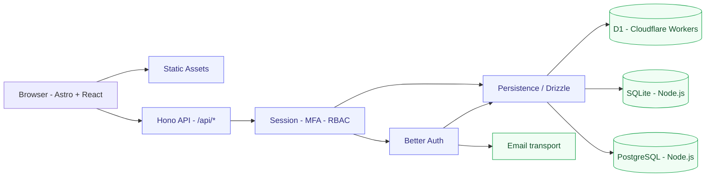
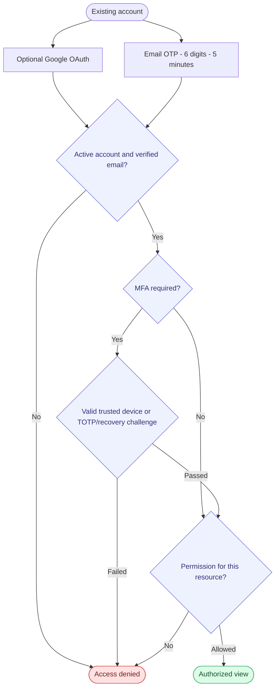
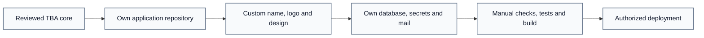

<div align="center">

<a href="https://rounver.com" target="_blank" rel="noopener noreferrer"></a>


# TBA | Template Basic Authenticator

**Astro | React | Hono | Better Auth | D1 | SQLite | PostgreSQL**


<p align="center"><strong>English</strong> | <a href="docs/README.es.md" lang="es">Español</a> | <a href="docs/README.pt.md" lang="pt">Português</a> | <a href="docs/README.de.md" lang="de">Deutsch</a> | <a href="docs/README.fr.md" lang="fr">Français</a> | <a href="docs/README.it.md" lang="it">Italiano</a> | <a href="docs/README.zh.md" lang="zh">简体中文</a> | <a href="docs/README.ja.md" lang="ja">日本語</a> | <a href="docs/README.hi.md" lang="hi">हिन्दी</a> | <a href="docs/README.ar.md" lang="ar">العربية</a></p>

<p align="center">
  <strong>Author:</strong> Sil R. Galeano | Copyright © 2026 Rounver Corp. |
  <a href="docs/en/README.md">Technical documentation</a>
</p>

</div>

---

TBA uses Cloudflare Workers with D1 by default. The same frontend and Hono API also run on Node.js with SQLite or PostgreSQL. [Database engines](docs/en/database-engines.md)

**Authentication without rebuilding the foundation.**

**TBA (Template Basic Authenticator)** is a modular, reusable authentication and administration starter from **Rounver Corp.** It allows independent web applications to begin with a working identity, permissions and user-management foundation instead of rebuilding them for each project.

> [!NOTE]
> TBA provides a reusable core. Advanced table engines and XLSX exports are excluded; see [template scope](docs/en/template-scope.md).


## <picture></picture> Capabilities

| Identity and access | Technical foundation |
| :--- | :--- |
| Passwordless 6-digit email OTP; expires in 5 minutes; one-time use | Astro 7, React 19, strict TypeScript and Tailwind CSS 4 |
| Optional Google OAuth; off by default | Hono on Cloudflare Workers or Node.js |
| Optional TOTP MFA, one-time recovery codes and 30-day revocable trusted devices | Better Auth, Drizzle ORM, D1, SQLite, PostgreSQL |
| Roles, server-side permissions, user administration and session revocation | Each application owns its own users, database, secrets and deployment |
| Closed, approval-based or open registration; audit trail and profiles | Responsive UI, light/dark themes and 10 languages |
| Administrative dashboard and independent extension points | Static Assets served directly; private endpoints under `/api/` |

## <picture></picture> Architecture - static by default, private by design



Astro generates static documents without private account data. Cloudflare serves existing assets directly. **Every private API request** passes through Hono and server-side checks for account status, session, email verification, MFA and role permissions. UI visibility never replaces authorization.

## <picture></picture> Authentication and authorization flow



The email login path always requires its first factor. A trusted device may avoid a repeated second-factor challenge but never replaces email verification. Google OAuth is optional and must pass the same account and MFA gates. In open registration, the server assigns the administrator-configured role after email verification; users do not select privileges.

## <picture></picture> Run locally

**Requirements:** Node.js 24+, npm and Git. The commands below use a **local** D1 instance and local mail; they do not create remote infrastructure.

Run the following commands from the project directory:

```bash
git clone https://github.com/rounverr/tba.git
cd tba
npm ci
npm run setup -- --name "My application" --id my-application
npm run db:migrate:local
npm run admin:bootstrap -- --email admin@example.test --name "Initial Admin"
npm run build
npm run mail:dev
```

In a **second terminal**, start the complete local Worker:

```bash
npm run dev:worker
```

Open **http://localhost:8787**. The development mailbox is at **http://127.0.0.1:8025**; messages do not leave the machine and its memory is cleared when the server restarts. The first administrator must still verify their address with OTP. For rapid frontend changes use `npm run dev`; for full auth behavior use `dev:worker` after building.

<details>
<summary><strong>Command reference</strong></summary>

| Command | Purpose |
| :--- | :--- |
| `npm run check` | Astro and TypeScript checks |
| `npm test` | Local automated tests |
| `npm run build` | Build the frontend |
| `npm run worker:check` | Worker dry run without deployment |
| `npm run setup` | Configure an independent application |
| `npm run db:create` / `npm run db:link` | Remote D1 operations; explicit account and confirmation required |
| `npm run deploy` | Manual deploy to the explicitly selected account |

</details>

## <picture></picture> Transactional email - choose your provider

TBA uses a **configurable mail transport**. Authentication generates OTP and security messages separately from the provider that delivers them.

| Option | Current status |
| :--- | :--- |
| Wavicc | Rounver's **preferred future integration**; API adapter is not implemented yet |
| Cloudflare Email Sending (Worker only) | **Implemented** with the native `EMAIL` binding |
| Resend | **Implemented**; `--mail resend`, `RESEND_API_KEY` and verified `MAIL_FROM` |
| Local development mailbox | **Implemented** for development, without external delivery |
| Other transactional email services | Implement and test an adapter for the selected service. |

Setup supports `--mail local`, `--mail resend` and `--mail cloudflare`. Local mail uses a local `APP_URL` and `npm run mail:dev`. Resend needs `RESEND_API_KEY` and `MAIL_FROM`. Cloudflare reuses the existing adapter and needs a `send_email` binding named `EMAIL`, an allowed `MAIL_FROM` and an onboarded sending domain. Setup checks local requirements without provisioning or verifying a remote domain. Missing configuration can be completed later: interactive setup asks whether to continue; noninteractive setup continues with a pending checklist. It does not invent a binding, sender or credential, and email cannot be delivered until configured. Keep secrets outside Git. Wavicc remains the preferred future integration and `WAVICC_API_KEY` a placeholder. See [mail setup](docs/en/setup-mail.md).

## <picture></picture> Languages and accessibility

| Language | Code | Layout |
| :--- | :---: | :---: |
| English | en | LTR |
| Español | es | LTR |
| Português | pt | LTR |
| Deutsch | de | LTR |
| Français | fr | LTR |
| Italiano | it | LTR |
| 简体中文 | zh | LTR |
| 日本語 | ja | LTR |
| हिन्दी | hi | LTR |
| العربية | ar | RTL |

English is the base language of the code and setup assistant. All ten translations and local fonts are included. Use `npm run setup -- --languages en,pt` to enable only English and Portuguese, without installing extra packages or deleting the other translations. Omitting `--languages` preserves the current selection, or enables all ten in a configuration without a language list. English always remains enabled as the translation fallback. `--locale en` sets the application default; any enabled language is accepted. The interface prioritizes the saved preference, then a supported browser language, then the configured default. Switching languages does not reload the page or reset forms; Arabic retains RTL.

English stays bundled as the fallback. Other access and panel catalogs use dynamic imports and an in-memory cache per namespace. Pointer or keyboard focus on a language option starts loading that option; opening the menu does not fetch all languages. A change commits only when its catalogs are ready, keeping forms, session and navigation mounted. Cached changes need no network; the last selection wins. An initial loading failure reveals English; a failure during a change preserves the current language. Transactional email and build-time metadata use complete server-only catalogs, independent of the browser cache. See [language loading](docs/en/language-loading.md).

The document starts loading the detected language while React loads, sharing the same cache with the provider to avoid a second startup waterfall.

## <picture></picture> Create an independent project

Create a separate repository from the template, then configure it for your application. The core does not share users, cookies, identity databases or secrets between derived projects.



Use `src/config/app.json` for identity, styling and default theme. Review the Cloudflare account and D1 binding before making remote changes. **The team performs validation and deployment manually**; GitHub Actions and Workers Builds are not publication requirements. A GitHub template copy does not automatically receive upstream updates.

## <picture></picture> Technical documentation

[Architecture](docs/en/architecture.md) | [Security / MFA / permissions](docs/en/security.md) | [Registration and extension hooks](docs/en/registration.md) | [Transactional email](docs/en/mail-providers.md) | [Operations and D1](docs/en/operations.md) | [Access languages](docs/en/auth-i18n.md) | [Panel languages](docs/en/workspace-i18n.md) | [Validation](docs/en/validation.md) | [Documentation index](docs/en/README.md)

## <picture></picture> License, branding and maintenance

**MIT License** covers Rounver-owned original software; third-party components and fonts retain their own licenses. The **Rounver name and corporate logo are reserved** and not granted under MIT. Rounver exclusively maintains the upstream project and does not accept external contributions, while the MIT license still permits independent forks, modifications and redistribution. See [LICENSE](LICENSE), [TRADEMARKS.md](TRADEMARKS.md) and [CONTRIBUTING.md](CONTRIBUTING.md).

[Third-party licenses](docs/licenses/README.md#en)
