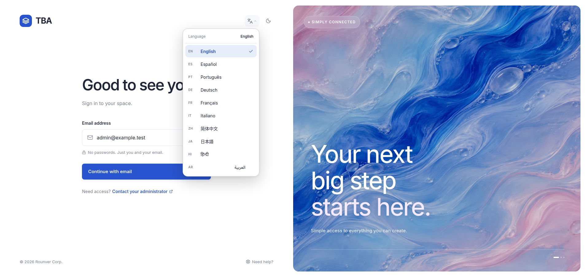
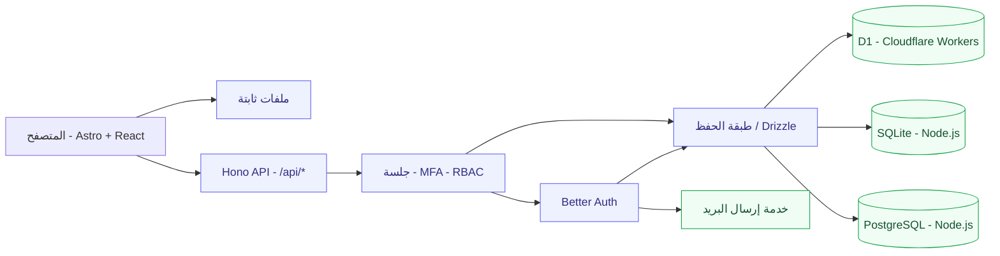
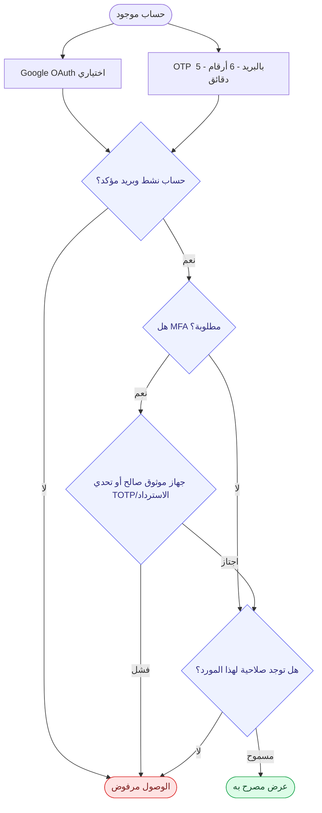

<div align="center">

<a href="https://rounver.com" target="_blank" rel="noopener noreferrer"></a>


# TBA | Template Basic Authenticator

**Astro | React | Hono | Better Auth | D1 | SQLite | PostgreSQL**


<p align="center"><a href="../README.md" lang="en">English</a> | <a href="README.es.md" lang="es">Español</a> | <a href="README.pt.md" lang="pt">Português</a> | <a href="README.de.md" lang="de">Deutsch</a> | <a href="README.fr.md" lang="fr">Français</a> | <a href="README.it.md" lang="it">Italiano</a> | <a href="README.zh.md" lang="zh">简体中文</a> | <a href="README.ja.md" lang="ja">日本語</a> | <a href="README.hi.md" lang="hi">हिन्दी</a> | <strong>العربية</strong></p>

<p align="center" dir="rtl">
  <strong>المؤلف:</strong> <span dir="ltr">Sil R. Galeano</span> | <span dir="ltr">Copyright © 2026 Rounver Corp.</span> |
  <a href="ar/README.md">التوثيق التقني</a>
</p>

</div>

---

يستخدم TBA افتراضيًا Cloudflare Workers مع D1. تعمل الواجهة نفسها وواجهة Hono API أيضًا على Node.js مع SQLite أو PostgreSQL. [محركات قواعد البيانات](ar/database-engines.md)

**مصادقة جاهزة دون إعادة بناء الأساس.**

**TBA (Template Basic Authenticator)** قالب معياري قابل لإعادة الاستخدام للمصادقة والإدارة طورته **Rounver Corp.** يتيح لتطبيقات الويب المستقلة البدء بأساس جاهز للهوية والصلاحيات وإدارة المستخدمين دون إعادة تطويره لكل مشروع.

> [!NOTE]
> يتضمن هذا الفرع المكونات الأساسية القابلة لإعادة الاستخدام. لا يتضمن محركات الجداول المتقدمة وتصدير XLSX؛ راجع [نطاق القالب](ar/template-scope.md).




## <picture></picture> الوظائف الأساسية

| الهوية والوصول | الأساس التقني |
| :--- | :--- |
| رمز OTP من ستة أرقام عبر البريد دون كلمة مرور، صالح لخمس دقائق ويستخدم مرة واحدة | Astro 7 وReact 19 وTypeScript الصارم وTailwind CSS 4 |
| Google OAuth اختياري ومعطل افتراضيًا | Hono على Cloudflare Workers أو Node.js |
| مصادقة TOTP متعددة العوامل اختيارية، ورموز استرداد للاستخدام مرة واحدة، وأجهزة موثوقة قابلة للإلغاء لمدة 30 يومًا | Better Auth وDrizzle ORM وCloudflare D1 |
| أدوار وصلاحيات تتحقق على الخادم، وإدارة مستخدمين، وإلغاء جلسات | لكل تطبيق مستخدموه وقاعدة بياناته وأسراره ونشره المستقل |
| تسجيل مغلق أو بموافقة أو مفتوح؛ سجل تدقيق وملفات شخصية | واجهة متجاوبة، وضعان فاتح وداكن، وعشر لغات |
| لوحة إدارة ونقاط توسعة مستقلة | تقديم الملفات الثابتة مباشرة؛ واجهات API الخاصة ضمن `/api/` |

## <picture></picture> البنية - ملفات ثابتة وخصوصية منذ التصميم



ينشئ Astro صفحات ثابتة لا تحتوي على بيانات حسابات خاصة، وتقدم Cloudflare الملفات الموجودة مباشرة. **كل طلب API خاص** يمر عبر Hono وفحوصات الخادم لحالة الحساب والجلسة وتأكيد البريد وMFA وصلاحيات الدور. إخفاء عنصر من الواجهة لا يغني عن التفويض.

## <picture></picture> تسلسل المصادقة والتفويض



يتطلب تسجيل الدخول بالبريد العامل الأول دائمًا. قد يعفي الجهاز الموثوق من إعادة تحدي العامل الثاني عند استيفاء الشروط، لكنه لا يحل محل التحقق من البريد. Google OAuth اختياري ويخضع لقواعد الحساب وMFA نفسها. في التسجيل المفتوح يمنح الخادم الدور الذي حدده المسؤول بعد تأكيد البريد، ولا يختار المستخدم صلاحياته.

## <picture></picture> التشغيل محليًا

**المتطلبات:** Node.js 24 أو أحدث، وnpm، وGit. تستخدم الأوامر التالية D1 والبريد **محليًا** ولا تنشئ بنية تحتية بعيدة.

نفذ الأوامر التالية من مجلد المشروع:

```bash
git clone https://github.com/rounverr/tba.git
cd tba
npm ci
npm run setup -- --name "My application" --id my-application
npm run db:migrate:local
npm run admin:bootstrap -- --email admin@example.test --name "Initial Admin"
npm run build
npm run mail:dev
```

في **نافذة طرفية ثانية** شغّل Worker المحلي الكامل:

```bash
npm run dev:worker
```

افتح **http://localhost:8787**. صندوق بريد التطوير على **http://127.0.0.1:8025**؛ لا تغادر الرسائل الجهاز وتُمسح الذاكرة عند إعادة التشغيل. يجب على المسؤول الأول أيضًا تأكيد بريده باستخدام OTP. استخدم `npm run dev` لتعديل الواجهة سريعًا و`dev:worker` بعد البناء لاختبار المصادقة الكاملة.

<details>
<summary><strong>مرجع الأوامر</strong></summary>

| الأمر | الغرض |
| :--- | :--- |
| `npm run check` | فحوصات Astro وTypeScript |
| `npm test` | اختبارات آلية محلية |
| `npm run build` | بناء الواجهة الأمامية |
| `npm run worker:check` | فحص Worker دون نشر |
| `npm run setup` | إعداد تطبيق مستقل |
| `npm run db:create` / `npm run db:link` | عمليات D1 البعيدة تتطلب حسابًا وتأكيدًا صريحين |
| `npm run deploy` | نشر يدوي إلى الحساب المحدد |

</details>

## <picture></picture> البريد الإلكتروني للمعاملات - اختر مزودك

يستخدم TBA **وسيلة إرسال بريد قابلة للتغيير**. تنشئ المصادقة رموز OTP وإشعارات الأمان بشكل مستقل عن الشركة التي تسلم الرسائل.

| الخيار | الحالة الحالية |
| :--- | :--- |
| Wavicc | **التكامل المستقبلي المفضل لدى Rounver**؛ لم يُنفذ محول API بعد |
| Cloudflare Email Sending (على Worker فقط) | **منفذ** باستخدام الربط الأصلي `EMAIL` |
| Resend | **منفذ**؛ `--mail resend` و`RESEND_API_KEY` و`MAIL_FROM` موثق |
| صندوق البريد المحلي | **منفذ** للتطوير دون تسليم خارجي |
| خدمات البريد الأخرى للمعاملات | نفّذ محوّلًا للخدمة المختارة واختبره. |

يدعم الإعداد `--mail local` و`--mail resend` و`--mail cloudflare`. يستخدم البريد المحلي `APP_URL` محليًا و`npm run mail:dev`، ويحتاج Resend إلى `RESEND_API_KEY` و`MAIL_FROM`. يعيد Cloudflare استخدام المحول الحالي ويتطلب ربط `send_email` باسم `EMAIL` و`MAIL_FROM` مسموحًا ونطاق إرسال مجهزًا. يتحقق الإعداد محليًا دون إنشاء موارد أو التحقق من نطاق بعيد. يمكن تأجيل الإعداد: يسأل الوضع التفاعلي عن المتابعة، ويتابع غير التفاعلي بقائمة مهام معلقة. لا يخترع ربطًا أو مرسلًا أو بيانات اعتماد؛ لا يعمل الإرسال حتى اكتمال الإعداد. احفظ الأسرار خارج Git. يبقى Wavicc التكامل المستقبلي المفضل و`WAVICC_API_KEY` حقلًا محجوزًا. راجع [إعداد البريد](ar/setup-mail.md).

## <picture></picture> اللغات وإمكانية الوصول

| اللغة | الرمز | الاتجاه |
| :--- | :---: | :---: |
| English | en | LTR |
| Español | es | LTR |
| Português | pt | LTR |
| Deutsch | de | LTR |
| Français | fr | LTR |
| Italiano | it | LTR |
| 简体中文 | zh | LTR |
| 日本語 | ja | LTR |
| हिन्दी | hi | LTR |
| العربية | ar | RTL |

الإنجليزية لغة أساس الشيفرة ومساعد setup. تأتي الترجمات العشر والخطوط المحلية ضمن الحزمة. يفعّل `npm run setup -- --languages en,pt` الإنجليزية والبرتغالية فقط دون تثبيت حزم إضافية أو حذف الترجمات الأخرى. يحفظ حذف الخيار `--languages` الاختيار الحالي، أو يفعّل العشر إن لم توجد قائمة. تبقى الإنجليزية مفعلة كمرجع احتياطي للترجمات. يحدد `--locale en` لغة التطبيق الافتراضية ويقبل أي لغة مفعلة. الأولوية للتفضيل المحفوظ ثم لغة المتصفح المدعومة ثم الافتراضية المحددة. لا يعيد تغيير اللغة تحميل الصفحة أو ضبط النماذج؛ وتبقى العربية RTL.

تبقى الإنجليزية ضمن الحزمة الأولية كلغة بديلة. تستخدم بقية قواميس الدخول واللوحة استيرادًا ديناميكيًا وذاكرة تخزين لكل وحدة. يبدأ تركيز لوحة المفاتيح أو المؤشر تحميل الخيار المقصود فقط؛ فتح القائمة لا ينزل جميع اللغات. يطبق التغيير بعد اكتمال القواميس مع الحفاظ على النماذج والجلسة والتنقل. لا تحتاج الخيارات المخزنة إلى الشبكة، ويسود آخر اختيار. يظهر فشل البداية الإنجليزية، ويحافظ فشل التغيير على اللغة الحالية. تستخدم الرسائل وبيانات البناء قواميس كاملة خاصة بالخادم. راجع [تحميل اللغات](ar/language-loading.md).

يبدأ المستند تحميل اللغة المكتشفة أثناء تحميل React ويشارك الذاكرة مع المزوّد لتجنب انتظار ثانٍ عند البدء.

## <picture></picture> إنشاء مشروع مستقل

أنشئ مستودعًا منفصلًا من القالب ثم هيئه لتطبيقك. لا تتشارك المشاريع المشتقة المستخدمين أو ملفات تعريف الارتباط أو قواعد الهوية أو الأسرار.


استخدم `src/config/app.json` لتحديد الهوية والمظهر والموضوع الافتراضي. تحقق من حساب Cloudflare وربط D1 قبل أي تغيير بعيد. **يجري الفريق الاختبارات والنشر يدويًا**؛ GitHub Actions وWorkers Builds ليسا شرطين للنشر. نسخ GitHub Template لا تتلقى تحديثات المستودع الأصلي تلقائيًا.

## <picture></picture> التوثيق التقني

[البنية](ar/architecture.md) | [الأمان وMFA والصلاحيات](ar/security.md) | [التسجيل ونقاط التوسعة](ar/registration.md) | [البريد للمعاملات](ar/mail-providers.md) | [العمليات وD1](ar/operations.md) | [لغات الدخول](ar/auth-i18n.md) | [لغات لوحة الإدارة](ar/workspace-i18n.md) | [التحقق](ar/validation.md) | [فهرس التوثيق](ar/README.md)

## <picture></picture> الترخيص والعلامة التجارية والصيانة

تسري **رخصة MIT** على البرنامج الأصلي الذي تملك Rounver حقوقه، مع بقاء تراخيص مكونات الجهات الأخرى والخطوط سارية. **اسم Rounver وشعار الشركة محفوظان** ولا يشملهما منح MIT. تتولى Rounver وحدها صيانة المستودع الأصلي ولا تقبل مساهمات خارجية، مع بقاء حق إنشاء نسخ مستقلة وتعديلها وإعادة توزيعها وفق MIT. راجع [LICENSE](../LICENSE) و[TRADEMARKS.md](../TRADEMARKS.md) و[CONTRIBUTING.md](../CONTRIBUTING.md).

</div>

---

<div align="center">

**Rounver Corp.** | Reusable software | Independent projects | Rounver-maintained upstream

</div>

[تراخيص الجهات الخارجية](licenses/README.md#ar)
