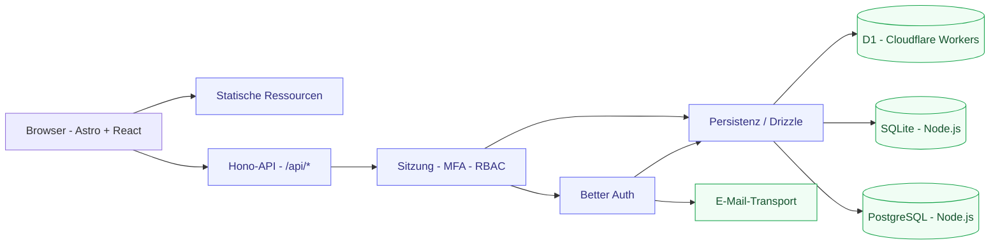
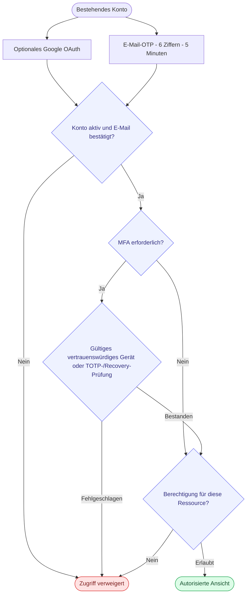
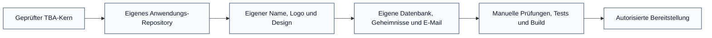

<div align="center">

<a href="https://rounver.com" target="_blank" rel="noopener noreferrer"></a>


# TBA | Template Basic Authenticator

**Astro | React | Hono | Better Auth | D1 | SQLite | PostgreSQL**


<p align="center"><a href="../README.md" lang="en">English</a> | <a href="README.es.md" lang="es">Español</a> | <a href="README.pt.md" lang="pt">Português</a> | <strong>Deutsch</strong> | <a href="README.fr.md" lang="fr">Français</a> | <a href="README.it.md" lang="it">Italiano</a> | <a href="README.zh.md" lang="zh">简体中文</a> | <a href="README.ja.md" lang="ja">日本語</a> | <a href="README.hi.md" lang="hi">हिन्दी</a> | <a href="README.ar.md" lang="ar">العربية</a></p>

<p align="center">
  <strong>Autor:</strong> Sil R. Galeano | Copyright © 2026 Rounver Corp. |
  <a href="de/README.md">Technische Dokumentation</a>
</p>

</div>

---

TBA verwendet standardmäßig Cloudflare Workers mit D1. Dieselbe Oberfläche und Hono-API laufen mit SQLite oder PostgreSQL auch unter Node.js. [Datenbank-Engines](de/database-engines.md)

**Authentifizierung, ohne die Grundlage neu zu entwickeln.**

**TBA (Template Basic Authenticator)** ist eine modulare, wiederverwendbare Vorlage für Authentifizierung und Verwaltung von **Rounver Corp.** Unabhängige Webanwendungen erhalten damit eine Grundlage für Identitäten, Berechtigungen und Benutzerverwaltung, ohne diese für jedes Projekt neu entwickeln zu müssen.

> [!NOTE]
> Dieser Branch enthält den wiederverwendbaren Kern. Erweiterte Tabellen und XLSX-Exporte sind ausgeschlossen; siehe [Template-Umfang](de/template-scope.md).


## <picture></picture> Funktionen

| Identität und Zugriff | Technische Grundlage |
| :--- | :--- |
| Passwortloses E-Mail-OTP mit sechs Ziffern, fünf Minuten gültig und einmal verwendbar | Astro 7, React 19, strenges TypeScript und Tailwind CSS 4 |
| Optionales Google OAuth, standardmäßig deaktiviert | Hono auf Cloudflare Workers oder Node.js |
| Optionale TOTP-MFA, einmalige Wiederherstellungscodes und widerrufbare vertrauenswürdige Geräte für 30 Tage | Better Auth, Drizzle ORM, D1, SQLite, PostgreSQL |
| Rollen, serverseitige Berechtigungen, Benutzerverwaltung und Sitzungswiderruf | Jede Anwendung hat eigene Benutzer, Datenbank, Geheimnisse und Bereitstellung |
| Geschlossene, genehmigungspflichtige oder offene Registrierung; Audit-Protokoll und Profile | Responsives Design, Hell-/Dunkelmodus und zehn Sprachen |
| Administrationsbereich und unabhängige Erweiterungspunkte | Statische Ressourcen werden direkt ausgeliefert; private Endpunkte unter `/api/` |

## <picture></picture> Architektur - statische Ressourcen und Datenschutz von Anfang an



Astro erzeugt statische Dokumente ohne private Kontodaten. Cloudflare liefert vorhandene Ressourcen direkt aus. **Jede private API-Anfrage** durchläuft Hono und serverseitige Prüfungen für Kontostatus, Sitzung, bestätigte E-Mail, MFA und Rollenberechtigungen. Die Anzeige eines UI-Elements ersetzt niemals die Autorisierung.

## <picture></picture> Ablauf von Authentifizierung und Autorisierung



Die E-Mail-Anmeldung erfordert immer den ersten Faktor. Ein vertrauenswürdiges Gerät kann eine weitere MFA-Abfrage vermeiden, ersetzt jedoch niemals die E-Mail-Verifizierung. Google OAuth ist optional und unterliegt denselben Konto- und MFA-Prüfungen. Bei offener Registrierung vergibt der Server nach E-Mail-Bestätigung die vom Administrator festgelegte Rolle; Benutzer wählen keine Privilegien.

## <picture></picture> Lokal ausführen

**Voraussetzungen:** Node.js ab Version 24, npm und Git. Die folgenden Befehle verwenden **lokales** D1 und E-Mail-Postfach und erstellen keine entfernte Infrastruktur.

Im Projektverzeichnis die folgenden Befehle ausführen:

```bash
git clone https://github.com/rounverr/tba.git
cd tba
npm ci
npm run setup -- --name "My application" --id my-application
npm run db:migrate:local
npm run admin:bootstrap -- --email admin@example.test --name "Initial Admin"
npm run build
npm run mail:dev
```

In einem **zweiten Terminal** den vollständigen lokalen Worker starten:

```bash
npm run dev:worker
```

**http://localhost:8787** öffnen. Das Entwicklungs-Postfach ist unter **http://127.0.0.1:8025** erreichbar. Nachrichten verlassen den Rechner nicht; beim Neustart wird der Speicher geleert. Auch der erste Administrator muss seine Adresse per OTP bestätigen. Für schnelle UI-Änderungen `npm run dev` verwenden, für vollständige Authentifizierung nach dem Build `dev:worker`.

<details>
<summary><strong>Befehlsübersicht</strong></summary>

| Befehl | Zweck |
| :--- | :--- |
| `npm run check` | Astro- und TypeScript-Prüfungen |
| `npm test` | Lokale automatisierte Tests |
| `npm run build` | Frontend erstellen |
| `npm run worker:check` | Worker-Probelauf ohne Bereitstellung |
| `npm run setup` | Eigenständige Anwendung konfigurieren |
| `npm run db:create` / `npm run db:link` | Entfernte D1-Vorgänge; explizites Konto und Bestätigung nötig |
| `npm run deploy` | Manuelle Bereitstellung im ausgewählten Konto |

</details>

## <picture></picture> Transaktions-E-Mails - Anbieter frei wählen

TBA verwendet einen **austauschbaren E-Mail-Transport**. Die Authentifizierung erstellt OTPs und Sicherheitsnachrichten unabhängig davon, welcher Dienst sie zustellt.

| Option | Aktueller Stand |
| :--- | :--- |
| Wavicc | **Bevorzugte künftige Integration von Rounver**; API-Adapter noch nicht implementiert |
| Cloudflare Email Sending (Nur Worker) | **Implementiert** über natives `EMAIL`-Binding |
| Resend | **Implementiert**; `--mail resend`, `RESEND_API_KEY` und bestätigtes `MAIL_FROM` |
| Lokales Entwicklungs-Postfach | **Implementiert** für Entwicklung ohne externen Versand |
| Andere Transaktions-E-Mail-Dienste | Einen Adapter für den gewählten Dienst implementieren und testen. |

Setup unterstützt `--mail local`, `--mail resend` und `--mail cloudflare`. Lokal werden eine lokale `APP_URL` und `npm run mail:dev` verwendet. Resend benötigt `RESEND_API_KEY` und `MAIL_FROM`. Cloudflare nutzt den bestehenden Adapter und benötigt ein `send_email`-Binding namens `EMAIL`, einen erlaubten `MAIL_FROM` und eine eingerichtete Versanddomain. Setup prüft lokal, ohne Ressourcen anzulegen oder entfernte Domains zu prüfen. Fehlendes kann später ergänzt werden: interaktiv wird nach Fortsetzung gefragt, nicht interaktiv mit einer Aufgabenliste fortgefahren. Binding, Absender und Zugangsdaten werden nicht erfunden; bis zur Konfiguration erfolgt kein Versand. Geheimnisse gehören nicht in Git. Wavicc bleibt die bevorzugte künftige Integration mit `WAVICC_API_KEY` als Platzhalter. Siehe [Mail-Setup](de/setup-mail.md).

## <picture></picture> Sprachen und Barrierefreiheit

| Sprache | Code | Richtung |
| :--- | :---: | :---: |
| English | en | LTR |
| Español | es | LTR |
| Português | pt | LTR |
| Deutsch | de | LTR |
| Français | fr | LTR |
| Italiano | it | LTR |
| 简体中文 | zh | LTR |
| 日本語 | ja | LTR |
| हिन्दी | hi | LTR |
| العربية | ar | RTL |

Englisch ist die Basissprache des Codes und des Setup-Assistenten. Alle zehn Übersetzungen und lokalen Schriften sind enthalten. `npm run setup -- --languages en,pt` aktiviert nur Englisch und Portugiesisch, ohne zusätzliche Pakete oder das Löschen anderer Übersetzungen. Ohne `--languages` bleibt die Auswahl erhalten; ohne vorhandene Liste gelten alle zehn. Englisch bleibt als Übersetzungsfallback aktiv. `--locale en` legt die Anwendungssprache als Standard fest; jede aktivierte Sprache ist zulässig. Vorrang haben gespeicherte Präferenz, unterstützte Browsersprache und konfigurierter Standard. Sprachwechsel laden keine Seite neu und bewahren Formulare; Arabisch behält RTL.

Englisch bleibt als Fallback enthalten. Weitere Login- und Panelkataloge werden dynamisch importiert und pro Modul im Speicher gehalten. Tastatur- oder Zeigerfokus lädt nur die betreffende Option vor; das Menü lädt nicht alle Sprachen. Der Wechsel erfolgt erst mit vollständigen Katalogen und erhält Formulare, Sitzung und Navigation. Zwischengespeicherte Wechsel benötigen kein Netz; die letzte Auswahl gilt. Ein anfänglicher Ladefehler zeigt Englisch, ein späterer Fehler erhält die aktuelle Sprache. E-Mails und Build-Metadaten verwenden vollständige Serverkataloge. Siehe [Sprachladen](de/language-loading.md).

Das Dokument lädt die erkannte Sprache parallel zu React und teilt den Cache mit dem Provider, um eine zweite Ladephase beim Start zu vermeiden.

## <picture></picture> Eigenständiges Projekt erstellen

Ein separates Repository aus der Vorlage erstellen und für die jeweilige Anwendung konfigurieren. Der Kern teilt keine Benutzer, Cookies, Identitätsdatenbanken oder Geheimnisse zwischen abgeleiteten Projekten.



Mit `src/config/app.json` Identität, Stil und Startthema festlegen. Vor entfernten Änderungen Cloudflare-Konto und D1-Binding prüfen. **Das Team validiert und veröffentlicht manuell**; GitHub Actions und Workers Builds sind keine Voraussetzung. Kopien über GitHub Template erhalten nicht automatisch Updates.

## <picture></picture> Technische Dokumentation

[Architektur](de/architecture.md) | [Sicherheit, MFA und Berechtigungen](de/security.md) | [Registrierung und Erweiterungspunkte](de/registration.md) | [Transaktions-E-Mail](de/mail-providers.md) | [Betrieb und D1](de/operations.md) | [Sprachen der Anmeldung](de/auth-i18n.md) | [Sprachen des Panels](de/workspace-i18n.md) | [Validierung](de/validation.md) | [Dokumentationsübersicht](de/README.md)

## <picture></picture> Lizenz, Marke und Wartung

Die **MIT-Lizenz** gilt für originale Software, deren Rechte Rounver besitzt. Komponenten und Schriften Dritter behalten ihre eigenen Lizenzen. **Name und Firmenlogo von Rounver sind vorbehalten** und nicht durch MIT freigegeben. Rounver wartet allein das ursprüngliche Repository und nimmt keine externen Beiträge an; die MIT-Lizenz erlaubt trotzdem unabhängige Forks, Änderungen und Weitergabe. Siehe [LICENSE](../LICENSE), [TRADEMARKS.md](../TRADEMARKS.md) und [CONTRIBUTING.md](../CONTRIBUTING.md).

[Drittanbieterlizenzen](licenses/README.md#de)
