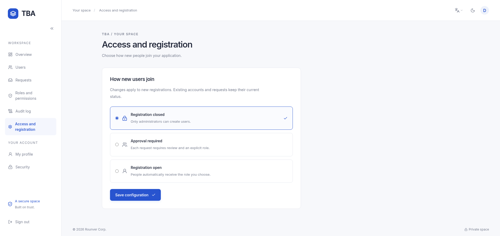
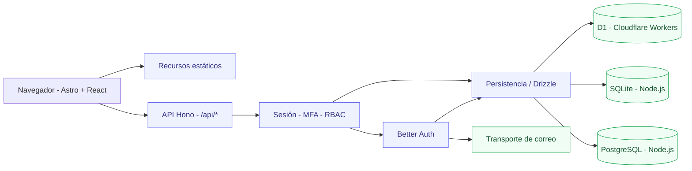
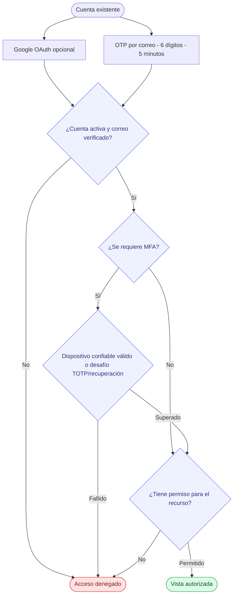
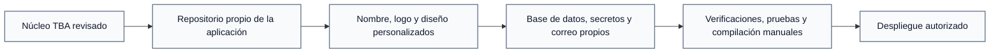

<div align="center">

<a href="https://rounver.com" target="_blank" rel="noopener noreferrer"></a>


# TBA | Template Basic Authenticator

**Astro | React | Hono | Better Auth | D1 | SQLite | PostgreSQL**


<p align="center"><a href="../README.md" lang="en">English</a> | <strong>Español</strong> | <a href="README.pt.md" lang="pt">Português</a> | <a href="README.de.md" lang="de">Deutsch</a> | <a href="README.fr.md" lang="fr">Français</a> | <a href="README.it.md" lang="it">Italiano</a> | <a href="README.zh.md" lang="zh">简体中文</a> | <a href="README.ja.md" lang="ja">日本語</a> | <a href="README.hi.md" lang="hi">हिन्दी</a> | <a href="README.ar.md" lang="ar">العربية</a></p>

<p align="center">
  <strong>Autor:</strong> Sil R. Galeano | Copyright © 2026 Rounver Corp. |
  <a href="es/README.md">Documentación técnica</a>
</p>

</div>

---

TBA usa Cloudflare Workers con D1 de forma predeterminada. La misma interfaz y API Hono también funcionan en Node.js con SQLite o PostgreSQL. [Motores de base de datos](es/database-engines.md)

**Autenticación sin volver a construir los fundamentos.**

**TBA (Template Basic Authenticator)** es una plantilla modular y reutilizable de autenticación y administración desarrollada por **Rounver Corp.** Permite que las aplicaciones web independientes comiencen con una base de identidad, permisos y gestión de usuarios, sin tener que desarrollarla nuevamente para cada proyecto.

> [!NOTE]
> TBA ofrece un núcleo reutilizable. Los motores de tablas avanzadas y las exportaciones XLSX quedan excluidos; consulta el [alcance del template](es/template-scope.md).




## <picture></picture> Funcionalidades

| Identidad y acceso | Base tecnológica |
| :--- | :--- |
| OTP por correo de seis dígitos, sin contraseña; válido por cinco minutos y de un solo uso | Astro 7, React 19, TypeScript estricto y Tailwind CSS 4 |
| Google OAuth opcional, deshabilitado de forma predeterminada | Hono en Cloudflare Workers o Node.js |
| MFA TOTP opcional, códigos de recuperación de un solo uso y dispositivos confiables revocables por 30 días | Better Auth, Drizzle ORM, D1, SQLite, PostgreSQL |
| Roles, permisos validados en el servidor, administración de usuarios y revocación de sesiones | Cada aplicación tiene usuarios, base de datos, secretos y despliegue propios |
| Registro cerrado, sujeto a aprobación o abierto; auditoría y perfiles | Interfaz adaptable, temas claro y oscuro, y diez idiomas |
| Panel administrativo y puntos de extensión independientes | Entrega directa de recursos estáticos; endpoints privados bajo `/api/` |

## <picture></picture> Arquitectura: recursos estáticos y privacidad desde el diseño



Astro genera documentos estáticos sin datos privados de las cuentas. Cloudflare entrega directamente los recursos existentes. **Cada solicitud privada a la API** pasa por Hono y por las verificaciones de servidor: estado de la cuenta, sesión, correo verificado, MFA y permisos del rol. La visibilidad de un elemento de interfaz nunca sustituye la autorización.

## <picture></picture> Flujo de autenticación y autorización



El acceso por correo siempre requiere el primer factor. Un dispositivo confiable puede evitar una nueva comprobación del segundo factor, pero nunca reemplaza la verificación por correo. Google OAuth es opcional y está sujeto a los mismos controles de cuenta y MFA. En el registro abierto, el servidor asigna el rol configurado por el administrador después de verificar el correo; el usuario no selecciona sus privilegios.

## <picture></picture> Ejecución local

**Requisitos:** Node.js 24 o superior, npm y Git. Los comandos siguientes utilizan D1 y correo **locales**; no crean infraestructura remota.

Ejecutar los siguientes comandos desde el directorio del proyecto:

```bash
git clone https://github.com/rounverr/tba.git
cd tba
npm ci
npm run setup -- --name "My application" --id my-application
npm run db:migrate:local
npm run admin:bootstrap -- --email admin@example.test --name "Initial Admin"
npm run build
npm run mail:dev
```

En una **segunda terminal**, iniciar el Worker local completo:

```bash
npm run dev:worker
```

Abrir **http://localhost:8787**. El buzón de desarrollo está disponible en **http://127.0.0.1:8025**; los mensajes no salen del equipo y la memoria se vacía al reiniciar el servidor. El administrador inicial también debe verificar su dirección mediante OTP. Para trabajar rápidamente en la interfaz se puede usar `npm run dev`; para comprobar la autenticación completa, utilizar `dev:worker` después de compilar.

<details>
<summary><strong>Referencia de comandos</strong></summary>

| Comando | Función |
| :--- | :--- |
| `npm run check` | Verificaciones de Astro y TypeScript |
| `npm test` | Pruebas automatizadas locales |
| `npm run build` | Compilación del frontend |
| `npm run worker:check` | Comprobación del Worker sin despliegue |
| `npm run setup` | Configuración de una aplicación independiente |
| `npm run db:create` / `npm run db:link` | Operaciones remotas sobre D1; requieren cuenta y confirmación explícitas |
| `npm run deploy` | Despliegue manual en la cuenta seleccionada expresamente |

</details>

## <picture></picture> Correo transaccional: selección del proveedor

TBA utiliza un **transporte de correo configurable**. El sistema de autenticación genera los códigos OTP y las notificaciones de seguridad de forma independiente del proveedor que los entrega.

| Opción | Estado actual |
| :--- | :--- |
| Wavicc | **Integración futura preferida de Rounver**; el adaptador de API todavía no está implementado |
| Cloudflare Email Sending (Solo para Worker) | **Implementado** con el binding nativo `EMAIL` |
| Resend | **Implementado**; `--mail resend`, `RESEND_API_KEY` y `MAIL_FROM` verificado |
| Buzón local de desarrollo | **Implementado** para desarrollo, sin entrega externa |
| Otros servicios de correo transaccional | Implementa y prueba un adaptador para el servicio elegido. |

El setup admite `--mail local`, `--mail resend` y `--mail cloudflare`. El correo local usa un `APP_URL` local y `npm run mail:dev`. Resend requiere `RESEND_API_KEY` y `MAIL_FROM`. Cloudflare reutiliza el adaptador existente y requiere un binding `send_email` llamado `EMAIL`, un `MAIL_FROM` permitido y un dominio habilitado para enviar. El setup comprueba requisitos locales sin crear recursos ni verificar dominios remotos. Se puede configurar después: el modo interactivo pregunta si deseas continuar y el no interactivo continúa con una lista de pendientes. No inventa bindings, remitentes ni credenciales; el correo no podrá enviarse hasta configurarlo. Guarda los secretos fuera de Git. Wavicc sigue como integración futura preferida y `WAVICC_API_KEY` como placeholder. Consulta el [setup de correo](es/setup-mail.md).

## <picture></picture> Idiomas y accesibilidad

| Idioma | Código | Dirección |
| :--- | :---: | :---: |
| English | en | LTR |
| Español | es | LTR |
| Português | pt | LTR |
| Deutsch | de | LTR |
| Français | fr | LTR |
| Italiano | it | LTR |
| 简体中文 | zh | LTR |
| 日本語 | ja | LTR |
| हिन्दी | hi | LTR |
| العربية | ar | RTL |

El inglés es la base del código y del asistente setup. Las diez traducciones y sus fuentes locales vienen incluidas. Usa `npm run setup -- --languages en,pt` para habilitar únicamente inglés y portugués, sin instalar paquetes adicionales ni eliminar las otras traducciones. Omitir `--languages` conserva la selección actual, o habilita los diez si la configuración no tiene una lista. El inglés siempre permanece habilitado como respaldo de traducciones. `--locale en` establece el idioma predeterminado de la aplicación; admite cualquiera de los habilitados. La interfaz prioriza la preferencia guardada, después un idioma compatible del navegador y finalmente el predeterminado configurado. Cambiar idioma no recarga la página ni reinicia formularios; árabe conserva RTL.

El inglés permanece incluido como respaldo. Los demás catálogos de acceso y panel usan importaciones dinámicas y caché en memoria por módulo. El foco de teclado o puntero sobre una opción anticipa su carga; abrir el menú no descarga todos los idiomas. El cambio se aplica cuando sus catálogos están listos y conserva formularios, sesión y navegación. Los cambios en caché no requieren red; prevalece la última selección. Ante un fallo inicial se muestra inglés; durante un cambio se mantiene el idioma actual. El correo y los metadatos del build usan catálogos completos solo en servidor. Consulta la [carga de idiomas](es/language-loading.md).

El documento inicia la carga del idioma detectado mientras carga React y comparte la caché con el proveedor para evitar una segunda espera al iniciar.

## <picture></picture> Creación de un proyecto independiente

Crear un repositorio independiente a partir de la plantilla y configurarlo para la aplicación. El núcleo no comparte usuarios, cookies, bases de identidad ni secretos entre proyectos derivados.



Utilizar `src/config/app.json` para establecer la identidad, los estilos y el tema inicial. Revisar la cuenta de Cloudflare y la vinculación de D1 antes de realizar operaciones remotas. **El equipo administra las validaciones y los despliegues manualmente**; GitHub Actions y Workers Builds no son requisitos de publicación. Las copias creadas mediante GitHub Template no reciben actualizaciones del repositorio original de forma automática.

## <picture></picture> Documentación técnica

[Arquitectura](es/architecture.md) | [Seguridad, MFA y permisos](es/security.md) | [Registro y puntos de extensión](es/registration.md) | [Correo transaccional](es/mail-providers.md) | [Operaciones y D1](es/operations.md) | [Idiomas de acceso](es/auth-i18n.md) | [Idiomas del panel](es/workspace-i18n.md) | [Validación](es/validation.md) | [Índice de documentación](es/README.md)

## <picture></picture> Licencia, marca y mantenimiento

La **licencia MIT** cubre el software original cuyos derechos corresponden a Rounver; los componentes y fuentes de terceros conservan sus propias licencias. El **nombre y el logotipo corporativo de Rounver están reservados** y no se incluyen en la autorización MIT. Rounver mantiene exclusivamente el repositorio original y no acepta contribuciones externas; la licencia MIT continúa permitiendo bifurcaciones independientes, modificaciones y redistribución. Consultar [LICENSE](../LICENSE), [TRADEMARKS.md](../TRADEMARKS.md) y [CONTRIBUTING.md](../CONTRIBUTING.md).

[Licencias de terceros](licenses/README.md#es)
