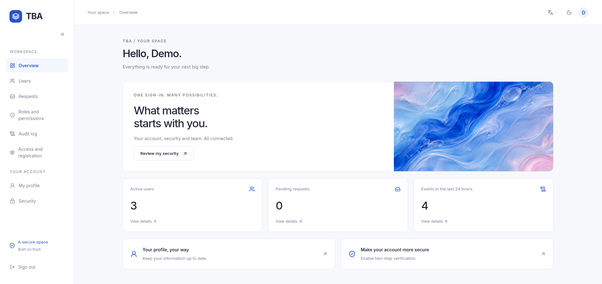
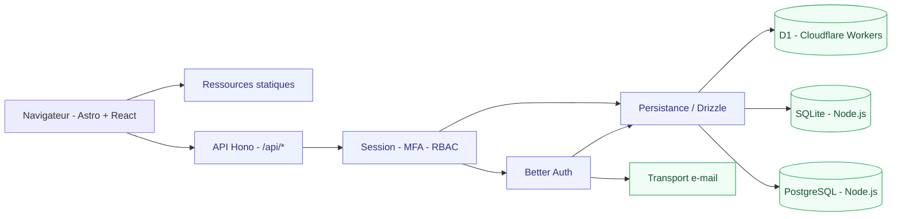
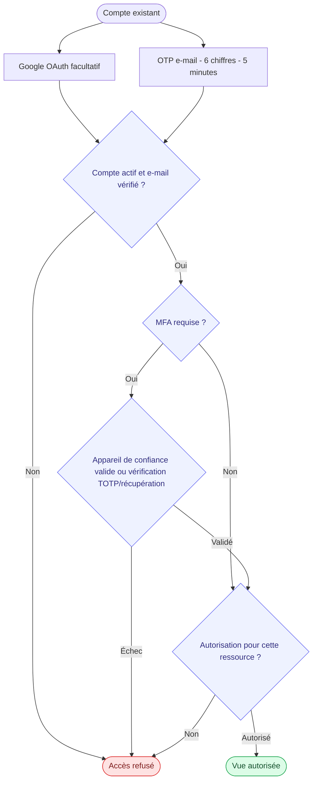
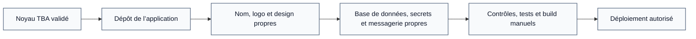

<div align="center">

<a href="https://rounver.com" target="_blank" rel="noopener noreferrer"></a>


# TBA | Template Basic Authenticator

**Astro | React | Hono | Better Auth | D1 | SQLite | PostgreSQL**


<p align="center"><a href="../README.md" lang="en">English</a> | <a href="README.es.md" lang="es">Español</a> | <a href="README.pt.md" lang="pt">Português</a> | <a href="README.de.md" lang="de">Deutsch</a> | <strong>Français</strong> | <a href="README.it.md" lang="it">Italiano</a> | <a href="README.zh.md" lang="zh">简体中文</a> | <a href="README.ja.md" lang="ja">日本語</a> | <a href="README.hi.md" lang="hi">हिन्दी</a> | <a href="README.ar.md" lang="ar">العربية</a></p>

<p align="center">
  <strong>Auteur:</strong> Sil R. Galeano | Copyright © 2026 Rounver Corp. |
  <a href="fr/README.md">Documentation technique</a>
</p>

</div>

---

TBA utilise Cloudflare Workers avec D1 par défaut. La même interface et la même API Hono fonctionnent sous Node.js avec SQLite ou PostgreSQL. [Moteurs de base de données](fr/database-engines.md)

**Une authentification prête à l’emploi, sans repartir de zéro.**

**TBA (Template Basic Authenticator)** est une base modulaire et réutilisable d’authentification et d’administration développée par **Rounver Corp.** Elle permet à chaque application web indépendante de disposer de l’identité, des autorisations et de la gestion des utilisateurs sans tout reconstruire.

> [!NOTE]
> Cette branche contient le noyau réutilisable. Les tableaux avancés et les exports XLSX sont exclus ; voir le [périmètre du template](fr/template-scope.md).





## <picture></picture> Fonctionnalités

| Identité et accès | Fondations techniques |
| :--- | :--- |
| OTP de six chiffres par e-mail, sans mot de passe, valable cinq minutes et à usage unique | Astro 7, React 19, TypeScript strict et Tailwind CSS 4 |
| Google OAuth facultatif, désactivé par défaut | Hono sur Cloudflare Workers ou Node.js |
| MFA TOTP facultative, codes de récupération à usage unique et appareils de confiance révocables pendant 30 jours | Better Auth, Drizzle ORM, D1, SQLite, PostgreSQL |
| Rôles, autorisations vérifiées côté serveur, gestion des utilisateurs et révocation des sessions | Chaque application possède ses utilisateurs, sa base, ses secrets et son déploiement |
| Inscription fermée, soumise à approbation ou ouverte ; audit et profils | Interface adaptative, thèmes clair/sombre et dix langues |
| Tableau de bord administratif et points d’extension indépendants | Ressources statiques servies directement ; API privées sous `/api/` |

## <picture></picture> Architecture - ressources statiques et confidentialité dès la conception



Astro génère des pages statiques sans données privées des comptes. Cloudflare sert directement les ressources existantes. **Toute requête d’API privée** passe par Hono et par les contrôles côté serveur : état du compte, session, e-mail vérifié, MFA et autorisations. La visibilité d’un composant d’interface ne remplace jamais l’autorisation.

## <picture></picture> Parcours d’authentification et d’autorisation



La connexion par e-mail exige toujours le premier facteur. Un appareil de confiance peut éviter une nouvelle vérification MFA, mais ne remplace jamais la vérification du courrier. Google OAuth est facultatif et soumis aux mêmes contrôles de compte et de MFA. En inscription ouverte, le serveur attribue après vérification le rôle configuré par l’administrateur ; l’utilisateur ne choisit pas ses privilèges.

## <picture></picture> Exécution locale

**Prérequis :** Node.js 24 ou supérieur, npm et Git. Les commandes ci-dessous utilisent D1 et la messagerie **locales**, sans créer d’infrastructure distante.

Exécuter les commandes suivantes dans le répertoire du projet :

```bash
git clone https://github.com/rounverr/tba.git
cd tba
npm ci
npm run setup -- --name "My application" --id my-application
npm run db:migrate:local
npm run admin:bootstrap -- --email admin@example.test --name "Initial Admin"
npm run build
npm run mail:dev
```

Dans un **second terminal**, démarrer le Worker local complet :

```bash
npm run dev:worker
```

Ouvrir **http://localhost:8787**. La boîte de développement est disponible sur **http://127.0.0.1:8025** ; les messages ne quittent pas la machine et la mémoire est effacée au redémarrage. L’administrateur initial doit aussi vérifier son adresse avec un OTP. Utiliser `npm run dev` pour modifier rapidement l’interface ; utiliser `dev:worker` après compilation pour tester toute l’authentification.

<details>
<summary><strong>Référence des commandes</strong></summary>

| Commande | Objectif |
| :--- | :--- |
| `npm run check` | Vérifications Astro et TypeScript |
| `npm test` | Tests automatisés locaux |
| `npm run build` | Compilation du frontend |
| `npm run worker:check` | Vérification du Worker sans déploiement |
| `npm run setup` | Configuration d’une application indépendante |
| `npm run db:create` / `npm run db:link` | Opérations D1 distantes avec compte et confirmation explicites |
| `npm run deploy` | Déploiement manuel vers le compte choisi |

</details>

## <picture></picture> E-mail transactionnel - libre choix du fournisseur

TBA utilise un **transport d’e-mail configurable**. L’authentification génère OTP et notifications de sécurité indépendamment du fournisseur chargé de les acheminer.

| Option | État actuel |
| :--- | :--- |
| Wavicc | **Intégration future privilégiée de Rounver** ; adaptateur API non encore implémenté |
| Cloudflare Email Sending (Worker uniquement) | **Implémenté** grâce au binding natif `EMAIL` |
| Resend | **Implémenté** ; `--mail resend`, `RESEND_API_KEY` et `MAIL_FROM` vérifié |
| Boîte de développement locale | **Implémentée** pour les essais, sans envoi externe |
| Autres services d’e-mail transactionnel | Implémenter et tester un adaptateur pour le service choisi. |

Le setup accepte `--mail local`, `--mail resend` et `--mail cloudflare`. Le courrier local utilise une `APP_URL` locale et `npm run mail:dev`. Resend nécessite `RESEND_API_KEY` et `MAIL_FROM`. Cloudflare réutilise l’adaptateur existant avec un binding `send_email` nommé `EMAIL`, un `MAIL_FROM` autorisé et un domaine configuré pour l’envoi. Le setup vérifie localement, sans créer de ressources ni vérifier un domaine distant. La configuration peut attendre : le mode interactif demande confirmation, le mode non interactif continue avec une liste de tâches. Aucun binding, expéditeur ou secret n’est inventé ; l’envoi nécessite la configuration. Garder les secrets hors de Git. Wavicc reste l’intégration future privilégiée avec `WAVICC_API_KEY` comme emplacement réservé. Voir le [setup e-mail](fr/setup-mail.md).

## <picture></picture> Langues et accessibilité

| Langue | Code | Direction |
| :--- | :---: | :---: |
| English | en | LTR |
| Español | es | LTR |
| Português | pt | LTR |
| Deutsch | de | LTR |
| Français | fr | LTR |
| Italiano | it | LTR |
| 简体中文 | zh | LTR |
| 日本語 | ja | LTR |
| हिन्दी | hi | LTR |
| العربية | ar | RTL |

L’anglais est la langue de base du code et de l’assistant setup. Les dix traductions et polices locales sont incluses. `npm run setup -- --languages en,pt` active uniquement anglais et portugais, sans installer de paquets ni supprimer les autres traductions. Sans `--languages`, la sélection reste inchangée ; sans liste existante, les dix sont activées. L’anglais reste actif comme repli des traductions. `--locale en` définit la langue par défaut et accepte toute langue activée. La priorité est préférence enregistrée, langue compatible du navigateur, puis langue par défaut configurée. Le changement ne recharge pas la page et conserve les formulaires ; l’arabe garde RTL.

L’anglais reste inclus comme repli. Les autres catalogues de connexion et du panneau utilisent des imports dynamiques et un cache mémoire par module. Le focus clavier ou pointeur précharge uniquement l’option visée ; ouvrir le menu ne charge pas toutes les langues. Le changement attend les catalogues complets et conserve formulaires, session et navigation. Le cache évite le réseau ; le dernier choix prévaut. Un échec initial affiche l’anglais, un échec ultérieur conserve la langue actuelle. E-mails et métadonnées du build utilisent des catalogues complets côté serveur. Voir le [chargement des langues](fr/language-loading.md).

Le document charge la langue détectée pendant le chargement de React et partage le cache avec le fournisseur pour éviter une seconde attente au démarrage.

## <picture></picture> Créer un projet indépendant

Créer un dépôt distinct à partir du modèle et le configurer pour l’application. Le noyau ne partage ni utilisateurs, ni cookies, ni bases d’identité, ni secrets entre projets dérivés.



Utiliser `src/config/app.json` pour l’identité, les styles et le thème initial. Vérifier le compte Cloudflare et le binding D1 avant toute opération distante. **L’équipe valide et déploie manuellement** ; GitHub Actions et Workers Builds ne sont pas requis. Une copie GitHub Template ne reçoit pas automatiquement les mises à jour.

## <picture></picture> Documentation technique

[Architecture](fr/architecture.md) | [Sécurité, MFA et autorisations](fr/security.md) | [Inscription et points d’extension](fr/registration.md) | [E-mail transactionnel](fr/mail-providers.md) | [Exploitation et D1](fr/operations.md) | [Langues de connexion](fr/auth-i18n.md) | [Langues du panneau](fr/workspace-i18n.md) | [Validation](fr/validation.md) | [Index de documentation](fr/README.md)

## <picture></picture> Licence, marque et maintenance

La **licence MIT** couvre le logiciel original détenu par Rounver ; les composants et polices de tiers conservent leurs licences. **Le nom et le logo de Rounver restent réservés** et ne sont pas accordés par MIT. Rounver assure seule la maintenance du dépôt d’origine et n’accepte pas de contributions externes ; MIT autorise toutefois les forks, modifications et redistributions indépendants. Voir [LICENSE](../LICENSE), [TRADEMARKS.md](../TRADEMARKS.md) et [CONTRIBUTING.md](../CONTRIBUTING.md).

[Licences des tiers](licenses/README.md#fr)
