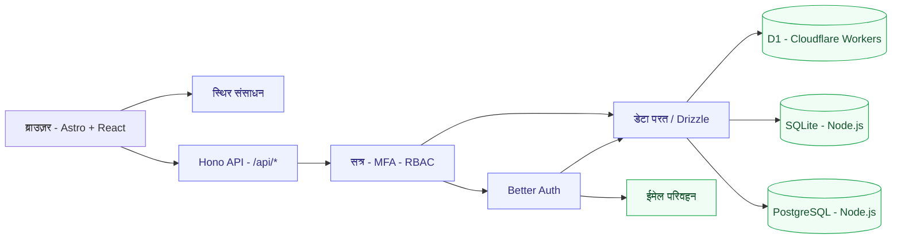
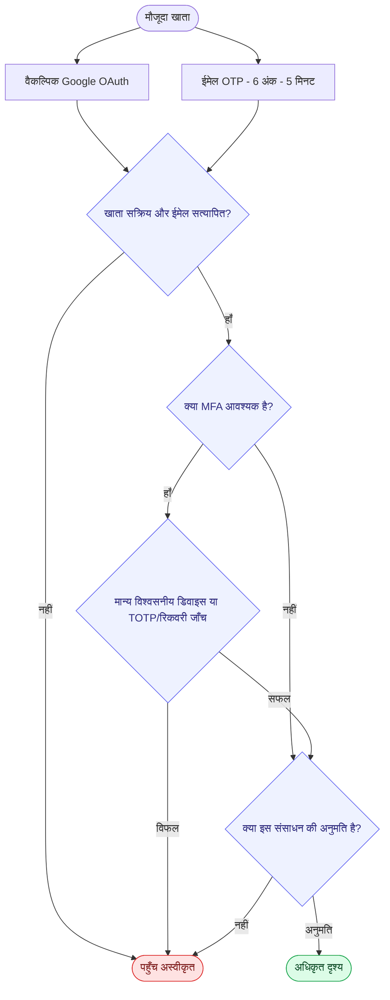
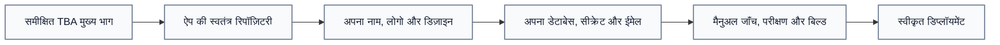

<div align="center">

<a href="https://rounver.com" target="_blank" rel="noopener noreferrer"></a>


# TBA | Template Basic Authenticator

**Astro | React | Hono | Better Auth | D1 | SQLite | PostgreSQL**


<p align="center"><a href="../README.md" lang="en">English</a> | <a href="README.es.md" lang="es">Español</a> | <a href="README.pt.md" lang="pt">Português</a> | <a href="README.de.md" lang="de">Deutsch</a> | <a href="README.fr.md" lang="fr">Français</a> | <a href="README.it.md" lang="it">Italiano</a> | <a href="README.zh.md" lang="zh">简体中文</a> | <a href="README.ja.md" lang="ja">日本語</a> | <strong>हिन्दी</strong> | <a href="README.ar.md" lang="ar">العربية</a></p>

<p align="center">
  <strong>लेखक:</strong> Sil R. Galeano | Copyright © 2026 Rounver Corp. |
  <a href="hi/README.md">तकनीकी दस्तावेज़</a>
</p>

</div>

---

TBA का डिफ़ॉल्ट विन्यास Cloudflare Workers और D1 है। यही इंटरफ़ेस और Hono API Node.js पर SQLite या PostgreSQL के साथ चलते हैं। [डेटाबेस इंजन](hi/database-engines.md)

**प्रमाणीकरण की बुनियाद बार-बार बनाने की आवश्यकता नहीं।**

**TBA (Template Basic Authenticator)**, **Rounver Corp.** द्वारा बनाया गया एक मॉड्यूलर और दोबारा उपयोग किया जा सकने वाला प्रमाणीकरण तथा प्रशासन टेम्पलेट है। इससे स्वतंत्र वेब अनुप्रयोगों को हर परियोजना में पहचान, अनुमतियों और उपयोगकर्ता प्रबंधन को नए सिरे से नहीं बनाना पड़ता।

> [!NOTE]
> इस शाखा में पुन: उपयोग योग्य मुख्य प्रणाली है। उन्नत टेबल इंजन और XLSX निर्यात शामिल नहीं हैं; [टेम्पलेट का दायरा](hi/template-scope.md) देखें।


## <picture></picture> मुख्य सुविधाएँ

| पहचान और पहुँच | तकनीकी आधार |
| :--- | :--- |
| ईमेल द्वारा छह अंकों का पासवर्ड-रहित OTP; पाँच मिनट में समाप्त, एक बार उपयोग | Astro 7, React 19, सख़्त TypeScript और Tailwind CSS 4 |
| वैकल्पिक Google OAuth, डिफ़ॉल्ट रूप से बंद | Cloudflare Workers या Node.js पर Hono |
| वैकल्पिक TOTP MFA, एक बार उपयोग वाले रिकवरी कोड और 30 दिनों तक मान्य तथा रद्द किए जा सकने वाले विश्वसनीय डिवाइस | Better Auth, Drizzle ORM, D1, SQLite, PostgreSQL |
| भूमिकाएँ, सर्वर पर अनुमति जाँच, उपयोगकर्ता प्रशासन और सत्र निरस्तीकरण | हर ऐप के अपने उपयोगकर्ता, डेटाबेस, रहस्य और डिप्लॉयमेंट |
| बंद, स्वीकृति-आधारित या खुला पंजीकरण; ऑडिट और प्रोफ़ाइल | उत्तरदायी UI, लाइट/डार्क थीम और दस भाषाएँ |
| प्रशासनिक डैशबोर्ड और अलग विस्तार बिंदु | स्थिर संसाधनों की सीधी डिलीवरी; निजी API `/api/` के अंतर्गत |

## <picture></picture> आर्किटेक्चर - स्थिर संसाधन और शुरू से गोपनीयता



Astro निजी खाता जानकारी के बिना स्थिर पेज बनाता है और Cloudflare मौजूदा फ़ाइलें सीधे उपलब्ध कराता है। **हर निजी API अनुरोध** Hono और सर्वर पर खाता स्थिति, सत्र, सत्यापित ईमेल, MFA तथा भूमिका-अनुमतियों की जाँच से गुजरता है। UI में कोई तत्व छिपाना अनुमति का विकल्प नहीं है।

## <picture></picture> प्रमाणीकरण और अनुमति का प्रवाह



ईमेल लॉगिन में पहला प्रमाणीकरण चरण हमेशा अनिवार्य है। विश्वसनीय डिवाइस अतिरिक्त MFA जाँच से छूट दे सकता है, लेकिन ईमेल सत्यापन का स्थान नहीं लेता। Google OAuth वैकल्पिक है और उसी खाता तथा MFA नीति के अंतर्गत आता है। खुले पंजीकरण में ईमेल सत्यापित होने के बाद सर्वर व्यवस्थापक द्वारा तय भूमिका देता है; उपयोगकर्ता विशेषाधिकार नहीं चुनते।

## <picture></picture> स्थानीय रूप से चलाना

**आवश्यकताएँ:** Node.js 24 या नया, npm और Git। नीचे दिए आदेश **स्थानीय** D1 और ईमेल का उपयोग करते हैं; दूरस्थ संसाधन नहीं बनाते।

परियोजना की डायरेक्टरी में निम्न आदेश चलाएँ:

```bash
git clone https://github.com/rounverr/tba.git
cd tba
npm ci
npm run setup -- --name "My application" --id my-application
npm run db:migrate:local
npm run admin:bootstrap -- --email admin@example.test --name "Initial Admin"
npm run build
npm run mail:dev
```

**दूसरे टर्मिनल** में पूरा स्थानीय Worker चलाएँ:

```bash
npm run dev:worker
```

**http://localhost:8787** खोलें। विकास मेलबॉक्स **http://127.0.0.1:8025** पर है; संदेश मशीन से बाहर नहीं जाते और सर्वर पुनः आरंभ होने पर मेमोरी साफ़ होती है। प्रारंभिक व्यवस्थापक को भी OTP से ईमेल सत्यापित करना होगा। UI में तेज़ बदलाव के लिए `npm run dev` और बिल्ड के बाद पूर्ण प्रमाणीकरण जाँच के लिए `dev:worker` का उपयोग करें।

<details>
<summary><strong>कमांड संदर्भ</strong></summary>

| कमांड | उद्देश्य |
| :--- | :--- |
| `npm run check` | Astro और TypeScript जाँच |
| `npm test` | स्थानीय स्वचालित परीक्षण |
| `npm run build` | फ्रंटएंड बिल्ड |
| `npm run worker:check` | बिना डिप्लॉयमेंट Worker जाँच |
| `npm run setup` | स्वतंत्र ऐप का विन्यास |
| `npm run db:create` / `npm run db:link` | दूरस्थ D1 कार्य; स्पष्ट खाता और पुष्टि आवश्यक |
| `npm run deploy` | चुने हुए खाते में मैनुअल डिप्लॉयमेंट |

</details>

## <picture></picture> ट्रांज़ैक्शनल ईमेल - अपना प्रदाता चुनें

TBA में **कॉन्फ़िगर किया जा सकने वाला ईमेल परिवहन** है। OTP और सुरक्षा संदेश बनाने की प्रक्रिया उन्हें भेजने वाले प्रदाता से स्वतंत्र है।

| विकल्प | वर्तमान स्थिति |
| :--- | :--- |
| Wavicc | Rounver का **भविष्य का पसंदीदा एकीकरण**; API अडैप्टर अभी नहीं बना है |
| Cloudflare Email Sending (केवल Worker) | मूल `EMAIL` बाइंडिंग के साथ **लागू** |
| Resend | **लागू**; `--mail resend`, `RESEND_API_KEY` और सत्यापित `MAIL_FROM` |
| स्थानीय विकास मेलबॉक्स | विकास के लिए **लागू**, बाहरी डिलीवरी नहीं |
| अन्य ट्रांज़ैक्शनल ईमेल सेवाएँ | चुनी गई सेवा के लिए अडैप्टर लागू करें और उसकी जाँच करें। |

सेटअप `--mail local`, `--mail resend` और `--mail cloudflare` स्वीकार करता है। स्थानीय ईमेल में local `APP_URL` और `npm run mail:dev`; Resend में `RESEND_API_KEY` और `MAIL_FROM` चाहिए। Cloudflare मौजूदा adapter इस्तेमाल करता है और `EMAIL` नाम का `send_email` binding, अनुमत `MAIL_FROM` तथा सक्षम sending domain चाहता है। सेटअप केवल स्थानीय जाँच करता है, संसाधन बनाता या remote domain जाँचता नहीं। कॉन्फ़िगरेशन बाद में हो सकती है: interactive मोड जारी रखने का विकल्प देता है, noninteractive मोड लंबित सूची दिखाकर आगे बढ़ता है। binding, sender या credentials गढ़े नहीं जाते; कॉन्फ़िगरेशन पूरी होने पर ही भेजना संभव है। secrets Git से बाहर रखें। Wavicc पसंदीदा भावी एकीकरण और `WAVICC_API_KEY` placeholder है। [ईमेल सेटअप](hi/setup-mail.md) देखें।

## <picture></picture> भाषाएँ और सुगम्यता

| भाषा | कोड | दिशा |
| :--- | :---: | :---: |
| English | en | LTR |
| Español | es | LTR |
| Português | pt | LTR |
| Deutsch | de | LTR |
| Français | fr | LTR |
| Italiano | it | LTR |
| 简体中文 | zh | LTR |
| 日本語 | ja | LTR |
| हिन्दी | hi | LTR |
| العربية | ar | RTL |

कोड और setup सहायक की मूल भाषा अंग्रेज़ी है। दसों अनुवाद और स्थानीय फ़ॉन्ट पैकेज में हैं। `npm run setup -- --languages en,pt` केवल अंग्रेज़ी और पुर्तगाली सक्रिय करता है; अतिरिक्त पैकेज नहीं लगते और अन्य अनुवाद नहीं मिटते। `--languages` न देने पर मौजूदा चयन रहता है; सूची न हो तो दसों सक्रिय हैं। अंग्रेज़ी अनुवाद fallback के रूप में हमेशा रहती है। `--locale en` ऐप की डिफ़ॉल्ट भाषा तय करता है और कोई भी सक्रिय भाषा स्वीकार करता है। प्राथमिकता सहेजी पसंद, समर्थित ब्राउज़र भाषा, फिर विन्यस्त डिफ़ॉल्ट है। भाषा बदलने से पेज रीलोड या फ़ॉर्म रीसेट नहीं होता; अरबी RTL सुरक्षित है।

अंग्रेज़ी fallback के रूप में शुरुआती बंडल में रहती है। अन्य लॉगिन और पैनल कैटलॉग dynamic import और प्रति मॉड्यूल memory cache से लोड होते हैं। कीबोर्ड या पॉइंटर focus केवल संबंधित भाषा पहले लोड करता है; मेनू खोलने से सभी भाषाएँ डाउनलोड नहीं होतीं। पूरे कैटलॉग तैयार होने पर बदलाव होता है, जिससे फ़ॉर्म, सत्र और नेविगेशन सुरक्षित रहते हैं। cached बदलाव में नेटवर्क नहीं लगता; अंतिम चयन लागू होता है। शुरुआती विफलता में अंग्रेज़ी और बाद की विफलता में वर्तमान भाषा रहती है। ईमेल और build metadata पूरे server-only कैटलॉग इस्तेमाल करते हैं। [भाषा लोडिंग](hi/language-loading.md) देखें।

दस्तावेज़ React लोड होते समय ही पहचानी गई भाषा लोड करना शुरू करता है और provider के साथ cache साझा करता है, जिससे शुरुआत में दोबारा इंतज़ार नहीं होता।

## <picture></picture> स्वतंत्र परियोजना बनाना

टेम्पलेट से अलग रिपॉज़िटरी बनाएँ और उसे अपने ऐप के लिए कॉन्फ़िगर करें। विभिन्न परियोजनाओं में उपयोगकर्ता, कुकी, पहचान डेटाबेस या रहस्य साझा नहीं होते।



पहचान, दृश्य शैली और प्रारंभिक थीम के लिए `src/config/app.json` का उपयोग करें। किसी दूरस्थ बदलाव से पहले Cloudflare खाता और D1 बाइंडिंग जाँचें। **टीम परीक्षण और डिप्लॉयमेंट मैनुअल करती है**; GitHub Actions या Workers Builds अनिवार्य नहीं हैं। GitHub Template से बनी प्रतियों को ऊपर की रिपॉज़िटरी से स्वतः अपडेट नहीं मिलते।

## <picture></picture> तकनीकी दस्तावेज़

[आर्किटेक्चर](hi/architecture.md) | [सुरक्षा, MFA और अनुमतियाँ](hi/security.md) | [पंजीकरण और विस्तार हुक](hi/registration.md) | [ट्रांज़ैक्शनल ईमेल](hi/mail-providers.md) | [संचालन और D1](hi/operations.md) | [लॉगिन भाषाएँ](hi/auth-i18n.md) | [पैनल भाषाएँ](hi/workspace-i18n.md) | [सत्यापन](hi/validation.md) | [दस्तावेज़ सूची](hi/README.md)

## <picture></picture> लाइसेंस, ब्रांड और रखरखाव

**MIT लाइसेंस** Rounver के स्वामित्व वाले मूल सॉफ़्टवेयर पर लागू है; तीसरे पक्ष के घटकों और फ़ॉन्ट के अपने लाइसेंस रहते हैं। **Rounver का कंपनी नाम और लोगो सुरक्षित हैं**, MIT द्वारा प्रदान नहीं किए जाते। मूल रिपॉज़िटरी का रखरखाव केवल Rounver करता है और बाहरी योगदान स्वीकार नहीं करता, लेकिन MIT स्वतंत्र फ़ोर्क, संशोधन और पुनर्वितरण की अनुमति देता है। [LICENSE](../LICENSE), [TRADEMARKS.md](../TRADEMARKS.md) और [CONTRIBUTING.md](../CONTRIBUTING.md) देखें।

---

<div dir="rtl">

[तृतीय-पक्ष लाइसेंस](licenses/README.md#hi)
