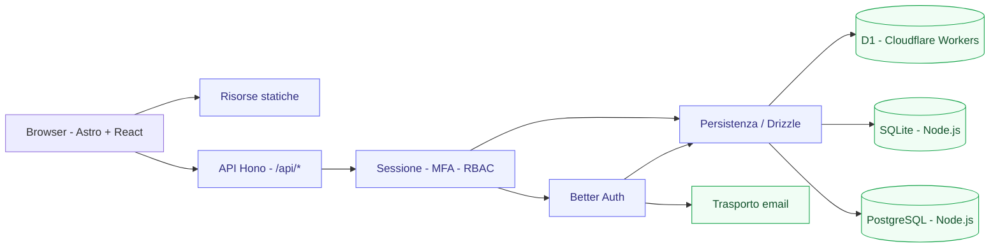
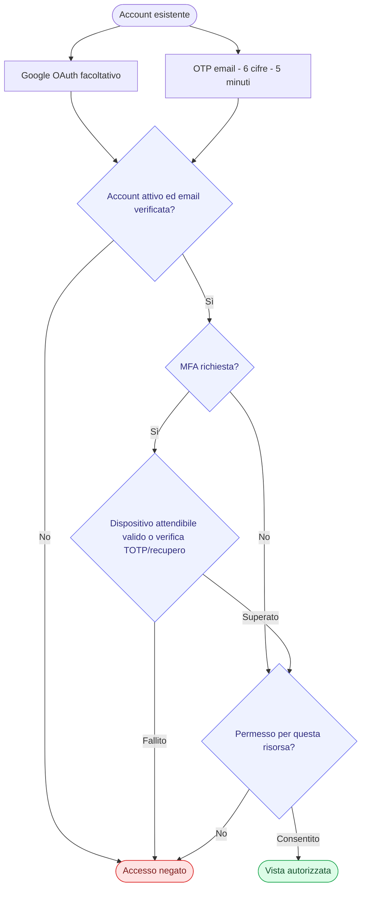
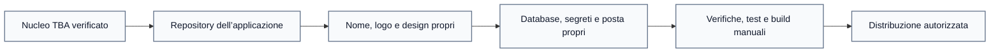

<div align="center">

<a href="https://rounver.com" target="_blank" rel="noopener noreferrer"></a>


# TBA | Template Basic Authenticator

**Astro | React | Hono | Better Auth | D1 | SQLite | PostgreSQL**


<p align="center"><a href="../README.md" lang="en">English</a> | <a href="README.es.md" lang="es">Español</a> | <a href="README.pt.md" lang="pt">Português</a> | <a href="README.de.md" lang="de">Deutsch</a> | <a href="README.fr.md" lang="fr">Français</a> | <strong>Italiano</strong> | <a href="README.zh.md" lang="zh">简体中文</a> | <a href="README.ja.md" lang="ja">日本語</a> | <a href="README.hi.md" lang="hi">हिन्दी</a> | <a href="README.ar.md" lang="ar">العربية</a></p>

<p align="center">
  <strong>Autore:</strong> Sil R. Galeano | Copyright © 2026 Rounver Corp. |
  <a href="it/README.md">Documentazione tecnica</a>
</p>

</div>

---

TBA usa Cloudflare Workers con D1 per impostazione predefinita. La stessa interfaccia e API Hono funzionano in Node.js con SQLite o PostgreSQL. [Motori di database](it/database-engines.md)

**Autenticazione pronta, senza ricostruire le fondamenta.**

**TBA (Template Basic Authenticator)** è un modello modulare e riutilizzabile per autenticazione e amministrazione sviluppato da **Rounver Corp.** Consente alle applicazioni web indipendenti di partire con una base per identità, permessi e gestione degli utenti senza ricrearla per ogni progetto.

> [!NOTE]
> Questo ramo contiene il nucleo riutilizzabile. Tabelle avanzate ed esportazioni XLSX sono escluse; vedi [ambito del template](it/template-scope.md).


## <picture></picture> Funzionalità

| Identità e accesso | Base tecnologica |
| :--- | :--- |
| OTP email di sei cifre senza password, valido cinque minuti e monouso | Astro 7, React 19, TypeScript rigoroso e Tailwind CSS 4 |
| Google OAuth opzionale, disabilitato per impostazione predefinita | Hono su Cloudflare Workers o Node.js |
| MFA TOTP opzionale, codici di recupero monouso e dispositivi attendibili revocabili per 30 giorni | Better Auth, Drizzle ORM, D1, SQLite, PostgreSQL |
| Ruoli, permessi verificati sul server, amministrazione utenti e revoca delle sessioni | Ogni applicazione ha utenti, database, segreti e distribuzione propri |
| Registrazione chiusa, soggetta ad approvazione o aperta; audit e profili | Interfaccia responsive, temi chiaro/scuro e dieci lingue |
| Dashboard amministrativa e punti di estensione indipendenti | Risorse statiche servite direttamente; endpoint privati in `/api/` |

## <picture></picture> Architettura - risorse statiche e privacy fin dalla progettazione



Astro genera pagine statiche senza dati privati degli account. Cloudflare serve direttamente le risorse esistenti. **Ogni richiesta API privata** passa attraverso Hono e i controlli lato server: stato dell’account, sessione, email verificata, MFA e permessi del ruolo. Nascondere un elemento dell’interfaccia non sostituisce l’autorizzazione.

## <picture></picture> Flusso di autenticazione e autorizzazione



L’accesso tramite email richiede sempre il primo fattore. Un dispositivo attendibile può evitare una nuova verifica MFA, ma non sostituisce la verifica dell’email. Google OAuth è opzionale e segue le stesse regole per account e MFA. Nella registrazione aperta il server assegna, dopo la verifica, il ruolo configurato dall’amministratore; gli utenti non scelgono i privilegi.

## <picture></picture> Esecuzione locale

**Requisiti:** Node.js 24 o successivo, npm e Git. I comandi seguenti usano D1 e posta **locali** e non creano infrastrutture remote.

Eseguire i seguenti comandi nella directory del progetto:

```bash
git clone https://github.com/rounverr/tba.git
cd tba
npm ci
npm run setup -- --name "My application" --id my-application
npm run db:migrate:local
npm run admin:bootstrap -- --email admin@example.test --name "Initial Admin"
npm run build
npm run mail:dev
```

In un **secondo terminale**, avviare il Worker locale completo:

```bash
npm run dev:worker
```

Aprire **http://localhost:8787**. La casella di sviluppo è su **http://127.0.0.1:8025**; i messaggi non escono dal computer e la memoria viene svuotata al riavvio. Anche l’amministratore iniziale deve verificare l’indirizzo tramite OTP. Usare `npm run dev` per modifiche rapide all’interfaccia e `dev:worker` dopo la compilazione per provare l’autenticazione completa.

<details>
<summary><strong>Riferimento dei comandi</strong></summary>

| Comando | Funzione |
| :--- | :--- |
| `npm run check` | Controlli Astro e TypeScript |
| `npm test` | Test automatizzati locali |
| `npm run build` | Compilazione del frontend |
| `npm run worker:check` | Verifica del Worker senza distribuzione |
| `npm run setup` | Configurazione di un’applicazione indipendente |
| `npm run db:create` / `npm run db:link` | Operazioni D1 remote: conto e conferma espliciti |
| `npm run deploy` | Distribuzione manuale nel conto selezionato |

</details>

## <picture></picture> Email transazionali - scelta del provider

TBA utilizza un **trasporto email configurabile**. L’autenticazione genera OTP e notifiche di sicurezza indipendentemente dal servizio che li recapita.

| Opzione | Stato attuale |
| :--- | :--- |
| Wavicc | **Integrazione futura preferita di Rounver**; adattatore API non ancora implementato |
| Cloudflare Email Sending (Solo Worker) | **Implementato** con binding nativo `EMAIL` |
| Resend | **Implementato**; `--mail resend`, `RESEND_API_KEY` e `MAIL_FROM` verificato |
| Casella di sviluppo locale | **Implementata** per sviluppo, senza consegna esterna |
| Altri servizi email transazionali | Implementare e testare un adattatore per il servizio scelto. |

Il setup accetta `--mail local`, `--mail resend` e `--mail cloudflare`. La posta locale usa `APP_URL` locale e `npm run mail:dev`. Resend richiede `RESEND_API_KEY` e `MAIL_FROM`. Cloudflare riutilizza l’adattatore esistente e richiede un binding `send_email` chiamato `EMAIL`, `MAIL_FROM` consentito e dominio abilitato all’invio. Il setup verifica localmente senza creare risorse né verificare domini remoti. Si può configurare dopo: il modo interattivo chiede se proseguire, quello non interattivo continua con le attività pendenti. Non inventa binding, mittenti o credenziali; l’invio richiede la configurazione. I segreti restano fuori da Git. Wavicc resta l’integrazione futura preferita con `WAVICC_API_KEY` come placeholder. Vedi il [setup email](it/setup-mail.md).

## <picture></picture> Lingue e accessibilità

| Lingua | Codice | Direzione |
| :--- | :---: | :---: |
| English | en | LTR |
| Español | es | LTR |
| Português | pt | LTR |
| Deutsch | de | LTR |
| Français | fr | LTR |
| Italiano | it | LTR |
| 简体中文 | zh | LTR |
| 日本語 | ja | LTR |
| हिन्दी | hi | LTR |
| العربية | ar | RTL |

L’inglese è la lingua base del codice e dell’assistente setup. Sono incluse dieci traduzioni e font locali. `npm run setup -- --languages en,pt` abilita solo inglese e portoghese, senza installare pacchetti né cancellare altre traduzioni. Senza `--languages` si conserva la selezione attuale; senza elenco esistente vengono abilitate tutte e dieci. Inglese resta attivo come fallback delle traduzioni. `--locale en` imposta la lingua predefinita e accetta ogni lingua abilitata. La priorità è preferenza salvata, lingua compatibile del browser, poi predefinita configurata. Il cambio non ricarica né azzera moduli; arabo mantiene RTL.

L’inglese resta incluso come fallback. Gli altri cataloghi di accesso e pannello usano import dinamici e cache in memoria per modulo. Il focus di tastiera o puntatore precarica solo l’opzione indicata; aprire il menu non scarica tutte le lingue. Il cambio attende i cataloghi completi e conserva moduli, sessione e navigazione. La cache evita la rete; prevale l’ultima scelta. Un errore iniziale mostra l’inglese, un errore successivo mantiene la lingua attuale. Email e metadati del build usano cataloghi completi solo sul server. Vedi il [caricamento delle lingue](it/language-loading.md).

Il documento carica la lingua rilevata mentre si carica React e condivide la cache con il provider per evitare una seconda attesa iniziale.

## <picture></picture> Creare un progetto indipendente

Creare un repository distinto dal modello e configurarlo per l’applicazione. Il nucleo non condivide utenti, cookie, database di identità o segreti fra progetti derivati.



Usare `src/config/app.json` per identità, stile e tema iniziale. Verificare l’account Cloudflare e il binding D1 prima delle operazioni remote. **Il team esegue controlli e distribuzioni manualmente**; GitHub Actions e Workers Builds non sono requisiti. Le copie tramite GitHub Template non ricevono aggiornamenti automatici.

## <picture></picture> Documentazione tecnica

[Architettura](it/architecture.md) | [Sicurezza, MFA e permessi](it/security.md) | [Registrazione e punti di estensione](it/registration.md) | [Email transazionali](it/mail-providers.md) | [Operazioni e D1](it/operations.md) | [Lingue dell’accesso](it/auth-i18n.md) | [Lingue del pannello](it/workspace-i18n.md) | [Validazione](it/validation.md) | [Indice documentazione](it/README.md)

## <picture></picture> Licenza, marchio e manutenzione

La **licenza MIT** copre il software originale i cui diritti appartengono a Rounver; componenti e font di terzi mantengono le proprie licenze. **Nome e logo aziendale Rounver sono riservati** e non concessi da MIT. Rounver mantiene esclusivamente il repository originale e non accetta contributi esterni; MIT consente comunque fork, modifiche e ridistribuzioni indipendenti. Vedere [LICENSE](../LICENSE), [TRADEMARKS.md](../TRADEMARKS.md) e [CONTRIBUTING.md](../CONTRIBUTING.md).

[Licenze di terze parti](licenses/README.md#it)
