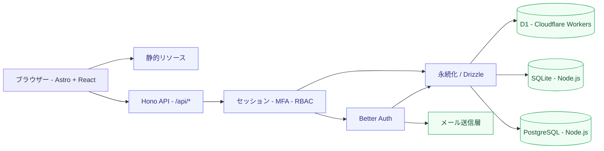
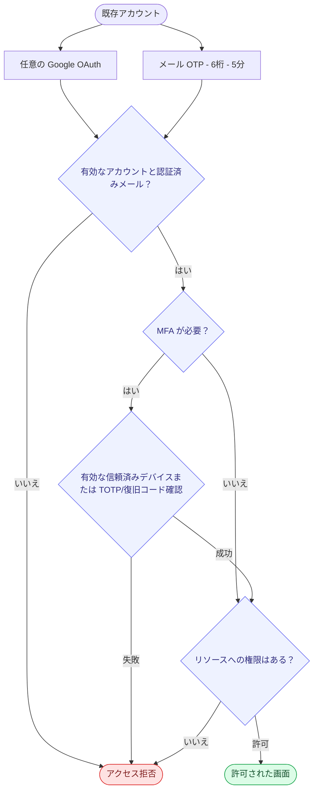
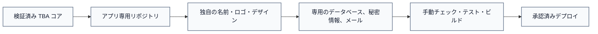

<div align="center">

<a href="https://rounver.com" target="_blank" rel="noopener noreferrer"></a>


# TBA | Template Basic Authenticator

**Astro | React | Hono | Better Auth | D1 | SQLite | PostgreSQL**


<p align="center"><a href="../README.md" lang="en">English</a> | <a href="README.es.md" lang="es">Español</a> | <a href="README.pt.md" lang="pt">Português</a> | <a href="README.de.md" lang="de">Deutsch</a> | <a href="README.fr.md" lang="fr">Français</a> | <a href="README.it.md" lang="it">Italiano</a> | <a href="README.zh.md" lang="zh">简体中文</a> | <strong>日本語</strong> | <a href="README.hi.md" lang="hi">हिन्दी</a> | <a href="README.ar.md" lang="ar">العربية</a></p>

<p align="center">
  <strong>著者:</strong> Sil R. Galeano | Copyright © 2026 Rounver Corp. |
  <a href="ja/README.md">技術ドキュメント</a>
</p>

</div>

---

TBA の既定構成は Cloudflare Workers と D1 です。同じ画面と Hono API は Node.js 上で SQLite または PostgreSQL と組み合わせて動作します。 [データベースエンジン](ja/database-engines.md)

**認証基盤を何度も作り直さないために。**

**TBA（Template Basic Authenticator）** は **Rounver Corp.** が開発した、再利用可能なモジュール型の認証・管理テンプレートです。独立した Web アプリケーションごとにログイン、権限、ユーザー管理を一から構築する必要がなくなります。

> [!NOTE]
> このブランチは再利用可能なコアを含みます。高度なテーブル機能と XLSX 出力は対象外です。[テンプレートの範囲](ja/template-scope.md)を参照してください。


## <picture></picture> 主な機能

| 認証とアクセス制御 | 技術基盤 |
| :--- | :--- |
| メールによる6桁のワンタイム OTP、5分で期限切れ、使い捨て | Astro 7、React 19、厳格な TypeScript、Tailwind CSS 4 |
| 任意の Google OAuth、初期設定では無効 | Cloudflare Workers または Node.js 上の Hono |
| 任意の TOTP MFA、使い捨ての復旧コード、30日間有効で取り消し可能な信頼済みデバイス | Better Auth、Drizzle ORM、Cloudflare D1 |
| ロール、サーバー側の権限確認、ユーザー管理、セッション失効 | アプリごとに独立したユーザー、DB、シークレット、デプロイ |
| 登録禁止・承認制・公開登録、監査履歴とプロフィール | レスポンシブ UI、ライト/ダークテーマ、10言語 |
| 管理ダッシュボードと独立した拡張ポイント | 静的ファイルを直接配信し、非公開 API は `/api/` 配下 |

## <picture></picture> アーキテクチャ：静的配信とプライバシー重視



Astro は個人アカウント情報を含まない静的ページを生成し、Cloudflare が既存のアセットを直接配信します。**すべての非公開 API リクエスト**は Hono を経由し、アカウント状態、セッション、メール認証、MFA、ロール権限がサーバー側で確認されます。UI を非表示にするだけでは認可になりません。

## <picture></picture> 認証・認可フロー



メールログインでは必ず第一要素が必要です。信頼済みデバイスは条件を満たせば追加の MFA 確認を省略できますが、メール確認の代わりにはなりません。Google OAuth も任意であり、同じアカウントと MFA の制約を受けます。公開登録ではメール確認後に管理者が設定したロールをサーバーが割り当て、利用者は権限を選択できません。

## <picture></picture> ローカル実行

**必要な環境：** Node.js 24 以上、npm、Git。以下のコマンドは**ローカル**の D1 とメールを使い、リモート環境を作成しません。

プロジェクトのディレクトリで以下を順に実行します。

```bash
git clone https://github.com/rounverr/tba.git
cd tba
npm ci
npm run setup -- --name "My application" --id my-application
npm run db:migrate:local
npm run admin:bootstrap -- --email admin@example.test --name "Initial Admin"
npm run build
npm run mail:dev
```

**別のターミナル**で完全なローカル Worker を起動します。

```bash
npm run dev:worker
```

**http://localhost:8787** を開きます。開発用メールボックスは **http://127.0.0.1:8025** です。メールは外部に送信されず、再起動するとメモリが消去されます。初期管理者も OTP によるメール認証が必要です。UI の素早い変更には `npm run dev`、ビルド後の認証動作の確認には `dev:worker` を利用します。

<details>
<summary><strong>コマンドリファレンス</strong></summary>

| コマンド | 用途 |
| :--- | :--- |
| `npm run check` | Astro と TypeScript のチェック |
| `npm test` | ローカル自動テスト |
| `npm run build` | フロントエンドのビルド |
| `npm run worker:check` | デプロイなしの Worker 確認 |
| `npm run setup` | 独立アプリの設定 |
| `npm run db:create` / `npm run db:link` | リモート D1 操作。アカウント指定と明示確認が必要 |
| `npm run deploy` | 指定アカウントへの手動デプロイ |

</details>

## <picture></picture> トランザクションメール：プロバイダーを自由に選択

TBA は**切り替え可能なメール送信層**を利用します。OTP やセキュリティ通知の生成は、実際に配信するプロバイダーから独立しています。

| 選択肢 | 現在の状態 |
| :--- | :--- |
| Wavicc | Rounver が**将来の優先連携先**として予定。API アダプターは未実装 |
| Cloudflare Email Sending (Worker 専用) | ネイティブの `EMAIL` バインディングで**実装済み** |
| Resend | **実装済み**。`--mail resend`、`RESEND_API_KEY`、検証済みの `MAIL_FROM` |
| ローカル開発メールボックス | **実装済み**。外部送信なし |
| その他のトランザクションメールサービス | 選んだサービス向けのアダプターを実装してテストします。 |

セットアップは `--mail local`、`--mail resend`、`--mail cloudflare` に対応します。ローカルメールはローカルの `APP_URL` と `npm run mail:dev`、Resend は `RESEND_API_KEY` と `MAIL_FROM` を使います。Cloudflare は既存アダプターを使い、`EMAIL` という `send_email` バインディング、許可された `MAIL_FROM`、送信設定済みドメインが必要です。ローカル条件だけを検査し、リソース作成や遠隔ドメイン検証は行いません。後回しにでき、対話モードは続行を確認し、非対話モードは未設定項目を表示して続行します。バインディング・送信元・資格情報を生成せず、設定完了まで送信できません。秘密情報は Git 外に保存します。Wavicc は将来の優先連携で、`WAVICC_API_KEY` は予約用です。[メールセットアップ](ja/setup-mail.md)を参照してください。

## <picture></picture> 言語とアクセシビリティ

| 言語 | コード | 文字方向 |
| :--- | :---: | :---: |
| English | en | LTR |
| Español | es | LTR |
| Português | pt | LTR |
| Deutsch | de | LTR |
| Français | fr | LTR |
| Italiano | it | LTR |
| 简体中文 | zh | LTR |
| 日本語 | ja | LTR |
| हिन्दी | hi | LTR |
| العربية | ar | RTL |

コードと setup アシスタントは英語を基準とします。10言語の翻訳とローカルフォントを同梱しています。`npm run setup -- --languages en,pt` は英語とポルトガル語のみを有効化し、追加パッケージのインストールや他の翻訳の削除は行いません。`--languages` を省略すると現在の選択を維持し、一覧がない設定では全10言語が有効です。英語は翻訳フォールバックとして常に有効です。`--locale en` で既定言語を指定でき、有効な言語を選べます。保存設定、対応ブラウザー言語、設定した既定値の順に解決します。言語変更でページやフォームは再読み込みせず、アラビア語の RTL も保持します。

英語はフォールバックとして初期バンドルに含まれます。他のログイン・管理画面カタログは動的インポートとモジュール別メモリーキャッシュを使います。キーボードやポインターのフォーカスで該当オプションのみ先読みし、メニューを開くだけでは全言語を読み込みません。カタログが揃ってから切り替え、フォーム・セッション・画面遷移状態を保持します。キャッシュ済みの変更は通信不要で最後の選択が優先されます。初回失敗は英語、切り替え失敗は現在の言語を表示します。メールとビルド用メタデータは完全なサーバー専用辞書を使います。[言語読み込み](ja/language-loading.md)を参照してください。

文書は React の読み込み中に検出言語の読み込みを開始し、プロバイダーとキャッシュを共有して起動時の二重待ちを避けます。

## <picture></picture> 独立したプロジェクトの作成

テンプレートから独立したリポジトリを作成し、アプリごとに設定します。派生プロジェクト間でユーザー、Cookie、認証データベース、秘密鍵を共有しません。



`src/config/app.json` で名称、外観、初期テーマを設定します。リモート操作前に Cloudflare アカウントと D1 バインディングを確認してください。**検証とデプロイはチームが手動で行います**。GitHub Actions や Workers Builds は公開の必須条件ではありません。GitHub Template の複製には上流の更新が自動反映されません。

## <picture></picture> 技術ドキュメント

[アーキテクチャ](ja/architecture.md) | [セキュリティ、MFA、権限](ja/security.md) | [登録と拡張フック](ja/registration.md) | [トランザクションメール](ja/mail-providers.md) | [運用と D1](ja/operations.md) | [ログインの言語](ja/auth-i18n.md) | [管理画面の言語](ja/workspace-i18n.md) | [検証](ja/validation.md) | [ドキュメント一覧](ja/README.md)

## <picture></picture> ライセンス、ブランド、保守

**MIT ライセンス**は Rounver が権利を保有するオリジナルソフトウェアに適用されます。第三者の部品やフォントはそれぞれのライセンスに従います。**Rounver の社名・企業ロゴは留保**され、MIT に含まれません。上流リポジトリは Rounver のみが保守し、外部からの貢献は受け付けませんが、MIT は独立したフォーク、変更、再配布を認めます。[LICENSE](../LICENSE)、[TRADEMARKS.md](../TRADEMARKS.md)、[CONTRIBUTING.md](../CONTRIBUTING.md)を参照してください。

[サードパーティーのライセンス](licenses/README.md#ja)
