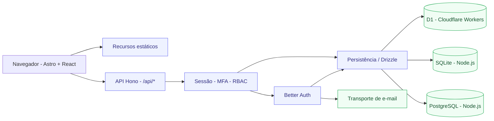
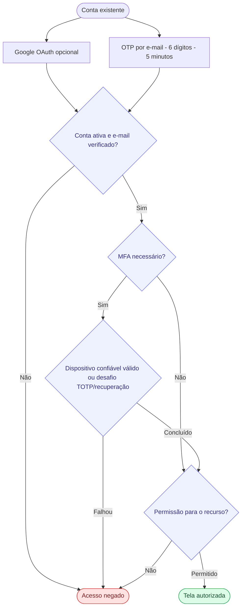
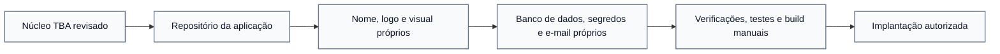

<div align="center">

<a href="https://rounver.com" target="_blank" rel="noopener noreferrer"></a>


# TBA | Template Basic Authenticator

**Astro | React | Hono | Better Auth | D1 | SQLite | PostgreSQL**


<p align="center"><a href="../README.md" lang="en">English</a> | <a href="README.es.md" lang="es">Español</a> | <strong>Português</strong> | <a href="README.de.md" lang="de">Deutsch</a> | <a href="README.fr.md" lang="fr">Français</a> | <a href="README.it.md" lang="it">Italiano</a> | <a href="README.zh.md" lang="zh">简体中文</a> | <a href="README.ja.md" lang="ja">日本語</a> | <a href="README.hi.md" lang="hi">हिन्दी</a> | <a href="README.ar.md" lang="ar">العربية</a></p>

<p align="center">
  <strong>Autor:</strong> Sil R. Galeano | Copyright © 2026 Rounver Corp. |
  <a href="pt/README.md">Documentação técnica</a>
</p>

</div>

---

O TBA usa Cloudflare Workers com D1 por padrão. A mesma interface e API Hono também funcionam no Node.js com SQLite ou PostgreSQL. [Mecanismos de banco de dados](pt/database-engines.md)

**Autenticação sem reconstruir a base.**

**TBA (Template Basic Authenticator)** é um modelo modular e reutilizável de autenticação e administração desenvolvido pela **Rounver Corp.** Ele permite iniciar aplicações web independentes com identidade, permissões e gerenciamento de usuários prontos, sem reconstruir tudo em cada projeto.

> [!NOTE]
> Esta branch contém o núcleo reutilizável. Tabelas avançadas e exportações XLSX ficam excluídas; consulte o [escopo do template](pt/template-scope.md).


## <picture></picture> Funcionalidades

| Identidade e acesso | Base tecnológica |
| :--- | :--- |
| OTP de seis dígitos por e-mail, sem senha; validade de cinco minutos e uso único | Astro 7, React 19, TypeScript rigoroso e Tailwind CSS 4 |
| Google OAuth opcional, desativado por padrão | Hono em Cloudflare Workers ou Node.js |
| MFA TOTP opcional, códigos de recuperação de uso único e dispositivos confiáveis revogáveis por 30 dias | Better Auth, Drizzle ORM, D1, SQLite, PostgreSQL |
| Funções, permissões verificadas no servidor, gestão de usuários e revogação de sessões | Cada aplicação possui usuários, banco de dados, segredos e implantação próprios |
| Cadastro fechado, sujeito à aprovação ou aberto; auditoria e perfis | Interface responsiva, temas claro/escuro e dez idiomas |
| Painel administrativo e pontos de extensão independentes | Recursos estáticos servidos diretamente; endpoints privados em `/api/` |

## <picture></picture> Arquitetura - recursos estáticos e privacidade desde a concepção



O Astro gera documentos estáticos sem dados privados de contas. A Cloudflare fornece os recursos existentes diretamente. **Toda requisição à API privada** passa pelo Hono e por verificações no servidor: situação da conta, sessão, e-mail verificado, MFA e permissões de função. A visibilidade da interface nunca substitui a autorização.

## <picture></picture> Fluxo de autenticação e autorização



O login por e-mail sempre exige o primeiro fator. Um dispositivo confiável pode evitar uma nova verificação do segundo fator, mas nunca substitui a verificação por e-mail. Google OAuth é opcional e segue as mesmas regras de conta e MFA. No cadastro aberto, o servidor atribui a função configurada pelo administrador após verificar o e-mail; o usuário não escolhe privilégios.

## <picture></picture> Executar localmente

**Requisitos:** Node.js 24 ou superior, npm e Git. Os comandos abaixo usam D1 e e-mail **locais** e não criam infraestrutura remota.

Execute estes comandos a partir do diretório do projeto:

```bash
git clone https://github.com/rounverr/tba.git
cd tba
npm ci
npm run setup -- --name "My application" --id my-application
npm run db:migrate:local
npm run admin:bootstrap -- --email admin@example.test --name "Initial Admin"
npm run build
npm run mail:dev
```

Em um **segundo terminal**, inicie o Worker local completo:

```bash
npm run dev:worker
```

Abra **http://localhost:8787**. A caixa de desenvolvimento está em **http://127.0.0.1:8025**; as mensagens não saem da máquina e a memória é apagada ao reiniciar. O administrador inicial também precisa verificar seu e-mail por OTP. Use `npm run dev` para alterações rápidas na interface; use `dev:worker` após compilar para testar a autenticação completa.

<details>
<summary><strong>Referência de comandos</strong></summary>

| Comando | Função |
| :--- | :--- |
| `npm run check` | Verificações do Astro e TypeScript |
| `npm test` | Testes automatizados locais |
| `npm run build` | Compilação do frontend |
| `npm run worker:check` | Verificação do Worker sem implantação |
| `npm run setup` | Configuração de uma aplicação independente |
| `npm run db:create` / `npm run db:link` | Operações remotas no D1; exigem conta e confirmação explícitas |
| `npm run deploy` | Implantação manual na conta selecionada |

</details>

## <picture></picture> E-mail transacional - escolha o provedor

O TBA usa um **transporte de e-mail configurável**. A autenticação gera códigos OTP e notificações de segurança de forma independente do provedor que os entrega.

| Opção | Estado atual |
| :--- | :--- |
| Wavicc | **Integração futura preferencial da Rounver**; o adaptador de API ainda não foi implementado |
| Cloudflare Email Sending (Somente Worker) | **Implementado** com o binding nativo `EMAIL` |
| Resend | **Implementado**; `--mail resend`, `RESEND_API_KEY` e `MAIL_FROM` verificado |
| Caixa de e-mail local | **Implementada** para desenvolvimento, sem entrega externa |
| Outros serviços de e-mail transacional | Implemente e teste um adaptador para o serviço escolhido. |

O setup aceita `--mail local`, `--mail resend` e `--mail cloudflare`. E-mail local usa `APP_URL` local e `npm run mail:dev`. Resend exige `RESEND_API_KEY` e `MAIL_FROM`. Cloudflare reutiliza o adaptador existente e exige binding `send_email` chamado `EMAIL`, `MAIL_FROM` permitido e domínio habilitado para envio. O setup verifica requisitos locais sem criar recursos nem verificar domínios remotos. É possível configurar depois: o modo interativo pergunta se deseja continuar; o não interativo continua com pendências. Não inventa bindings, remetentes ou credenciais; o envio depende da configuração. Segredos ficam fora do Git. Wavicc permanece a integração futura preferida, com `WAVICC_API_KEY` como placeholder. Consulte o [setup de e-mail](pt/setup-mail.md).

## <picture></picture> Idiomas e acessibilidade

| Idioma | Código | Direção |
| :--- | :---: | :---: |
| English | en | LTR |
| Español | es | LTR |
| Português | pt | LTR |
| Deutsch | de | LTR |
| Français | fr | LTR |
| Italiano | it | LTR |
| 简体中文 | zh | LTR |
| 日本語 | ja | LTR |
| हिन्दी | hi | LTR |
| العربية | ar | RTL |

O inglês é a base do código e do assistente setup. As dez traduções e fontes locais estão incluídas. Use `npm run setup -- --languages en,pt` para habilitar somente inglês e português, sem instalar pacotes nem apagar outras traduções. Omitir `--languages` preserva a seleção atual ou habilita os dez quando não existe lista. Inglês permanece habilitado como fallback das traduções. `--locale en` define o idioma padrão da aplicação e aceita qualquer idioma habilitado. A interface prioriza a preferência salva, depois o idioma compatível do navegador e finalmente o padrão configurado. Mudar idioma não recarrega a página nem reinicia formulários; árabe mantém RTL.

O inglês permanece incluído como fallback. Os outros catálogos de login e painel usam imports dinâmicos e cache em memória por módulo. O foco do teclado ou ponteiro antecipa apenas a opção indicada; abrir o menu não baixa todos os idiomas. A troca ocorre quando os catálogos estão prontos, preservando formulários, sessão e navegação. Idiomas em cache não exigem rede; vale a última escolha. Falhas iniciais mostram inglês; falhas na troca mantêm o idioma atual. E-mails e metadados do build usam catálogos completos apenas no servidor. Consulte a [carga de idiomas](pt/language-loading.md).

O documento começa a carregar o idioma detectado enquanto React carrega, compartilhando o cache com o provider para evitar uma segunda espera na inicialização.

## <picture></picture> Criar um projeto independente

Crie um repositório separado a partir do modelo e configure-o para sua aplicação. O núcleo não compartilha usuários, cookies, bancos de identidade ou segredos entre projetos derivados.



Use `src/config/app.json` para definir identidade, estilos e tema inicial. Verifique a conta Cloudflare e o binding D1 antes de qualquer alteração remota. **A equipe faz verificações e implantações manualmente**; GitHub Actions e Workers Builds não são requisitos para publicar. Cópias feitas pelo GitHub Template não recebem atualizações automaticamente.

## <picture></picture> Documentação técnica

[Arquitetura](pt/architecture.md) | [Segurança, MFA e permissões](pt/security.md) | [Cadastro e pontos de extensão](pt/registration.md) | [E-mail transacional](pt/mail-providers.md) | [Operações e D1](pt/operations.md) | [Idiomas do acesso](pt/auth-i18n.md) | [Idiomas do painel](pt/workspace-i18n.md) | [Validação](pt/validation.md) | [Índice da documentação](pt/README.md)

## <picture></picture> Licença, marca e manutenção

A **licença MIT** cobre o software original cujos direitos pertencem à Rounver; componentes e fontes de terceiros mantêm suas próprias licenças. O **nome e o logotipo corporativo Rounver são reservados** e não estão incluídos na permissão MIT. A Rounver mantém exclusivamente o repositório original e não aceita contribuições externas; a licença MIT continua permitindo forks, modificações e redistribuição independentes. Consulte [LICENSE](../LICENSE), [TRADEMARKS.md](../TRADEMARKS.md) e [CONTRIBUTING.md](../CONTRIBUTING.md).

[Licenças de terceiros](licenses/README.md#pt)
