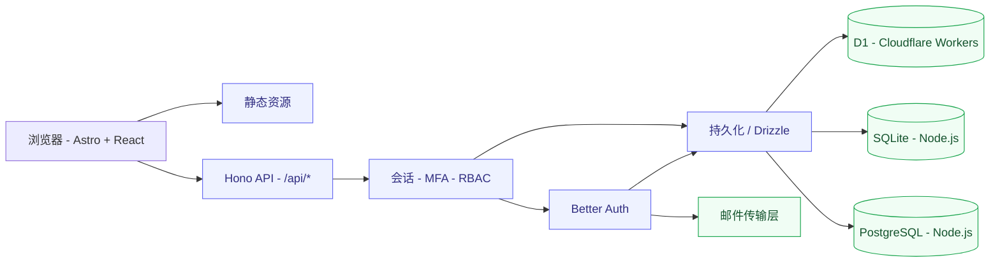
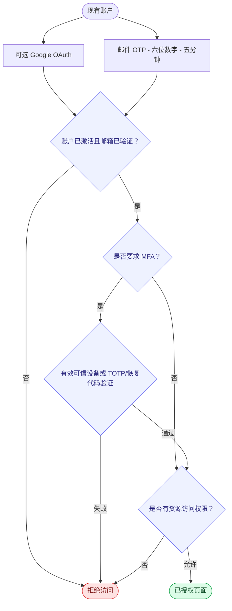
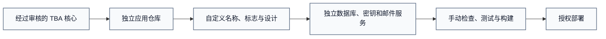

<div align="center">

<a href="https://rounver.com" target="_blank" rel="noopener noreferrer"></a>


# TBA | Template Basic Authenticator

**Astro | React | Hono | Better Auth | D1 | SQLite | PostgreSQL**


<p align="center"><a href="../README.md" lang="en">English</a> | <a href="README.es.md" lang="es">Español</a> | <a href="README.pt.md" lang="pt">Português</a> | <a href="README.de.md" lang="de">Deutsch</a> | <a href="README.fr.md" lang="fr">Français</a> | <a href="README.it.md" lang="it">Italiano</a> | <strong>简体中文</strong> | <a href="README.ja.md" lang="ja">日本語</a> | <a href="README.hi.md" lang="hi">हिन्दी</a> | <a href="README.ar.md" lang="ar">العربية</a></p>

<p align="center">
  <strong>作者:</strong> Sil R. Galeano | Copyright © 2026 Rounver Corp. |
  <a href="zh/README.md">技术文档</a>
</p>

</div>

---

TBA 默认在 Cloudflare Workers 上使用 D1。同一界面和 Hono API 也可在 Node.js 上搭配 SQLite 或 PostgreSQL 运行。 [数据库引擎](zh/database-engines.md)

**无需重复构建身份验证基础。**

**TBA（Template Basic Authenticator）** 是 **Rounver Corp.** 开发的模块化、可复用身份验证和管理模板。独立的 Web 应用可以直接获得身份管理、权限控制和用户管理基础，无需为每个项目重新开发。

> [!NOTE]
> 本分支包含可复用的核心功能，不包含高级表格引擎和 XLSX 导出。参见[模板范围](zh/template-scope.md)。


## <picture></picture> 核心功能

| 身份与访问控制 | 技术基础 |
| :--- | :--- |
| 六位数字电子邮件 OTP 免密码登录；五分钟有效且只能使用一次 | Astro 7、React 19、严格 TypeScript 与 Tailwind CSS 4 |
| 可选 Google OAuth，默认关闭 | Cloudflare Workers 或 Node.js 上的 Hono |
| 可选 TOTP 多因素认证、一次性恢复代码和有效期 30 天且可撤销的可信设备 | Better Auth、Drizzle ORM 和 Cloudflare D1 |
| 角色、服务端权限验证、用户管理和会话撤销 | 每个应用拥有独立的用户、数据库、密钥和部署 |
| 关闭注册、审核注册或开放注册；审计记录与用户资料 | 响应式界面、明暗主题与十种语言 |
| 管理仪表板和独立扩展点 | 直接交付静态资源；私有端点位于 `/api/` |

## <picture></picture> 架构：静态资源优先，隐私从设计开始



Astro 生成不包含私人账户数据的静态页面，Cloudflare 直接提供已有静态资源。**每一次私有 API 请求**都经由 Hono 并在服务端检查账户状态、会话、邮箱验证、MFA 和角色权限。仅在界面中隐藏元素不能替代服务端授权。

## <picture></picture> 身份验证与授权流程



邮件登录始终要求第一重身份验证。可信设备可以在符合条件时省去重复的 MFA 验证，但不能替代邮箱验证。Google OAuth 是可选方式，也必须遵守相同的账户与 MFA 规则。开放注册时，服务器在邮箱验证后分配管理员预设的角色；用户不能自行选择权限。

## <picture></picture> 本地运行

**环境要求：** Node.js 24 或更高版本、npm 和 Git。以下命令使用**本地** D1 与邮件服务，不会创建远程基础设施。

在项目目录中依次执行以下命令：

```bash
git clone https://github.com/rounverr/tba.git
cd tba
npm ci
npm run setup -- --name "My application" --id my-application
npm run db:migrate:local
npm run admin:bootstrap -- --email admin@example.test --name "Initial Admin"
npm run build
npm run mail:dev
```

在**第二个终端**中启动完整的本地 Worker：

```bash
npm run dev:worker
```

打开 **http://localhost:8787**。开发邮件箱位于 **http://127.0.0.1:8025**；邮件不会离开本机，重启服务器后内存数据会被清空。首位管理员仍需使用 OTP 验证邮箱。可用 `npm run dev` 快速修改界面；构建后用 `dev:worker` 测试完整身份验证流程。

<details>
<summary><strong>命令参考</strong></summary>

| 命令 | 用途 |
| :--- | :--- |
| `npm run check` | Astro 与 TypeScript 检查 |
| `npm test` | 本地自动化测试 |
| `npm run build` | 构建前端 |
| `npm run worker:check` | 不部署的 Worker 预检查 |
| `npm run setup` | 配置独立应用 |
| `npm run db:create` / `npm run db:link` | 远程 D1 操作；需要明确指定账户并确认 |
| `npm run deploy` | 向指定账户手动部署 |

</details>

## <picture></picture> 事务性邮件：自主选择服务商

TBA 采用**可配置的邮件传输层**。身份验证模块负责生成 OTP 与安全通知，独立于实际发送邮件的服务商。

| 选项 | 当前状态 |
| :--- | :--- |
| Wavicc | Rounver **优先考虑的未来集成**；API 适配器尚未实现 |
| Cloudflare Email Sending (仅限 Worker) | **已实现**原生 `EMAIL` 绑定 |
| Resend | **已实现**；`--mail resend`、`RESEND_API_KEY` 与已验证的 `MAIL_FROM` |
| 本地开发邮件箱 | **已实现**开发用途，不向外部发送邮件 |
| 其他事务性邮件服务 | 为所选服务实现并测试适配器。 |

初始化工具支持 `--mail local`、`--mail resend` 和 `--mail cloudflare`。本地邮件使用本地 `APP_URL` 和 `npm run mail:dev`；Resend 需要 `RESEND_API_KEY` 与 `MAIL_FROM`。Cloudflare 复用现有适配器，需要名为 `EMAIL` 的 `send_email` 绑定、允许的 `MAIL_FROM` 以及已启用发送的域名。工具只检查本地条件，不创建资源或验证远程域名。可稍后配置：交互模式询问是否继续，非交互模式列出待办后继续。不编造绑定、发件人或密钥，配置完成前无法发送邮件。密钥不得进入 Git。Wavicc 保留为首选未来集成，`WAVICC_API_KEY` 仅作占位。参见[邮件初始化](zh/setup-mail.md)。

## <picture></picture> 语言与无障碍支持

| 语言 | 代码 | 文字方向 |
| :--- | :---: | :---: |
| English | en | LTR |
| Español | es | LTR |
| Português | pt | LTR |
| Deutsch | de | LTR |
| Français | fr | LTR |
| Italiano | it | LTR |
| 简体中文 | zh | LTR |
| 日本語 | ja | LTR |
| हिन्दी | hi | LTR |
| العربية | ar | RTL |

代码和 setup 助手以英语为基础。十种翻译和本地字体均已包含。使用 `npm run setup -- --languages en,pt` 仅启用英语和葡萄牙语，不安装额外包，也不删除其他翻译。省略 `--languages` 会保留已有选择；配置中尚无列表时启用全部十种。英语始终保留为翻译回退。`--locale en` 设置应用默认语言，也接受任意已启用语言。界面优先使用已存偏好，其次为支持的浏览器语言，最后使用配置默认值。切换语言不刷新页面或重置表单；阿拉伯语保持 RTL。

英语作为回退始终包含在初始包中。其余登录和面板词典按模块动态导入并缓存在内存。键盘或指针聚焦某个选项时预加载该选项，打开菜单不会下载所有语言。词典完整就绪后才切换，保留表单、会话和导航；缓存切换无需网络，最后一次选择生效。首次加载失败显示英语，后续切换失败保留当前语言。邮件和构建元数据使用独立的完整服务端词典。参见[语言加载](zh/language-loading.md)。

文档在 React 加载期间就开始加载检测到的语言，并与上下文共享缓存，避免启动时再次等待。

## <picture></picture> 创建独立项目

从模板创建独立的代码仓库，并为自己的应用进行配置。派生项目之间不会共享用户、Cookie、身份数据库或密钥。



通过 `src/config/app.json` 配置应用身份、样式及默认主题。在执行远程操作前，确认 Cloudflare 账户和 D1 绑定。**团队手动执行验证和部署**；GitHub Actions 与 Workers Builds 不是发布条件。通过 GitHub Template 创建的副本不会自动接收上游更新。

## <picture></picture> 技术文档

[架构](zh/architecture.md) | [安全、MFA 与权限](zh/security.md) | [注册与扩展钩子](zh/registration.md) | [事务性邮件](zh/mail-providers.md) | [运维与 D1](zh/operations.md) | [登录语言](zh/auth-i18n.md) | [管理面板语言](zh/workspace-i18n.md) | [验证](zh/validation.md) | [文档索引](zh/README.md)

## <picture></picture> 许可证、品牌与维护

**MIT 许可证**适用于 Rounver 拥有权利的原创软件；第三方组件与字体继续遵循各自的许可证。**Rounver 的公司名称与徽标保留权利**，不属于 MIT 授权范围。Rounver 独立维护上游仓库，不接受外部贡献；MIT 仍允许独立分支、修改与再分发。详见 [LICENSE](../LICENSE)、[TRADEMARKS.md](../TRADEMARKS.md) 和 [CONTRIBUTING.md](../CONTRIBUTING.md)。

[第三方许可](licenses/README.md#zh)
