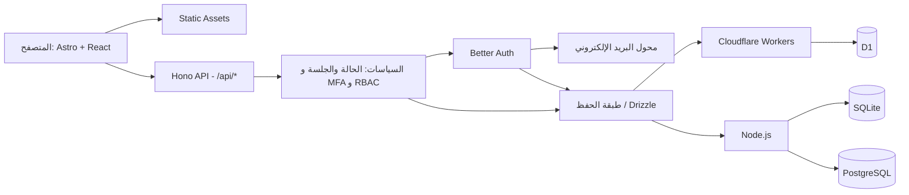

# <picture></picture> هندسة معمارية

<a href="../en/architecture.md" lang="en">English</a> | <a href="../es/architecture.md" lang="es">Español</a> | <a href="../pt/architecture.md" lang="pt">Português</a> | <a href="../de/architecture.md" lang="de">Deutsch</a> | <a href="../fr/architecture.md" lang="fr">Français</a> | <a href="../it/architecture.md" lang="it">Italiano</a> | <a href="../zh/architecture.md" lang="zh">简体中文</a> | <a href="../ja/architecture.md" lang="ja">日本語</a> | <a href="../hi/architecture.md" lang="hi">हिन्दी</a> | <strong>العربية</strong>

[التوثيق التقني](README.md) | [نظرة عامة على المشروع](../README.ar.md)

> [!NOTE]
> يستخدم TBA افتراضيًا Cloudflare Workers مع D1. تعمل الواجهة نفسها وواجهة Hono API أيضًا على Node.js مع SQLite أو PostgreSQL. [محركات قواعد البيانات](database-engines.md)

TBA تحتفظ بواجهة واحدة Astro + React وعميل Hono واحد. Astro يولد الملفات الثابتة وReact يُحَيي الشاشات التفاعلية فقط. فقط `/api` و `/api/*` يُشغلان Hono أولاً عبر `run_worker_first: ["/api", "/api/*"]`. Cloudflare يُقدم الصفحات والملفات الموجودة مباشرة عبر Workers Static Assets؛ Hono لا يدعو الارتباط `ASSETS`. لا يُحتاج إلى SSR للولوج أو حاوية اللوحة؛ هذه المستندات الثابتة لا تحتوي على بيانات خاصة.

`src/server/services/mail.ts`: `local`, `cloudflare`, `resend`. [Mail / Correo](mail-providers.md).

`src/server/auth.ts` يبني Better Auth عند الطلب ويتخدم محول Drizzle الخاص بالمحرك المحدد. لا يحافظ أبداً على الارتباطات أو البيانات من طلب في متغيرات عالمية. `security.ts` يطبق سياسات التصريح. `policy.ts` يحتوي على فهرس الصلاحيات وقيود الأدوار العامة. `database/schema.ts` يصف مخطط البيانات و `drizzle/*.sql` يحتوي على عمليات النقل القابلة للتنفيذ.

Better Auth يدير المستخدمين والجلسات وال حسابات والتحقق و TOTP. حقولها الرسمية للم_VERSION الثابتة محفوظة، بما في ذلك `verified` و `failedVerificationCount` و `lockedUntil` من عاملين. حقل `password` من الجدول `account` ينتمي إلى مخطط رسمي؛ مزود كلمة المرور معطل ونقاط النهاية الخاصة به غير معروضة.

الجداول الإضافية تحتوي على الأدوار والإعدادات والطلبات والمراقبة وتأكيد MFA للجلسة والثقة القابلة للإلغاء للأجهزة. الأدوار الأولية هي المدير والمحرر والمشاهد؛ المحرر والمشاهد يبدأان فقط مع `app.read`. كل تطبيق يضيف صلاحيات الأعمال الخاصة به، دون تعديل ضوابط الهوية.

مستندات اللوحة هي عامة كحاويات فارغة؛ واجهات برمجة التطبيقات تتطلب جلسة نشطة وبريد محقق وحساب نشط وعامل ثاني عند الاقتضاء وتصريح. إخفاء القوائم في React هو مجرد تحسين للتنقل. العامل يُجدد التحقق من كل عملية.

تتطلب التغييرات الإدارية للمستخدمين والأدوار والتسجيل صلاحيتها على الخادم وفحص المدير الحالي. يتطلب إلغاء الجلسات عبر `/api/private/users/:id/revoke` صلاحية `users.edit` دون فحص مدير إضافي. يتطلب الحذف النهائي أيضًا `users.deactivate` ويمنع حذف النفس ويحمي آخر مدير نشط. راجع [الأمان](security.md). يركب `Admin.tsx` اللوحة؛ يدير `admin/useAdminController.tsx` الحالة والطلبات و`usePanelHistory.ts` السجل و`AdminDialogs.tsx` الحوارات و`BasicListViews.tsx` القوائم المحدودة. يوفر `server/basic-lists.ts` صفحات من 20 صفًا مع السابق والتالي دون محرك جداول متقدم.

الإعدادات تستخدم سجلًا واحدًا في قاعدة البيانات؛ تغيير الوضع لا يتطلب إعادة النشر. آخر مدير نشط ودور محجوز محميان بحركات، بما في ذلك التغييرات المتزامنة.

لا يوجد تعدد المستأجرين أو المنظمات أو مساحات العمل أو الفواتير أو اتحاد الجلسات أو R2 النشط أو بنية تحتية متعددة الوكلاء. لكل تثبيت بيئة تشغيل وقاعدة بيانات ومستخدمون وجلسات وأسرار مستقلة.

## توجيه ثابت وأمان

نقطة الدخول `src/server/index.ts` تسجل مكونات `src/server/routes/` على مثيل واحد من Hono، بالترتيب الأصلي. `src/server/http.ts` يجمع المساعدين المشتركة. تم فحص جميع المعالجين: الإعدادات العامة والبريد والتحقق OTP والجلسة والتحدي MFA والعمليات الخاصة و Better Auth تحت `/api/`. استدعاء OAuth هو `/api/auth/callback/google`. `/login/complete/` هو صفحة Astro ثابتة التي تطلب `/api/session`؛ لا يعالج OAuth على الخادم. لا توجد نقاط نهاية ديناميكية خارج `/api`.

الصفحات `/` و `/login/` و `/login/complete/` و `/denied/` و `/admin/` ومناظيرها السبعة تُنشأ أثناء عملية البناء. حاويات الإدارة لا تحتوي على بيانات خاصة. الاستفسارات والطفرات تمر عبر واجهة برمجة التطبيقات بنفس فحوصات الجلسة والحالة والبريد المحقق والمفتاح الثاني و RBAC. التنقل المباشر وإعادة التحميل يخدم نفس HTML مثل التنقل العادي.

`public/_headers` يُنسخ إلى `dist/_headers` ويتطلب نفس الرؤوس الأمنية مثل Hono على استجابات Static Assets. يحتفظ Hono بـ `secureHeaders` من أجل API، بالإضافة إلى `Cache-Control: no-store`. تقارن الاختبارات كلا السياستين لاكتشاف الاختلافات. يتم الحفاظ على CSP وملفات تعريف الارتباط و منطق التحقق. يستخدم فقط الملفات المسمى بإصدار `/_astro/` `Cache-Control: public, max-age=31536000, immutable`؛ يتم الحفاظ على HTML والموارد غير المسمى بإصدار على إعادة التحقق المعتادة. `_headers` هو بيانات تعريف Cloudflare ولا ينشر كملف قابل للتحميل.

يتم الحفاظ على `not_found_handling: "404-page"`، بدون سقوط لSPA. إذا وصلت طلب خارج API إلى Hono، فإنه يرجع 404 ولا يستفسر `ASSETS`. يجب على المشتقات التي تتضمن SSR ونداءات خارج `/api/` أو معالجات ديناميكية أخرى توسيع الأنماط في كلا التكوينين وإضافة اختبارات قبل النشر. لا يتم تضمين البيانات الخاصة في HTML المسبق أو نشر الملفات الحساسة داخل `public` أو `dist`.

تجمع اختبارات `tests/assets.test.ts` Astro وال عامل مع Wrangler، وتشغيل الموجه الفعلي ل Static Assets في Miniflare/workerd، وعدّ الاستدعاءات بواسطة ربط حصرية للعربة المحلية. هذا الربط لا وجود له في التكوين أو النشر. يتحقق الاصطدام الثابت الاصطناعي تحت `/api/private/users` من أن الملف لا يمكنه تجاوز التحقق. لا توجد зависимости جديدة أو موارد بعيدة مطلوبة لهذه الاختبارات.

مراجع: [التوجيه الانتقائي](https://developers.cloudflare.com/workers/static-assets/routing/worker-script/) و[رؤوس Static Assets](https://developers.cloudflare.com/workers/static-assets/headers/).

يحتفظ الدور الأساسي بمعرفه الثابت `viewer`. تعرض استجابات الأدوار ومراجع التدقيق الاسم التاريخي "استفسار" كـ "مشاهد"، دون إعادة كتابة البيانات الحالية أو هجرات تم تطبيقها بالفعل. في التسجيل المفتوح، يختار المسؤول الدور الأولي من بين جميع الأدوار المكونة؛ تتحقق API من الاختيار وتتطلب تأكيدًا صريحًا. يتلقى الزائر الدور المكون عند التحقق من بريده الإلكتروني ولا يمكنه اختياره. لا يتم تمكين التسجيل المفتوح تلقائيًا. انظر [التسجيل واختيار الدور](registration.md).

يمكن أن يُ缩ّص القائمة الجانبية على سطح المكتب ويحتفظ بالتفضيل المرئي في `localStorage`. يحتفظ أزرار الملاحة المُ缩ّصة بأسماء قابلة للوصول والمساعدة بالعنوان. في الهاتف المحمول، يتم الحفاظ على القائمة الكاملة. يعيد شعار SVG الفيكون إعادة إنتاج رمز الطبقات من الشعار ويستخدم اللون الرئيسي المحدد للتطبيق.

## جداول الإدارة

تبقى قوائم المستخدمين والطلبات والتدقيق الأساسية مع تنقل محدود وصلاحيات على الخادم. محركات الجداول المتقدمة وExcel خارج القالب الأساسي؛ يضيفها كل مشروع عند الحاجة. راجع [النطاق](template-scope.md).

## ملاحة اللوحة

يحتفظ مكون React الإداري بالقائمة والشاشة المرئية أثناء تحميل الوجهة التالية. يحتفظ History API بالخلف والأمام دون طلب وثيقة Astro أخرى أو إعادة تحويل React مرة أخرى. تتم الموافقة على التحول عند استلام البيانات والاستجابات الملغاة لا يمكن استبدال الوجهة الحالية. يُستبدل مؤشر رقيق ومؤجل في العنوان شاشة "تحميل المحتوى". يبقى عناصر التحكم في المحتوى السابق غير نشطة أثناء تغيير الوجهة. يتم الحفاظ على الروابط المباشرة وإعادة التحميل والنقرات بال修饰ات.

تُرجع القراءات الخاصة التي تتضمن `context=1` بياناتها جنبًا إلى جنب مع `_context`، وهو عرض تقديمي للممثل المصرح به بالفعل. يمكن أن يتضمن المستخدمون والطلبات كتالوج الأدوار عبر `includeRoles=1`، بنفس الصلاحية التي يتمتع بها نهاية النقطة. لا توجد طلب منفصلة لـ `/api/session` أو الأدوار عند فتح كل عرض. يسمح الكتالوج المستلم أيضًا بفتح الأدوار دون طلب آخر أثناء صلاحيته. يُعادة استخدام نفس قراءة الملف الشخصي بواسطة الملف الشخصي والأمان.

`ViewCache` يحتفظ حتى ثماني إجابات عرض داخل المكون، قابلة لإعادة الاستخدام لمدة ثلاثين ثانية. قراءة مدخلة لا تمتد صلاحيتها. لا يتم تخزينها في localStorage أو sessionStorage أو Service Worker أو ذاكرة التخزين المؤقتة المشتركة. لا يتم تخزين التغييرات أو QR أو بذور TOTP أو رموز الاستعادة. يتم إلغاؤها بعد التغييرات، وتغيير سياق الهوية / الأذونات، ورفض الوصول، وإغلاق الجلسة، وعند الانتقال عبر BFCache. يحافظ تبديل علامة التبويب أو النافذة على العرض الحالي. يُفحص انتهاء الصلاحية عند قراءة مدخلة من ذاكرة التخزين المؤقت. لا توجد استطلاعات دورية أو تحميل جميع الصفحات.

السياق والذاكرة التخزين المؤقتة تمثل فقط البيانات التي تم استلامها بالفعل من قبل هذه الشخص. كل طلب جديد خاص يطبق التحكم الحالي للخادم؛ لا يمنح الأذونات ولا يسمح بتجاوز الإلغاء. استجابات HTTP لا تزال تستخدم `Cache-Control: no-store`.

الأول عرض إداري فارغ في كل من HTML الذي تم إنشاؤه بواسطة Astro وخلال التهيئة. `Admin` لا يثبت القائمة، والرأس، والعنوان، والاستمارات، ولا حالة التحميل حتى يستلم الرد الخاص المصرح به مع سياقه وبياناته. خلال إعادة التوجيه، يعود أيضًا بإخراج فارغ. لا يتم إضافة استعلام جلسة: يتم استخدام نفس القراءة الموجودة المدمجة. خطأ نهائي في الأذونات أو الخدمة يظهر تنبيهًا عامًا قليلًا، مع إعادة المحاولة، خارج هيكل الإدارة. الملاحة الداخلية لجلسة مؤكدة بالفعل تحافظ على المحتوى السابق وذاكرة التخزين المؤقتة كما كانت من قبل.

اللوحة تعاملت مع فقدان الجلسة بطريقة مركزية: عند 401 يتم تنظيف البيانات، وذاكرة التخزين المؤقتة، والأسرار المؤقتة للواجهة، ويتم استخدام `location.replace("/login/")`. إغلاق الجلسة المؤكد أيضًا يزيل هذا الحالة ويعيد كتابة إدخال التاريخ. قبل حفظ مستند في BFCache، يتم إخفاء لوحته بشكل متزامن وإغلاق حواراته. إذا قام المتصفح بإعادة تعيينه، يتم إهمال حالته الخاصة ويتطلب فقط عرض حالي؛ `pageshow` عادي لا يضيف طلبات. 403 من الأذونات يبقى على الشاشة، `MFA_REQUIRED` يقود إلى خطوة MFA، و `RECENT_AUTH_REQUIRED` يحافظ على تأكيد الهوية الصريح. APIs تحتفظ بstates وresponses JSON؛ يتم إعادة التوجيه في واجهة لوحة الأمام، دون تشغيل العامل لخدمة HTML.

جميع إعادة التأكيد للوحة تستخدم نفس حوار التطبيق القابل للوصول: تغييرات الوصول، وإلغاء الجلسات، وموافقة أو رفض الطلبات، وإلغاء الثقة، وتعطيل MFA، وتجديد الاستعادة. لا يتم استخدام `window.confirm`، `alert`، أو `prompt`. يظهر الشخص والنتائج قبل إرسال التغيير؛ إلغاء الحفظ يبقي على الاستمارة. تدفق البريد يفصل العنوان، وOTP، وعامل الثاني، مع نتيجة صريحة ودخول لاحق بالبريد الجديد.

## مكونات اللوحة

يجب فصل التنقل وتحميل البيانات والحالة والعروض الإدارية في الحزمة القابلة لإعادة الاستخدام، مع الحفاظ على التصميم واللغة المشتركة. يُحمّل مولد QR عند الحاجة لإعداد MFA؛ ولا يتطلب ذلك اعتمادًا على Excel.

تبقى الإنجليزية ضمن الحزمة الأولية كلغة بديلة. تستخدم بقية قواميس الدخول واللوحة استيرادًا ديناميكيًا وذاكرة تخزين لكل وحدة. يبدأ تركيز لوحة المفاتيح أو المؤشر تحميل الخيار المقصود فقط؛ فتح القائمة لا ينزل جميع اللغات. يطبق التغيير بعد اكتمال القواميس مع الحفاظ على النماذج والجلسة والتنقل. لا تحتاج الخيارات المخزنة إلى الشبكة، ويسود آخر اختيار. يظهر فشل البداية الإنجليزية، ويحافظ فشل التغيير على اللغة الحالية. تستخدم الرسائل وبيانات البناء قواميس كاملة خاصة بالخادم. راجع [تحميل اللغات](language-loading.md).

تستعلم اللوحة عن البيانات عند التنقل أو التحديث اليدوي أو حدوث تغيير ذي صلة. لا تؤدي فترات الخمول أو تغيّر التركيز أو تبديل التبويب أو انتهاء صلاحية الذاكرة المؤقتة وحدها إلى طلبات. عند الاستعادة من BFCache، يُعاد التحقق من الوصول قبل عرض البيانات الخاصة.
