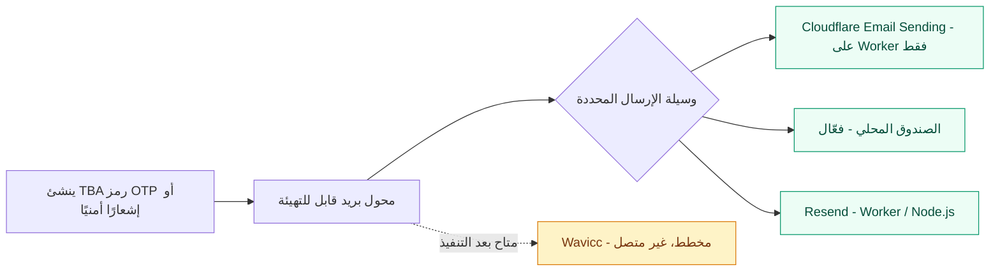

# <picture></picture> البريد الإلكتروني للمعاملات واستقلالية المزود

<a href="../en/mail-providers.md" lang="en">English</a> | <a href="../es/mail-providers.md" lang="es">Español</a> | <a href="../pt/mail-providers.md" lang="pt">Português</a> | <a href="../de/mail-providers.md" lang="de">Deutsch</a> | <a href="../fr/mail-providers.md" lang="fr">Français</a> | <a href="../it/mail-providers.md" lang="it">Italiano</a> | <a href="../zh/mail-providers.md" lang="zh">简体中文</a> | <a href="../ja/mail-providers.md" lang="ja">日本語</a> | <a href="../hi/mail-providers.md" lang="hi">हिन्दी</a> | <strong>العربية</strong>

[التوثيق التقني](README.md) | [نظرة عامة على المشروع](../README.ar.md)

> [!NOTE]
> **لا يفرض TBA مزود بريد تجاريًا بعينه.** تنشئ وحدة المصادقة رموز OTP وإشعارات الأمان، ويرسلها محول البريد عبر الخدمة المختارة لكل تطبيق مستقل. لا يغير اختيار المزود قواعد المصادقة أو الجلسات أو MFA.

## المزودون وحالة التنفيذ الفعلية

| وسيلة الإرسال | الحالة | متطلبات الإعداد |
| :--- | :--- | :--- |
| Cloudflare Email Sending | **منفذ** | `MAIL_PROVIDER=cloudflare` وربط `EMAIL` وعنوان `MAIL_FROM` مؤكد |
| صندوق البريد المحلي | **منفذ للاستخدام المحلي** | `MAIL_PROVIDER=local` وأصل محلي و`npm run mail:dev` |
| Resend | **منفذ** | `MAIL_PROVIDER=resend`, `RESEND_API_KEY`, `MAIL_FROM` |
| Wavicc | **التكامل المستقبلي المفضل لدى Rounver، غير منفذ بعد** | `WAVICC_API_KEY` مجرد حقل نموذجي؛ يلزم محول مختبر وعقد API مؤكد |
| أي خدمة بريد معاملات أخرى | **ممكنة بمحول مناسب، وليس تلقائيًا** | تنفيذ واختبار وسيلة إرسال للخدمة المختارة |

## بنية إرسال البريد

## الإعداد الذي يعمل حاليًا

يدعم الإعداد `--mail local` و`--mail resend` و`--mail cloudflare`. يستخدم البريد المحلي `APP_URL` محليًا و`npm run mail:dev`، ويحتاج Resend إلى `RESEND_API_KEY` و`MAIL_FROM`. يعيد Cloudflare استخدام المحول الحالي ويتطلب ربط `send_email` باسم `EMAIL` و`MAIL_FROM` مسموحًا ونطاق إرسال مجهزًا. يتحقق الإعداد محليًا دون إنشاء موارد أو التحقق من نطاق بعيد. يمكن تأجيل الإعداد: يسأل الوضع التفاعلي عن المتابعة، ويتابع غير التفاعلي بقائمة مهام معلقة. لا يخترع ربطًا أو مرسلًا أو بيانات اعتماد؛ لا يعمل الإرسال حتى اكتمال الإعداد. احفظ الأسرار خارج Git. يبقى Wavicc التكامل المستقبلي المفضل و`WAVICC_API_KEY` حقلًا محجوزًا. راجع [إعداد البريد](setup-mail.md).

## Wavicc: التكامل المستقبلي المفضل

Wavicc هو **التكامل المفضل لدى Rounver عند جاهزية API البريد للمعاملات**. يتضمن `.dev.vars.example` القيمة `WAVICC_API_KEY=` فقط لتوثيق اسم سر مستقبلي. **لا يقرأ TBA هذا المفتاح حاليًا؛ لا تضبط `MAIL_PROVIDER=wavicc` ولا تفترض وجود نقطة API.**

## ربط خدمة أخرى بأمان

**قبل تفعيل مزود جديد:**

1. تحقق من API الإرسال الفعلية وطريقة المصادقة وحقول الرسالة اللازمة.
2. نفذ محولًا خاصًا بالمزود مع الإبقاء على وسائل الإرسال العاملة.
3. احفظ بيانات الاعتماد في مخزن أسرار معتمد وهيئ عنوان مرسل مؤكدًا.
4. اختبر تسليم OTP وانتهاء الصلاحية وإعادة المحاولة والأخطاء وفشل الإشعارات.
5. حدّث الإعداد وفحوصات النشر بعد ثبوت نجاح المحول فقط.
6. اختر المزود لتطبيق محدد وانشره بعد الحصول على موافقة صريحة فقط.

## الأسرار والانتقال الآمن

يجب أن يبقى `.dev.vars.example` **خاليًا من بيانات الاعتماد الحقيقية**. تحفظ مفاتيح API في `.dev.vars` المحلي (المستبعد من Git) أو Wrangler Secrets، ويجب توثيق عنوان `MAIL_FROM`. القيمة `CUSTOM_MAIL_API_KEY=` حقل نموذجي لمحول مستقبلي أيضًا. يُحتفظ بمتغير مفتاح الوسيلة السابقة للتوافق فقط وليس كتوصية افتراضية.

يتضمن HTML المشترك بديلًا نصيًا دون صور أو خطوط خارجية أو تتبع. يغطي OTP للدخول والتسجيل والعنوان الجديد وتأكيد بدء MFA وإشعار تغيير العنوان والطلبات والموافقة. يتبع اسم العلامة `APP_NAME`؛ التطبيق العام TBA. تبقى صلاحية الرموز وقواعد المصادقة كما هي.

يختار `X-Auth-Language` لغة بريد مفعلة ولا يؤثر في الصلاحيات. دون ترويسة أو تفضيل صالح تُستخدم افتراضية التطبيق (الإنجليزية أولًا)، وكذلك للتفضيل المحفوظ الذي أُوقف. تبقى الإنجليزية مرجع المفاتيح المفقودة. يحفظ الدخول والتسجيل المتحققان واختيار اللوحة التفضيل في metadata الموجودة بـ`verification` (`mail-language:<userId>`)؛ وتستخدم الإشعارات المؤجلة لغة المستلم. لا يعيد التغيير إرسال الرموز ولا يغير الانتهاء أو المحاولات أو التحقق. تبقى نصوص الأخطاء القديمة معروفة للتوافق.
