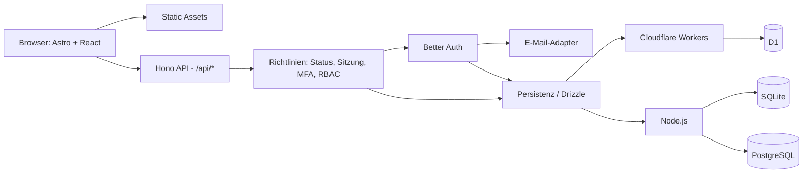

# <picture></picture> Architektur

<a href="../en/architecture.md" lang="en">English</a> | <a href="../es/architecture.md" lang="es">Español</a> | <a href="../pt/architecture.md" lang="pt">Português</a> | <strong>Deutsch</strong> | <a href="../fr/architecture.md" lang="fr">Français</a> | <a href="../it/architecture.md" lang="it">Italiano</a> | <a href="../zh/architecture.md" lang="zh">简体中文</a> | <a href="../ja/architecture.md" lang="ja">日本語</a> | <a href="../hi/architecture.md" lang="hi">हिन्दी</a> | <a href="../ar/architecture.md" lang="ar">العربية</a>

[Technische Dokumentation](README.md) | [Projektübersicht](../README.de.md)

> [!NOTE]
> TBA verwendet standardmäßig Cloudflare Workers mit D1. Dieselbe Oberfläche und Hono-API laufen mit SQLite oder PostgreSQL auch unter Node.js. [Datenbank-Engines](database-engines.md)

TBA verwendet ein einziges Frontend Astro + React und einen einzigen Worker Hono. Astro generiert die Assets und React hydratisiert nur die interaktiven Bildschirme. Nur `/api` und `/api/*` führen zuerst Hono über `run_worker_first: ["/api", "/api/*"]` aus. Cloudflare liefert die Seiten und Dateien direkt über Workers Static Assets; Hono ruft das Binding `ASSETS` nicht auf. Server-Side-Rendering (SSR) ist für den Login oder den Container des Panels nicht erforderlich; diese statischen Dokumente enthalten keine privaten Daten.

`src/server/services/mail.ts`: `local`, `cloudflare`, `resend`. [Mail / Correo](mail-providers.md).

`src/server/auth.ts` erstellt Better Auth auf Anfrage und verwendet den Drizzle-Adapter der gewählten Datenbank-Engine. Es speichert nie Bindings oder Daten aus einer Anfrage in globalen Variablen. `security.ts` wendet die Autorisierungsrichtlinien an. `policy.ts` enthält den Katalog der Berechtigungen und die Einschränkungen der öffentlichen Rollen. `database/schema.ts` beschreibt das Schema und `drizzle/*.sql` enthält die ausführbaren Migrationen.

Better Auth verwaltet Benutzer, Sitzungen, Konten, Überprüfungen und TOTP. Seine offiziellen Felder der festen Version werden beibehalten, einschließlich `verified`, `failedVerificationCount` und `lockedUntil` von Two Factor. Das Feld `password` der Tabelle `account` gehört zum offiziellen Schema; der Passwortanbieter ist deaktiviert und seine Endpunkte werden nicht veröffentlicht.

Die zusätzlichen Tabellen enthalten Rollen, Konfigurationen, Anfragen, Audits, MFA-Bestätigungen pro Sitzung und widerrufbares Vertrauen pro Gerät. Die anfänglichen Rollen sind Administrator, Editor und Betrachter; Editor und Betrachter starten nur mit `app.read`. Jede Anwendung fügt ihre Geschäftsberechtigungen hinzu, ohne die Identitätskontrollen zu ändern.

Die Dokumente des Panels sind öffentlich als leere Container; die APIs erfordern eine aktive Sitzung, eine verifizierte E-Mail-Adresse, ein aktives Konto, einen zweiten Faktor, wenn erforderlich, und eine Berechtigung. Das Verstecken von Menüs in React ist nur eine Navigationsverbesserung. Der Worker validiert jede Operation erneut.

Administrative Änderungen an Benutzern, Rollen und Registrierung benötigen ihre Serverberechtigung und die bestehende Administratorprüfung. Der Sitzungswiderruf unter `/api/private/users/:id/revoke` benötigt `users.edit` ohne zusätzliche Administratorprüfung. Endgültiges Löschen benötigt außerdem `users.deactivate`, verbietet Selbstlöschung und schützt den letzten aktiven Administrator. Siehe [Sicherheit](security.md). `Admin.tsx` setzt das Panel zusammen; `admin/useAdminController.tsx` verwaltet Zustand und Anfragen, `usePanelHistory.ts` den Verlauf, `AdminDialogs.tsx` die Dialoge und `BasicListViews.tsx` begrenzte Listen. `server/basic-lists.ts` liefert Seiten mit 20 Zeilen und Vor/Zurück ohne erweiterten Tabellenmotor.

Die Konfiguration verwendet ein einziges Register in der Datenbank; ein Moduswechsel erfordert keine erneute Bereitstellung. Der letzte aktive Administrator und die reservierte Rolle werden durch Trigger geschützt, einschließlich gleichzeitiger Änderungen.

Es gibt keine Multi-Tenancy, Organisationen, Arbeitsbereiche, Abrechnung, Sitzungs-Föderation, aktives R2 oder Multi-Agent-Infrastruktur. Jede Installation hat eine eigene Laufzeit, Datenbank, Benutzer, Sitzungen und Geheimnisse.

## Statisches Routing und Sicherheit

Der Einstiegspunkt `src/server/index.ts` registriert die Module von `src/server/routes/` über eine einzige Hono-Instanz, in der ursprünglichen Reihenfolge. `src/server/http.ts` sammelt die gemeinsam genutzten Helfer. Alle Handler wurden auditiert: öffentliche Konfiguration, Senden und Überprüfen von OTP, Sitzung, MFA-Herausforderung, private Operationen und Better Auth stehen unter `/api/`. Der OAuth-Callback ist `/api/auth/callback/google`. `/login/complete/` ist eine statische Astro-Seite, die `/api/session` abfragt; sie verarbeitet keinen OAuth auf dem Server. Es gibt keine dynamischen Endpunkte außerhalb von `/api`.

Die Seiten `/`, `/login/`, `/login/complete/`, `/denied/`, `/admin/` und ihre sieben Ansichten werden während des Build-Prozesses generiert. Die administrativen Container enthalten keine privaten Daten. Abfragen und Mutationen gehen durch die API mit denselben Sitzungs-, Status-, E-Mail-Überprüfungs-, MFA- und RBAC-Prüfungen. Die direkte Navigation und die Neuladung dienen demselben HTML wie eine normale Navigation.

`public/_headers` wird zu `dist/_headers` kopiert und wendet die gleichen Sicherheitsheader wie Hono auf die Antworten von Static Assets an. Hono behält `secureHeaders` für die API bei, zusätzlich zu `Cache-Control: no-store`. Die Tests vergleichen beide Richtlinien, um Unterschiede zu erkennen. CSP, Cookies und Authentifizierungslogik werden beibehalten. Nur Dateien mit versioniertem Namen von `/_astro/` verwenden `Cache-Control: public, max-age=31536000, immutable`; HTML und nicht versionierte Ressourcen behalten ihre übliche Revalidierung bei. `_headers` ist Metadaten von Cloudflare und wird nicht als herunterladbare Datei veröffentlicht.

`not_found_handling: "404-page"` wird beibehalten, ohne SPA-Fallback. Wenn eine Anfrage, die nicht zur API gehört, bei Hono ankommt, gibt sie 404 zurück und fragt `ASSETS` nicht ab. Ableitungen, die SSR, Callbacks außerhalb von `/api/` oder andere dynamische Handler einbeziehen, müssen die Muster in beiden Konfigurationen erweitern und Tests hinzufügen, bevor sie bereitgestellt werden. Private Daten sollten nicht in vorgerendertem HTML enthalten sein, und sensible Dateien sollten nicht innerhalb von `public` oder `dist` veröffentlicht werden.

Die Tests von `tests/assets.test.ts` kompilieren Astro und den Worker mit Wrangler, führen den tatsächlichen Router von Static Assets in Miniflare/workerd aus und zählen Aufrufe über eine exklusive Bindung des lokalen Harness. Diese Bindung existiert weder in der Konfiguration noch in der Bereitstellung. Eine künstliche statische Kollision unter `/api/private/users` überprüft, dass die Datei die Authentifizierung nicht umgehen kann. Für diese Tests sind keine neuen Abhängigkeiten oder Remote-Ressourcen erforderlich.

Referenzen: [selektive Routen](https://developers.cloudflare.com/workers/static-assets/routing/worker-script/) und [Header von Static Assets](https://developers.cloudflare.com/workers/static-assets/headers/).

Die grundlegende Rolle behält ihre stabile ID `viewer` bei. Die Antworten der Rollen und die Referenzen der Audit-Protokolle zeigen den historischen Namen "Abfrage" als "Viewer" an, ohne vorhandene Daten zu überschreiben oder bereits angewendete Migrationen durchzuführen. Bei offener Registrierung wählt der Administrator die anfängliche Rolle aus allen konfigurierten Rollen aus; die API validiert die Wahl und erfordert eine explizite Bestätigung. Der Besucher erhält die konfigurierte Rolle, wenn er seine E-Mail-Adresse überprüft, und kann sie nicht auswählen. Die offene Registrierung ist nicht automatisch aktiviert. Siehe [Registrierung und Rollenauswahl](registration.md).

Das Seitenmenü kann auf dem Desktop reduziert werden und behält die visuelle Präferenz in `localStorage` bei. Die reduzierten Navigationsbuttons behalten zugängliche Namen und Hilfen mit dem Titel bei. Auf mobilen Geräten wird das vollständige Menü beibehalten. Das SVG-Favicon reproduziert das Symbol der Schichten des Logos und verwendet die für die Anwendung definierte primäre Farbe.

## Verwaltungstabellen

Grundlegende Benutzer-, Anfrage- und Auditlisten bleiben mit begrenzter Navigation und serverseitigen Berechtigungen erhalten. Erweiterte Tabellenmodule und Excel gehören nicht zur Basis. Projekte ergänzen sie bei Bedarf. Siehe [Umfang](template-scope.md).

## Navigationspanel

Das administrative React-Component behält das Menü und den sichtbaren Bildschirm bei, während es das nächste Ziel lädt. Die History-API behält Zurück und Vorwärts ohne ein weiteres Astro-Dokument oder erneutes Hydratisieren von React bei. Der Übergang wird bestätigt, wenn die Daten und Antworten empfangen werden, und abgebrochene Antworten können das aktuelle Ziel nicht ersetzen. Ein feiner und verzögerter Indikator im Header ersetzt den "Inhalte laden"-Bildschirm. Die Steuerungen des vorherigen Inhalts werden inert, während das Ziel gewechselt wird. Direkte Links, Neuladungen und Klicks mit Modifikatoren werden beibehalten.

Private Lesevorgänge, die `context=1` enthalten, geben ihre Daten zusammen mit `_context` zurück, einer Präsentationsprojektion des bereits autorisierten Akteurs. Benutzer und Anfragen können das Rollenverzeichnis über `includeRoles=1` einbeziehen, mit der gleichen Autorisierung wie ihr Endpunkt. Es gibt keine separate Anfrage für `/api/session` oder Rollen, wenn jede Ansicht geöffnet wird. Das empfangene Verzeichnis ermöglicht es auch, Rollen ohne weitere Anfrage zu öffnen, solange es gültig ist. Profil und Sicherheit verwenden die gleiche Profil-Lesevorgang.

`ViewCache` bewahrt bis zu acht Präsentationsantworten innerhalb des Komponenten, die für dreißig Sekunden wiederverwendbar sind. Das Lesen einer Eingabe verlängert ihre Gültigkeit nicht. Sie werden nicht in localStorage, sessionStorage, Service Worker oder gemeinsamem Cache gespeichert. Mutationen, QR-, TOTP-Samensätze und Wiederherstellungscode werden nicht zwischengespeichert. Sie werden nach Mutationen, Änderungen des Identitäts-/Berechtigungskontexts, Zugriffsverweigerung, Abmeldung und BFCache-Übergängen ungültig. Beim Tab- oder Fensterwechsel bleibt die angezeigte Ansicht erhalten. Die Gültigkeit wird beim Lesen eines Cache-Eintrags geprüft. Es gibt keine periodischen Umfragen oder Vorladung aller Seiten.

Der Kontext und der Cache repräsentieren nur Daten, die diese Person bereits erhalten hat. Jede neue private Anfrage wendet aktuelle Serverkontrollen an; sie gewähren keine Autorisierung und ermöglichen es nicht, eine Widerrufung zu umgehen. HTTP-Antworten verwenden `Cache-Control: no-store`.

Das erste administrative Rendering ist sowohl im von Astro generierten HTML als auch während der Hydratation leer. `Admin` montiert weder Menü, Kopfzeile, Titel, Formulare noch Ladezustand, bis die autorisierte private Antwort mit ihrem Kontext und Daten erhalten wird. Während einer Umleitung gibt es auch eine leere Ausgabe. Es wird keine Sitzungsanfrage hinzugefügt: Die gleiche vorhandene kombinierte Lektüre wird verwendet. Ein endgültiger Berechtigungs- oder Dienstfehler zeigt eine minimale öffentliche Warnung mit Wiederholung außerhalb der administrativen Struktur an. Die interne Navigation einer bereits bestätigten Sitzung bewahrt den vorherigen Inhalt und den Cache wie zuvor.

Das Panel behandelt den Verlust einer Sitzung zentralisiert: Bei einem 401 löscht es Daten, Cache und transitorische Geheimnisse der Schnittstelle und verwendet `location.replace("/login/")`. Die bestätigte Abmeldung löscht auch diesen Zustand und ersetzt den Eintrag im Verlauf. Bevor ein Dokument im BFCache gespeichert wird, wird sein Panel synchron ausgeblendet und seine Dialoge geschlossen. Wenn der Browser es wiederherstellt, wird sein privater Zustand verworfen und nur die aktuelle Ansicht abgefragt; ein normaler `pageshow` fügt keine Anfragen hinzu. 403-Berechtigungsfehler bleiben auf dem Bildschirm, `MFA_REQUIRED` führt zum MFA-Schritt und `RECENT_AUTH_REQUIRED` bewahrt die explizite Identitätsbestätigung. APIs behalten ihre Zustände und JSON-Antworten bei; die Umleitung erfolgt im Frontend des Panels, ohne den Worker zum Servieren von HTML auszuführen.

Alle Bestätigungen des Panels verwenden das gleiche zugängliche Dialogfeld der Anwendung: Zugriffsänderungen, Sitzungswiderruf, Genehmigung oder Ablehnung von Anfragen, Widerruf von Vertrauen, Deaktivierung von MFA und Erneuerung von Wiederherstellungen. Es werden keine `window.confirm`, `alert` oder `prompt` verwendet. Sie zeigen die Person und die Folgen vor dem Senden der Mutation an; Abbrechen bewahrt das Formular. Der E-Mail-Fluss trennt die Adresse, OTP und den zweiten Faktor, mit einem expliziten Ergebnis und einem späteren Eintrag mit der neuen E-Mail.

## Panelmodule

Im wiederverwendbaren Paket sind Navigation, Datenladen/Zustand und Verwaltungsansichten zu trennen. Gemeinsames Design und Sprache bleiben erhalten. Der QR-Generator wird erst für die MFA-Einrichtung geladen; daraus entsteht keine Excel-Abhängigkeit.

Englisch bleibt als Fallback enthalten. Weitere Login- und Panelkataloge werden dynamisch importiert und pro Modul im Speicher gehalten. Tastatur- oder Zeigerfokus lädt nur die betreffende Option vor; das Menü lädt nicht alle Sprachen. Der Wechsel erfolgt erst mit vollständigen Katalogen und erhält Formulare, Sitzung und Navigation. Zwischengespeicherte Wechsel benötigen kein Netz; die letzte Auswahl gilt. Ein anfänglicher Ladefehler zeigt Englisch, ein späterer Fehler erhält die aktuelle Sprache. E-Mails und Build-Metadaten verwenden vollständige Serverkataloge. Siehe [Sprachladen](language-loading.md).

Das Panel ruft Daten beim Navigieren, beim manuellen Aktualisieren oder nach relevanten Änderungen ab. Inaktivität, Fokuswechsel, Tabwechsel und der Ablauf des Caches lösen allein keine Anfragen aus. Beim Wiederherstellen aus dem BFCache wird der Zugriff vor der Anzeige privater Daten erneut geprüft.
