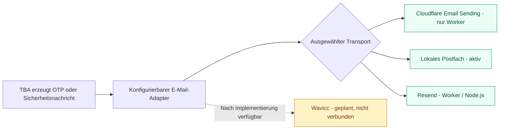

# <picture></picture> Transaktions-E-Mail und Anbieterunabhängigkeit

<a href="../en/mail-providers.md" lang="en">English</a> | <a href="../es/mail-providers.md" lang="es">Español</a> | <a href="../pt/mail-providers.md" lang="pt">Português</a> | <strong>Deutsch</strong> | <a href="../fr/mail-providers.md" lang="fr">Français</a> | <a href="../it/mail-providers.md" lang="it">Italiano</a> | <a href="../zh/mail-providers.md" lang="zh">简体中文</a> | <a href="../ja/mail-providers.md" lang="ja">日本語</a> | <a href="../hi/mail-providers.md" lang="hi">हिन्दी</a> | <a href="../ar/mail-providers.md" lang="ar">العربية</a>

[Technische Dokumentation](README.md) | [Projektübersicht](../README.de.md)

> [!NOTE]
> **TBA setzt keinen bestimmten kommerziellen E-Mail-Anbieter voraus.** Die Authentifizierung erzeugt OTPs und Sicherheitsbenachrichtigungen; ein Adapter liefert sie über den für jede Anwendung ausgewählten Dienst aus. Diese Auswahl verändert keine Authentifizierungs-, Sitzungs- oder MFA-Regeln.

## Anbieter und tatsächlicher Implementierungsstand

| Transport | Status | Voraussetzungen |
| :--- | :--- | :--- |
| Cloudflare Email Sending | **Implementiert** | `MAIL_PROVIDER=cloudflare`, `EMAIL`-Binding und bestätigter `MAIL_FROM`-Absender |
| Lokales Entwicklungs-Postfach | **Für lokale Nutzung implementiert** | `MAIL_PROVIDER=local`, lokaler Ursprung und `npm run mail:dev` |
| Resend | **Implementiert** | `MAIL_PROVIDER=resend`, `RESEND_API_KEY`, `MAIL_FROM` |
| Wavicc | **Bevorzugte künftige Rounver-Integration; nicht implementiert** | `WAVICC_API_KEY` ist ein Platzhalter; getesteter Adapter und verifizierter API-Vertrag fehlen |
| Beliebiger anderer Transaktionsdienst | **Über Adapter möglich; nicht automatisch** | Transport für den gewählten Dienst entwickeln und testen |

## Architektur des E-Mail-Versands

## Derzeit funktionierende Konfiguration

Setup unterstützt `--mail local`, `--mail resend` und `--mail cloudflare`. Lokal werden eine lokale `APP_URL` und `npm run mail:dev` verwendet. Resend benötigt `RESEND_API_KEY` und `MAIL_FROM`. Cloudflare nutzt den bestehenden Adapter und benötigt ein `send_email`-Binding namens `EMAIL`, einen erlaubten `MAIL_FROM` und eine eingerichtete Versanddomain. Setup prüft lokal, ohne Ressourcen anzulegen oder entfernte Domains zu prüfen. Fehlendes kann später ergänzt werden: interaktiv wird nach Fortsetzung gefragt, nicht interaktiv mit einer Aufgabenliste fortgefahren. Binding, Absender und Zugangsdaten werden nicht erfunden; bis zur Konfiguration erfolgt kein Versand. Geheimnisse gehören nicht in Git. Wavicc bleibt die bevorzugte künftige Integration mit `WAVICC_API_KEY` als Platzhalter. Siehe [Mail-Setup](setup-mail.md).

## Wavicc: bevorzugte künftige Integration

Wavicc ist die **bevorzugte Rounver-Integration, sobald die Transaktions-E-Mail-API bereitsteht**. `.dev.vars.example` enthält `WAVICC_API_KEY=` ausschließlich als Platzhalter für einen zukünftigen Geheimnisnamen. **TBA liest diesen Wert derzeit nicht. `MAIL_PROVIDER=wavicc` darf noch nicht eingestellt werden; ein API-Endpunkt darf nicht vorausgesetzt werden.**

## Einen weiteren Dienst sicher anbinden

**Vor der Aktivierung eines neuen Anbieters:**

1. Die reale Versand-API, Authentifizierung und benötigten Nachrichtenfelder prüfen.
2. Einen anbieterspezifischen Adapter entwickeln, ohne funktionierende Wege zu entfernen.
3. Zugangsdaten in einem zugelassenen Geheimnisspeicher hinterlegen und einen bestätigten Absender einrichten.
4. OTP-Zustellung, Ablauf, Wiederholungen, Fehlerbehandlung und Benachrichtigungsfehler testen.
5. Setup und Bereitstellungsprüfungen erst nach funktionierender Implementierung erweitern.
6. Den Anbieter für eine bestimmte Anwendung auswählen und nur mit ausdrücklicher Genehmigung bereitstellen.

## Geheimnisse und sichere Umstellung

In `.dev.vars.example` dürfen **keine echten Zugangsdaten** stehen. Für Schlüssel sind lokale `.dev.vars` (von Git ignoriert) oder Wrangler Secrets vorgesehen; `MAIL_FROM` benötigt eine bestätigte Adresse. `CUSTOM_MAIL_API_KEY=` ist ebenfalls nur ein Platzhalter. Die alte API-Schlüsselvariable bleibt nur aus Kompatibilitätsgründen erhalten und ist keine Empfehlung.

Das gemeinsame HTML besitzt eine Klartextalternative und keine externen Bilder, Schriften oder Tracking. Es umfasst Zugangs-/Registrierungs-OTP, neue Adresse, MFA-Einrichtungsbestätigung, Adressänderung, Anfragen und Genehmigungen. Der Markenname folgt `APP_NAME`; die allgemeine Anwendung heißt TBA. Ablauf und Authentifizierungsregeln der Codes bleiben erhalten.

`X-Auth-Language` wählt eine aktivierte E-Mail-Sprache, niemals Berechtigungen. Ohne gültigen Header oder Empfängerpräferenz gilt der konfigurierte Standard (anfangs Englisch). Deaktivierte gespeicherte Sprachen fallen ebenfalls darauf zurück. Fehlende Schlüssel verwenden Englisch. Bestätigter Zugang/Registrierung und die Panelauswahl speichern die Präferenz in `verification` (`mail-language:<userId>`); spätere Mitteilungen verwenden die Empfängersprache. Sprachwechsel versenden keine Codes erneut und ändern weder Ablauf noch Versuche oder Prüfung. Frühere Fehlertexte bleiben kompatibel.
