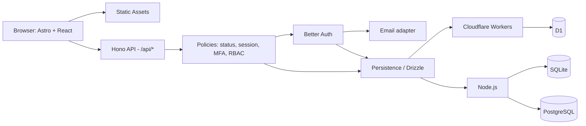

# <picture></picture> Architecture

<strong>English</strong> | <a href="../es/architecture.md" lang="es">Español</a> | <a href="../pt/architecture.md" lang="pt">Português</a> | <a href="../de/architecture.md" lang="de">Deutsch</a> | <a href="../fr/architecture.md" lang="fr">Français</a> | <a href="../it/architecture.md" lang="it">Italiano</a> | <a href="../zh/architecture.md" lang="zh">简体中文</a> | <a href="../ja/architecture.md" lang="ja">日本語</a> | <a href="../hi/architecture.md" lang="hi">हिन्दी</a> | <a href="../ar/architecture.md" lang="ar">العربية</a>

[Technical documentation](README.md) | [Project overview](../../README.md)

> [!NOTE]
> TBA uses Cloudflare Workers with D1 by default. The same frontend and Hono API also run on Node.js with SQLite or PostgreSQL. [Database engines](database-engines.md)

TBA uses one Astro + React frontend and one Hono application. On Workers, that application is the API entry point. On Node.js, the standalone runtime also serves the static build. Astro generates the assets and React hydrates only the interactive screens. Only `/api` and `/api/*` execute Hono first via `run_worker_first: ["/api", "/api/*"]`. Cloudflare delivers the pages and existing files directly via Workers Static Assets; Hono does not call the binding `ASSETS`. No SSR is needed for login or the panel container; those static documents do not contain private data.

`src/server/services/mail.ts`: `local`, `cloudflare`, `resend`. [Mail / Correo](mail-providers.md).

`src/server/auth.ts` builds Better Auth on demand using the Drizzle adapter for the selected engine. `database/persistence.ts` shares bound commands and transaction contracts. SQLite and PostgreSQL use the isolated Node runtime. The Worker bundle excludes Node runtimes and drivers. `security.ts` applies the authorization policies. `policy.ts` contains the permission catalog and public role restrictions. `database/schema.ts` describes the schema and `drizzle/*.sql` contains the executable migrations.

Better Auth manages users, sessions, accounts, verifications, and TOTP. Its official fixed-version fields are preserved, including `verified`, `failedVerificationCount`, and `lockedUntil` from Two Factor. The `password` field of the `account` table belongs to the official schema; the password provider is disabled and its endpoints are not exposed.

The additional tables contain roles, configuration, requests, auditing, MFA confirmation per session, and revocable trust per device. The initial roles are Administrator, Editor, and Viewer; Editor and Viewer start only with `app.read`. Each application adds its business permissions without modifying the identity controls.

The panel documents are public as empty containers; the APIs require an active session, verified email, active account, second factor when applicable, and permission. Hiding menus in React is just a navigation improvement. The Worker re-validates each operation.

Administrative changes to users, roles and registration require their server permission and the existing Administrator guard. Session revocation at `/api/private/users/:id/revoke` requires `users.edit` without an additional Administrator guard. Permanent deletion also requires `users.deactivate`, forbids self-deletion and preserves the last active administrator. See [security](security.md) for the exact controls. `Admin.tsx` composes the panel; `admin/useAdminController.tsx` owns state and requests, `usePanelHistory.ts` handles history, `AdminDialogs.tsx` contains dialogs, and `BasicListViews.tsx` renders bounded lists. `server/basic-lists.ts` provides 20-row pages with previous/next navigation and no advanced table engine.

The configuration uses a single record in the database; a mode change does not require redeployment. The last active administrator and the reserved role are protected with triggers, including concurrent changes.

There is no multi-tenancy, organizations, workspaces, billing, session federation, active R2, or multi-agent infrastructure. Each installation has its own runtime, database, users, sessions and secrets.

## Static Routing and Security

The entry point `src/server/index.ts` registers the `src/server/routes/` modules over the same Hono instance, in the original order. `src/server/http.ts` gathers the shared helpers. All handlers were audited: public configuration, sending and verifying OTP, session, MFA challenge, private operations, and Better Auth are under `/api/`. The OAuth callback is `/api/auth/callback/google`. `/login/complete/` is a static Astro page that queries `/api/session`; it does not process OAuth on the server. There are no dynamic endpoints outside of `/api`.

The pages `/`, `/login/`, `/login/complete/`, `/denied/`, `/admin/`, and their seven views are generated during the build. The administrative containers do not include private data. The queries and mutations go through the API with the same session, state, verified email, MFA, and RBAC checks. Direct navigation and reload serve the same HTML as normal navigation.

`public/_headers` is copied to `dist/_headers` and applies the same security headers as Hono to Static Assets responses. Hono keeps `secureHeaders` for the API, in addition to `Cache-Control: no-store`. Tests compare both policies to detect differences. CSP, cookies, and authentication logic are preserved. Only version-named files of `/_astro/` use `Cache-Control: public, max-age=31536000, immutable`; unversioned HTML and resources maintain their usual revalidation. `_headers` is Cloudflare metadata and is not published as a downloadable file.

`not_found_handling: "404-page"` is preserved, without SPA fallback. If a non-API request reaches Hono, it returns 404 and does not consult `ASSETS`. Derivatives that incorporate SSR, callbacks outside of `/api/`, or other dynamic handlers must extend patterns in both configurations and add tests before deploying. Do not include private data in pre-rendered HTML or publish sensitive files within `public` or `dist`.

`tests/assets.test.ts` tests compile Astro and the Worker with Wrangler, run the real Static Assets router in Miniflare/workerd, and count invocations through an exclusive binding of the local harness. That binding does not exist in the configuration or deployment. An artificial static collision under `/api/private/users` verifies that the file cannot bypass authentication. No new dependencies or remote resources are required for these tests.

References: [selective routing](https://developers.cloudflare.com/workers/static-assets/routing/worker-script/) and [Static Assets headers](https://developers.cloudflare.com/workers/static-assets/headers/).

The basic role preserves its stable identifier `viewer`. Role responses and audit references present the historical name "Consulta" as "Visualizador", without rewriting existing data or already applied migrations. In open registration, the administrator selects the initial role among all configured roles; the API validates the choice and requires explicit confirmation. The visitor receives the configured role when verifying their email and cannot choose it. Open registration is not enabled automatically. See [registration and role selection](registration.md).

The side menu can be collapsed on desktop and preserves the visual preference in `localStorage`. Collapsed navigation buttons maintain accessible names and help with the title. On mobile, the full menu is preserved. The SVG favicon reproduces the logo's layer symbol and uses the primary color defined for the application.

## Management Tables

Basic user, request and audit lists remain available with bounded navigation and server-side permissions. Advanced table engines and Excel export are outside the base template; each derivative implements them if needed. See [template scope](template-scope.md).

## Panel Navigation

The administrative React component preserves the menu and visible screen while loading the next destination. History API maintains Back and Forward without requesting another Astro document or rehydrating React again. The transition is confirmed upon receiving the data, and canceled responses cannot replace the current destination. A fine and deferred indicator in the header replaces the "Loading content" screen. Controls of the previous content become inert while changing destinations. Direct links, reloads, and clicks with modifiers are preserved.

Private readings that include `context=1` return their data along with `_context`, a presentation projection of the already authorized actor. Users and Requests can include the role catalog through `includeRoles=1`, with the same authorization as their endpoint. There is no separate request for `/api/session` or roles when opening each view. The received catalog also allows opening Roles without another request while it is valid. Profile and Security reuse the same profile reading.

A protected request checks the session and authorization version together. A valid versioned snapshot supplies permissions without re-reading the role. If the version changes, the backend rebuilds the snapshot atomically.

`ViewCache` keeps up to eight presentation responses within the component, reusable for thirty seconds. Reading an entry does not extend its validity. They are not stored in localStorage, sessionStorage, Service Worker, or shared cache. Mutations, QR, TOTP seeds, and recovery codes are not cached. They are invalidated after mutations, changes in identity/permission context, access rejection, logout, and BFCache transitions. Ordinary tab and window changes preserve the displayed view. Expiration is evaluated when an entry is read from the cache. There are no periodic polls or preloading of all pages.

The context and cache only represent data already received by that person. Each new private request applies current server controls; they do not confer authorization nor allow bypassing a revocation. HTTP responses continue using `Cache-Control: no-store`.

The first administrative render is empty both in the HTML generated by Astro and during hydration. `Admin` does not mount the menu, header, title, forms, or loading state until receiving the authorized private response with its context and data. During a redirect, it also returns an empty output. A session query is not added: the existing combined reading is used. A definitive permission or service error shows a minimal public notice, with retry, outside the administrative structure. Internal navigation of a confirmed session preserves the previous content and its cache as before.

The panel treats session loss in a centralized manner: in the face of a 401, it cleans interface data, cache, and transient secrets and uses `location.replace("/login/")`. Confirmed logout also cleans this state and replaces the history entry. Before saving a document in BFCache, its panel is synchronously hidden and its dialogs are closed. If the browser restores it, its private state is discarded and only the current view is queried again; a normal `pageshow` does not add requests. 403 permission errors remain on the screen, `MFA_REQUIRED` leads to the MFA step, and `RECENT_AUTH_REQUIRED` preserves explicit identity confirmation. APIs maintain their states and JSON responses; the redirect occurs in the panel frontend, without executing the Worker to serve HTML.

All panel reconfirmations use the same accessible application dialog: access changes, session revocation, approval or rejection of requests, trust revocation, MFA deactivation, and recovery renewal. `window.confirm`, `alert`, or `prompt` are not used. They show the person and consequences before sending the mutation; canceling preserves the form. The email flow separates address, OTP, and second factor, with explicit result and subsequent entry with the new email.

## Panel Modules

Keep navigation, data loading/state and administrative views separate in the reusable package. Preserve the shared design and language preference. Load the QR generator only when MFA setup needs it; this does not imply an Excel dependency.

English stays bundled as the fallback. Other access and panel catalogs use dynamic imports and an in-memory cache per namespace. Pointer or keyboard focus on a language option starts loading that option; opening the menu does not fetch all languages. A change commits only when its catalogs are ready, keeping forms, session and navigation mounted. Cached changes need no network; the last selection wins. An initial loading failure reveals English; a failure during a change preserves the current language. Transactional email and build-time metadata use complete server-only catalogs, independent of the browser cache. See [language loading](language-loading.md).

The panel fetches data on navigation, an explicit refresh, or a relevant change. Idle time, focus changes, switching tabs and cache expiry alone do not trigger background requests. Restoring a document from BFCache revalidates access before showing private data.
