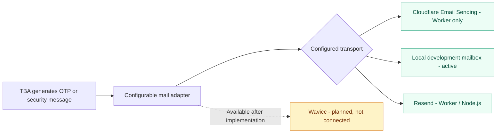

# <picture></picture> Transactional email and provider independence

<strong>English</strong> | <a href="../es/mail-providers.md" lang="es">Español</a> | <a href="../pt/mail-providers.md" lang="pt">Português</a> | <a href="../de/mail-providers.md" lang="de">Deutsch</a> | <a href="../fr/mail-providers.md" lang="fr">Français</a> | <a href="../it/mail-providers.md" lang="it">Italiano</a> | <a href="../zh/mail-providers.md" lang="zh">简体中文</a> | <a href="../ja/mail-providers.md" lang="ja">日本語</a> | <a href="../hi/mail-providers.md" lang="hi">हिन्दी</a> | <a href="../ar/mail-providers.md" lang="ar">العربية</a>

[Technical documentation](README.md) | [Project overview](../../README.md)

> [!NOTE]
> **TBA does not require a particular commercial email provider.** The authentication module generates OTP and security notifications; the mail adapter sends them through the provider selected for each independent application. Choosing a provider does not change the rules for authentication, sessions or MFA.

## Providers and actual implementation

| Transport | Status | Requirements |
| :--- | :--- | :--- |
| Cloudflare Email Sending | **Implemented** | `MAIL_PROVIDER=cloudflare`, `EMAIL` binding and verified `MAIL_FROM` |
| Local development inbox | **Implemented for local use** | `MAIL_PROVIDER=local`, local app origin and `npm run mail:dev` |
| Resend | **Implemented** | `MAIL_PROVIDER=resend`, `RESEND_API_KEY`, `MAIL_FROM` |
| Wavicc | **Rounver's preferred future integration; not implemented** | `WAVICC_API_KEY` is a placeholder; a tested adapter and verified API contract are still needed |
| Any other transactional service | **Possible through an adapter; not automatic** | Implement and test a transport for the selected service |

## Mail delivery architecture

## Configuration that works today

Setup supports `--mail local`, `--mail resend` and `--mail cloudflare`. Local mail uses a local `APP_URL` and `npm run mail:dev`. Resend needs `RESEND_API_KEY` and `MAIL_FROM`. Cloudflare reuses the existing adapter and needs a `send_email` binding named `EMAIL`, an allowed `MAIL_FROM` and an onboarded sending domain. Setup checks local requirements without provisioning or verifying a remote domain. Missing configuration can be completed later: interactive setup asks whether to continue; noninteractive setup continues with a pending checklist. It does not invent a binding, sender or credential, and email cannot be delivered until configured. Keep secrets outside Git. Wavicc remains the preferred future integration and `WAVICC_API_KEY` a placeholder. See [mail setup](setup-mail.md).

## Wavicc: preferred future integration

Wavicc is Rounver's **preferred integration once its transactional-email API is ready**. `.dev.vars.example` includes `WAVICC_API_KEY=` only to document the future secret name. **TBA does not read this key today. Do not set `MAIL_PROVIDER=wavicc` or assume an API endpoint exists.**

## Connecting another service safely

**Before enabling a new provider:**

1. Verify the real sending API, authentication mechanism and required message fields.
2. Implement a provider-specific adapter while retaining the working transports.
3. Store the actual credential in an approved secret store; configure a verified sender.
4. Test OTP delivery, expirations, retry/error behavior and notification failures.
5. Update the setup and deployment validation only after the adapter works.
6. Select the new provider for a specific application and deploy only with explicit approval.

## Secrets and safe rollout

Keep `.dev.vars.example` **without real credentials**. Use local `.dev.vars` (ignored by Git) or Wrangler Secrets for actual API keys, and configure `MAIL_FROM` with a verified address. `CUSTOM_MAIL_API_KEY=` is also just a placeholder for a future adapter. The existing legacy API-key variable is retained solely for compatibility, not as a recommended default.

The shared HTML layout has plain-text fallback and no external images, fonts or tracking. It covers access/registration OTP, new-address verification, MFA setup confirmation, changed-address notification, new registration requests and approval notices. Brand text uses configured `APP_NAME`; the generic application is TBA. Codes keep their existing expiry and authentication rules.

`X-Auth-Language` selects an enabled language for email presentation, never permissions. Without a valid header or recipient preference, mail uses the configured application default (English initially). A saved preference for a disabled language also falls back to that default. English remains the fallback for missing translation keys. Verified access/registration and explicit panel selection remember the recipient preference in existing `verification` metadata (`mail-language:<userId>`); deferred notices use the recipient’s language. Changing the interface language does not resend codes or change their expiry, attempts or verification. Legacy error texts remain recognized for compatibility.
