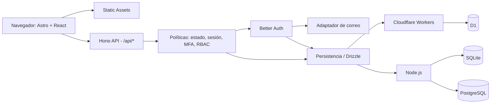

# <picture></picture> Arquitectura

<a href="../en/architecture.md" lang="en">English</a> | <strong>Español</strong> | <a href="../pt/architecture.md" lang="pt">Português</a> | <a href="../de/architecture.md" lang="de">Deutsch</a> | <a href="../fr/architecture.md" lang="fr">Français</a> | <a href="../it/architecture.md" lang="it">Italiano</a> | <a href="../zh/architecture.md" lang="zh">简体中文</a> | <a href="../ja/architecture.md" lang="ja">日本語</a> | <a href="../hi/architecture.md" lang="hi">हिन्दी</a> | <a href="../ar/architecture.md" lang="ar">العربية</a>

[Documentación técnica](README.md) | [Presentación del proyecto](../README.es.md)

> [!NOTE]
> TBA usa Cloudflare Workers con D1 de forma predeterminada. La misma interfaz y API Hono también funcionan en Node.js con SQLite o PostgreSQL. [Motores de base de datos](database-engines.md)

TBA usa una sola interfaz Astro + React y una sola aplicación Hono. En Workers, Hono es la entrada de la API. En Node.js, el entorno independiente también sirve la compilación estática. Astro genera los assets y React hidrata solo las pantallas interactivas. Solo `/api` y `/api/*` ejecutan primero Hono mediante `run_worker_first: ["/api", "/api/*"]`. Cloudflare entrega directamente las páginas y los archivos existentes mediante Workers Static Assets; Hono no llama al binding `ASSETS`. No se necesita SSR para el login o el contenedor del panel; esos documentos estáticos no contienen datos privados.

`src/server/services/mail.ts`: `local`, `cloudflare`, `resend`. [Mail / Correo](mail-providers.md).

`src/server/auth.ts` configura Better Auth por solicitud con el adaptador Drizzle del motor seleccionado. `database/persistence.ts` comparte comandos parametrizados y contratos de transacción. SQLite y PostgreSQL usan el runtime Node aislado. El bundle del Worker excluye el runtime y los drivers Node. `security.ts` aplica las políticas de autorización. `policy.ts` contiene el catálogo de permisos y las restricciones de roles públicos. `database/schema.ts` describe el esquema y `drizzle/*.sql` contiene las migraciones ejecutables.

Better Auth administra usuarios, sesiones, cuentas, verificaciones y TOTP. Sus campos oficiales de la versión fijada se conservan, incluidos `verified`, `failedVerificationCount` y `lockedUntil` de Two Factor. El campo `password` de la tabla `account` pertenece al esquema oficial; el proveedor de contraseñas está deshabilitado y sus endpoints no se exponen.

Las tablas adicionales contienen roles, configuración, solicitudes, auditoría, confirmación MFA por sesión y confianza revocable por dispositivo. Los roles iniciales son Administrador, Editor y Visualizador; Editor y Visualizador arrancan únicamente con `app.read`. Cada aplicación añade sus permisos de negocio, sin modificar los controles de identidad.

Los documentos del panel son públicos como contenedores vacíos; las APIs requieren sesión vigente, correo verificado, cuenta activa, segundo factor cuando corresponde y permiso. Ocultar menús en React es solo una mejora de navegación. El backend vuelve a validar cada operación.

Los cambios administrativos de usuarios, roles y registro requieren su permiso en el servidor y el control existente de Administrador. Revocar sesiones en `/api/private/users/:id/revoke` requiere `users.edit`, sin control adicional de Administrador. La eliminación definitiva también exige `users.deactivate`, impide la autoeliminación y protege al último administrador activo. Consulta los controles exactos en [seguridad](security.md). `Admin.tsx` compone el panel; `admin/useAdminController.tsx` concentra estado y peticiones, `usePanelHistory.ts` gestiona el historial, `AdminDialogs.tsx` contiene los diálogos y `BasicListViews.tsx` presenta listados acotados. `server/basic-lists.ts` ofrece páginas de 20 filas con anterior/siguiente, sin motor avanzado.

La configuración usa un registro único en la base de datos. El cambio de modalidad se aplica sin volver a desplegar. El último administrador activo y el rol reservado se protegen con triggers, incluyendo cambios concurrentes.

No hay multi-tenancy, organizaciones, workspaces, facturación, federación de sesiones, R2 activo ni infraestructura multiagente. Cada instalación usa su propio entorno de ejecución, base de datos, usuarios, sesiones y secretos.

## Enrutamiento estático y seguridad

El punto de entrada `src/server/index.ts` registra los módulos de `src/server/routes/` sobre una misma instancia de Hono, en el orden original. `src/server/http.ts` reúne los helpers compartidos. Se auditaron todos los handlers: configuración pública, envío y verificación OTP, sesión, desafío MFA, operaciones privadas y Better Auth están bajo `/api/`. El callback OAuth es `/api/auth/callback/google`. `/login/complete/` es una página Astro estática que consulta `/api/session`; no procesa OAuth en el servidor. No existen endpoints dinámicos fuera de `/api`.

Las páginas `/`, `/login/`, `/login/complete/`, `/denied/`, `/admin/` y sus siete vistas se generan durante el build. Los contenedores administrativos no incluyen datos privados. Las consultas y mutaciones pasan por la API con las mismas comprobaciones de sesión, estado, correo verificado, MFA y RBAC. La navegación directa y la recarga sirven el mismo HTML que una navegación normal.

`public/_headers` se copia a `dist/_headers` y aplica las mismas cabeceras de seguridad que Hono a las respuestas de Static Assets. Hono conserva `secureHeaders` para la API, además de `Cache-Control: no-store`. Las pruebas comparan ambas políticas para detectar diferencias. Se conservan CSP, cookies y lógica de autenticación. Solo los archivos con nombre versionado de `/_astro/` usan `Cache-Control: public, max-age=31536000, immutable`; HTML y recursos sin versionado mantienen su revalidación habitual. `_headers` es metadato de Cloudflare y no se publica como archivo descargable.

Se conserva `not_found_handling: "404-page"`, sin fallback de SPA. Si una solicitud fuera de la API llega a Hono, devuelve 404 y no consulta `ASSETS`. Los derivados que incorporen SSR, callbacks fuera de `/api/` u otros handlers dinámicos deben ampliar los patrones en ambas configuraciones y agregar pruebas antes de desplegar. No incluir datos privados en HTML prerenderizado ni publicar archivos sensibles dentro de `public` o `dist`.

Las pruebas de `tests/assets.test.ts` compilan Astro y el Worker con Wrangler, ejecutan el router real de Static Assets en Miniflare/workerd y cuentan invocaciones mediante un binding exclusivo del harness local. Ese binding no existe en la configuración ni en el despliegue. Una colisión estática artificial bajo `/api/private/users` verifica que el archivo no pueda evitar la autenticación. No se requieren dependencias nuevas ni recursos remotos para estas pruebas.

Referencias: [enrutamiento selectivo](https://developers.cloudflare.com/workers/static-assets/routing/worker-script/) y [cabeceras de Static Assets](https://developers.cloudflare.com/workers/static-assets/headers/).

El rol básico conserva su identificador estable `viewer`. Las respuestas de roles y las referencias de auditoría presentan el nombre histórico «Consulta» como «Visualizador», sin reescribir datos existentes ni migraciones ya aplicadas. En registro abierto, el administrador selecciona el rol inicial entre todos los roles configurados; la API valida la elección y exige confirmación explícita. El visitante recibe el rol configurado al verificar su correo y no puede elegirlo. No se habilita automáticamente el registro abierto. Ver [registro y selección de rol](registration.md).

El menú lateral puede contraerse en escritorio y conserva la preferencia visual en `localStorage`. Los botones de navegación contraídos mantienen nombres accesibles y ayudas con el título. En móvil se conserva el menú completo. El favicon SVG reproduce el símbolo de capas del logo y usa el color primario definido para la aplicación.

## Tablas de gestión

Se conservan los listados básicos de usuarios, solicitudes y auditoría, con navegación acotada y permisos del servidor. Los motores de tablas avanzadas y Excel quedan fuera del template base; cada derivado los implementa si los necesita. Ver [alcance del template](template-scope.md).

## Navegación del panel

El componente React administrativo conserva el menú y la pantalla visible mientras carga el siguiente destino. History API mantiene Atrás y Adelante sin solicitar otro documento Astro ni hidratar React otra vez. La transición se confirma al recibir los datos y las respuestas canceladas no pueden reemplazar al destino actual. Un indicador fino y diferido en el encabezado reemplaza la pantalla de «Cargando contenido». Los controles del contenido anterior quedan inertes mientras se cambia de destino. Se conservan enlaces directos, recargas y clics con modificadores.

Las lecturas privadas que incluyen `context=1` devuelven sus datos junto con `_context`, una proyección de presentación del actor ya autorizado. Usuarios y Solicitudes pueden incluir el catálogo de roles mediante `includeRoles=1`, con la misma autorización que su endpoint. No hay una petición separada de `/api/session` o roles al abrir cada vista. El catálogo recibido también permite abrir Roles sin otra petición mientras esté vigente. Perfil y Seguridad reutilizan la misma lectura de perfil.

Cada solicitud protegida comprueba en una sola lectura la sesión y la versión de autorización. El snapshot versionado vigente aporta los permisos sin releer el rol. Si cambia la versión, el backend reconstruye el snapshot de forma atómica.

`ViewCache` conserva hasta ocho respuestas de presentación dentro del componente, reutilizables por treinta segundos. La lectura de una entrada no prolonga su vigencia. No se guardan en localStorage, sessionStorage, Service Worker o caché compartida. No se cachean mutaciones, QR, semillas TOTP ni códigos de recuperación. Se invalidan después de mutaciones, cambios del contexto de identidad/permisos, rechazo de acceso, cierre de sesión y transiciones con BFCache. Los cambios de pestaña o ventana conservan la vista visible. El vencimiento se evalúa al consultar una entrada en caché. No hay sondeos periódicos ni precarga de todas las páginas.

El contexto y la caché solo representan datos ya recibidos por esa persona. Cada nueva petición privada aplica controles actuales del servidor; no confieren autorización ni permiten saltarse una revocación. Las respuestas HTTP siguen usando `Cache-Control: no-store`.

El primer render administrativo está vacío tanto en el HTML generado por Astro como durante la hidratación. `Admin` no monta menú, cabecera, título, formularios ni estado de carga hasta recibir la respuesta privada autorizada con su contexto y datos. Durante una redirección también devuelve una salida vacía. No se añade una consulta de sesión: se usa la misma lectura combinada existente. Un error definitivo de permisos o del servicio muestra un aviso público mínimo, con reintento, fuera de la estructura administrativa. La navegación interna de una sesión ya confirmada conserva el contenido anterior y su caché como antes.

El panel trata la pérdida de sesión de forma centralizada: ante un 401 limpia datos, caché y secretos transitorios de la interfaz y usa `location.replace("/login/")`. El cierre de sesión confirmado también limpia ese estado y reemplaza la entrada del historial. Antes de guardar un documento en BFCache se oculta sincrónicamente su panel y se cierran sus diálogos. Si el navegador lo restaura, se descarta su estado privado y se consulta de nuevo únicamente la vista actual; un `pageshow` normal no agrega peticiones. Los 403 de permisos permanecen en la pantalla, `MFA_REQUIRED` conduce al paso MFA y `RECENT_AUTH_REQUIRED` conserva la confirmación explícita de identidad. Las APIs mantienen sus estados y respuestas JSON; la redirección sucede en el frontend del panel, sin ejecutar el Worker para servir HTML.

Todas las reconfirmaciones del panel usan el mismo diálogo accesible de la aplicación: cambios de acceso, revocación de sesiones, aprobación o rechazo de solicitudes, revocación de confianza, desactivación MFA y renovación de recuperación. No se usan `window.confirm`, `alert` o `prompt`. Muestran la persona y las consecuencias antes de enviar la mutación; cancelar conserva el formulario. El flujo de correo separa dirección, OTP y segundo factor, con resultado explícito e ingreso posterior con el correo nuevo.

## Módulos del panel

El paquete reutilizable debe separar navegación, carga/estado y vistas administrativas, conservando el diseño y la preferencia de idioma compartidos. El generador QR se carga cuando el alta MFA lo necesita; no implica una dependencia de Excel.

El inglés permanece incluido como respaldo. Los demás catálogos de acceso y panel usan importaciones dinámicas y caché en memoria por módulo. El foco de teclado o puntero sobre una opción anticipa su carga; abrir el menú no descarga todos los idiomas. El cambio se aplica cuando sus catálogos están listos y conserva formularios, sesión y navegación. Los cambios en caché no requieren red; prevalece la última selección. Ante un fallo inicial se muestra inglés; durante un cambio se mantiene el idioma actual. El correo y los metadatos del build usan catálogos completos solo en servidor. Consulta la [carga de idiomas](language-loading.md).

El panel consulta datos al navegar, actualizar de forma explícita o realizar un cambio pertinente. La inactividad, los cambios de foco, el cambio de pestaña y el vencimiento de la caché por sí solos no generan solicitudes. Al restaurar un documento desde BFCache, el panel vuelve a validar el acceso antes de mostrar datos privados.
