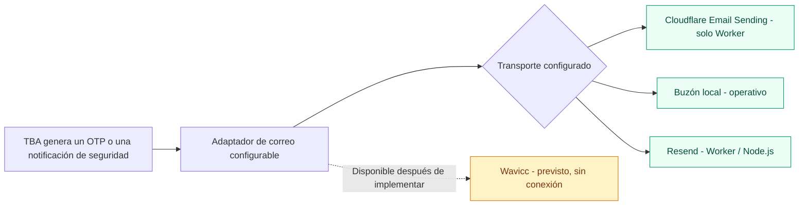

# <picture></picture> Correo transaccional e independencia del proveedor

<a href="../en/mail-providers.md" lang="en">English</a> | <strong>Español</strong> | <a href="../pt/mail-providers.md" lang="pt">Português</a> | <a href="../de/mail-providers.md" lang="de">Deutsch</a> | <a href="../fr/mail-providers.md" lang="fr">Français</a> | <a href="../it/mail-providers.md" lang="it">Italiano</a> | <a href="../zh/mail-providers.md" lang="zh">简体中文</a> | <a href="../ja/mail-providers.md" lang="ja">日本語</a> | <a href="../hi/mail-providers.md" lang="hi">हिन्दी</a> | <a href="../ar/mail-providers.md" lang="ar">العربية</a>

[Documentación técnica](README.md) | [Presentación del proyecto](../README.es.md)

> [!NOTE]
> **TBA no exige utilizar un proveedor comercial de correo específico.** El módulo de autenticación genera los códigos OTP y las notificaciones de seguridad; el adaptador de correo los entrega mediante el servicio elegido para cada aplicación independiente. La selección del proveedor no modifica las reglas de autenticación, sesiones ni MFA.

## Proveedores y estado real de implementación

| Transporte | Estado | Requisitos |
| :--- | :--- | :--- |
| Cloudflare Email Sending | **Implementado** | `MAIL_PROVIDER=cloudflare`, binding `EMAIL` y remitente `MAIL_FROM` verificado |
| Buzón local de desarrollo | **Implementado para uso local** | `MAIL_PROVIDER=local`, origen local de la aplicación y `npm run mail:dev` |
| Resend | **Implementado** | `MAIL_PROVIDER=resend`, `RESEND_API_KEY`, `MAIL_FROM` |
| Wavicc | **Integración futura preferida de Rounver; no implementada** | `WAVICC_API_KEY` es un ejemplo reservado; falta un adaptador probado y el contrato de API verificado |
| Cualquier otro servicio transaccional | **Posible mediante un adaptador; no automático** | Implementar y probar el transporte del servicio elegido |

## Arquitectura de entrega de correo

## Configuración funcional actual

El setup admite `--mail local`, `--mail resend` y `--mail cloudflare`. El correo local usa un `APP_URL` local y `npm run mail:dev`. Resend requiere `RESEND_API_KEY` y `MAIL_FROM`. Cloudflare reutiliza el adaptador existente y requiere un binding `send_email` llamado `EMAIL`, un `MAIL_FROM` permitido y un dominio habilitado para enviar. El setup comprueba requisitos locales sin crear recursos ni verificar dominios remotos. Se puede configurar después: el modo interactivo pregunta si deseas continuar y el no interactivo continúa con una lista de pendientes. No inventa bindings, remitentes ni credenciales; el correo no podrá enviarse hasta configurarlo. Guarda los secretos fuera de Git. Wavicc sigue como integración futura preferida y `WAVICC_API_KEY` como placeholder. Consulta el [setup de correo](setup-mail.md).

## Wavicc: integración futura preferida

Wavicc es la **integración preferida de Rounver cuando su API de correo transaccional esté disponible**. `.dev.vars.example` incluye `WAVICC_API_KEY=` solo para documentar el nombre de un futuro secreto. **TBA no utiliza actualmente esa clave. No se debe configurar `MAIL_PROVIDER=wavicc` ni asumir que ya existe un endpoint de API.**

## Conexión segura de otro servicio

**Antes de habilitar un proveedor nuevo:**

1. Verificar la API real de envío, su mecanismo de autenticación y los campos requeridos para los mensajes.
2. Implementar un adaptador específico sin eliminar los transportes funcionales.
3. Guardar las credenciales en un almacén de secretos aprobado y configurar un remitente verificado.
4. Probar la entrega de OTP, la caducidad, los reintentos, el tratamiento de errores y los fallos de notificación.
5. Actualizar el asistente de configuración y las validaciones de despliegue únicamente después de comprobar el adaptador.
6. Seleccionar el proveedor para una aplicación concreta y desplegarlo solo con autorización expresa.

## Secretos y transición segura

Mantener `.dev.vars.example` **sin credenciales reales**. Las claves API deben guardarse en `.dev.vars` local (ignorado por Git) o en Wrangler Secrets, y `MAIL_FROM` debe corresponder a una dirección verificada. `CUSTOM_MAIL_API_KEY=` también es un ejemplo para un adaptador futuro. La variable de la clave del transporte anterior se conserva exclusivamente por compatibilidad, no como recomendación predeterminada.

La plantilla HTML compartida conserva texto plano alternativo y no usa imágenes, fuentes remotas ni seguimiento. Cubre OTP de acceso/registro, verificación de dirección nueva, confirmación para iniciar MFA, aviso de cambio de dirección, solicitudes de registro y aprobación. La marca textual usa `APP_NAME` configurado; la aplicación genérica es TBA. Los códigos mantienen sus reglas de autenticación y caducidad.

`X-Auth-Language` elige un idioma habilitado para presentar el correo, nunca permisos. Sin cabecera válida o preferencia del destinatario se usa el idioma predeterminado configurado (inglés inicialmente). Una preferencia guardada que ya no esté habilitada también usa ese predeterminado. El inglés sigue siendo el respaldo de claves faltantes. El acceso/registro verificado y la selección explícita del panel recuerdan la preferencia en metadata existente de `verification` (`mail-language:<userId>`); los avisos diferidos usan el idioma del destinatario. Cambiar idioma no reenvía códigos ni modifica caducidad, intentos o verificación. Los textos de error anteriores siguen reconociéndose por compatibilidad.
