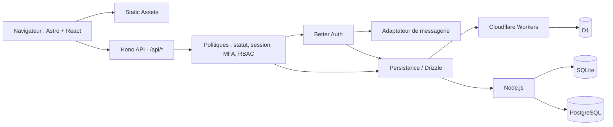

# <picture></picture> Architecture

<a href="../en/architecture.md" lang="en">English</a> | <a href="../es/architecture.md" lang="es">Español</a> | <a href="../pt/architecture.md" lang="pt">Português</a> | <a href="../de/architecture.md" lang="de">Deutsch</a> | <strong>Français</strong> | <a href="../it/architecture.md" lang="it">Italiano</a> | <a href="../zh/architecture.md" lang="zh">简体中文</a> | <a href="../ja/architecture.md" lang="ja">日本語</a> | <a href="../hi/architecture.md" lang="hi">हिन्दी</a> | <a href="../ar/architecture.md" lang="ar">العربية</a>

[Documentation technique](README.md) | [Présentation du projet](../README.fr.md)

> [!NOTE]
> TBA utilise Cloudflare Workers avec D1 par défaut. La même interface et la même API Hono fonctionnent sous Node.js avec SQLite ou PostgreSQL. [Moteurs de base de données](database-engines.md)

TBA maintient un unique frontend Astro + React et un unique Worker Hono. Astro génère les assets et React hydrate uniquement les écrans interactifs. Seuls `/api` et `/api/*` exécutent d'abord Hono via `run_worker_first: ["/api", "/api/*"]`. Cloudflare livre directement les pages et les fichiers existants via Workers Static Assets ; Hono n'appelle pas le binding `ASSETS`. Il n'est pas nécessaire de SSR pour le login ou le conteneur du panneau ; ces documents statiques ne contiennent pas de données privées.

`src/server/services/mail.ts`: `local`, `cloudflare`, `resend`. [Mail / Correo](mail-providers.md).

`src/server/auth.ts` construit Better Auth par demande et utilise l'adaptateur Drizzle du moteur sélectionné. Il ne conserve jamais les bindings ni les données d'une demande dans des variables globales. `security.ts` applique les politiques d'autorisation. `policy.ts` contient le catalogue des autorisations et les restrictions de rôles publics. `database/schema.ts` décrit le schéma et `drizzle/*.sql` contient les migrations exécutables.

Better Auth gère les utilisateurs, les sessions, les comptes, les vérifications et TOTP. Ses champs officiels de la version fixée sont conservés, y compris `verified`, `failedVerificationCount` et `lockedUntil` de Two Factor. Le champ `password` de la table `account` appartient au schéma officiel ; le fournisseur de mots de passe est désactivé et ses endpoints ne sont pas exposés.

Les tables supplémentaires contiennent les rôles, la configuration, les demandes, l'audit, la confirmation MFA par session et la confiance révocable par appareil. Les rôles initiaux sont Administrateur, Éditeur et Visualiseur ; Éditeur et Visualiseur démarrent uniquement avec `app.read`. Chaque application ajoute ses autorisations métier, sans modifier les contrôles d'identité.

Les documents du panneau sont publics comme conteneurs vides ; les API requièrent une session active, un courrier vérifié, un compte actif, un deuxième facteur lorsque cela correspond et une autorisation. Cacher les menus dans React n'est qu'une amélioration de la navigation. Le Worker révalide chaque opération.

Les modifications administratives des utilisateurs, rôles et inscriptions exigent leur permission serveur et le contrôle Administrateur existant. La révocation des sessions via `/api/private/users/:id/revoke` exige `users.edit`, sans contrôle Administrateur supplémentaire. La suppression définitive exige aussi `users.deactivate`, interdit l’auto-suppression et protège le dernier administrateur actif. Voir [sécurité](security.md). `Admin.tsx` compose le panneau ; `admin/useAdminController.tsx` gère état et requêtes, `usePanelHistory.ts` l’historique, `AdminDialogs.tsx` les dialogues et `BasicListViews.tsx` les listes limitées. `server/basic-lists.ts` fournit des pages de 20 lignes avec précédent/suivant, sans moteur avancé.

La configuration utilise un registre unique dans la base de données ; un changement de mode ne nécessite pas de redeploy. Le dernier administrateur actif et le rôle réservé sont protégés par des déclencheurs, y compris les changements concurrents.

Il n'y a pas de multi-locataires, d'organisations, d'espaces de travail, de facturation, de fédération de sessions, de R2 actif ni d'infrastructure multi-agent. Chaque installation possède son propre environnement d’exécution, sa base, ses utilisateurs, ses sessions et ses secrets.

## Routage statique et sécurité

Le point d'entrée `src/server/index.ts` enregistre les modules de `src/server/routes/` sur une même instance de Hono, dans l'ordre original. `src/server/http.ts` réunit les helpers partagés. Tous les handlers ont été audité : la configuration publique, l'envoi et la vérification OTP, la session, le défi MFA, les opérations privées et Better Auth sont sous `/api/`. Le callback OAuth est `/api/auth/callback/google`. `/login/complete/` est une page Astro statique qui consulte `/api/session` ; elle ne traite pas OAuth sur le serveur. Il n'existe pas d'endpoints dynamiques en dehors de `/api`.

Les pages `/`, `/login/`, `/login/complete/`, `/denied/`, `/admin/` et leurs sept vues sont générées pendant la construction. Les conteneurs administratifs ne contiennent pas de données privées. Les requêtes et les mutations passent par l'API avec les mêmes vérifications de session, d'état, de courrier vérifié, de MFA et de RBAC. La navigation directe et la recharge servent le même HTML qu'une navigation normale.

`public/_headers` se copie à `dist/_headers` et applique les mêmes en-têtes de sécurité que Hono aux réponses de Static Assets. Hono conserve `secureHeaders` pour l'API, en plus de `Cache-Control: no-store`. Les tests comparent les deux politiques pour détecter les différences. Les CSP, les cookies et la logique d'authentification sont conservés. Seuls les fichiers avec un nom de version de `/_astro/` utilisent `Cache-Control: public, max-age=31536000, immutable` ; HTML et ressources non versionnées maintiennent leur révalidation habituelle. `_headers` est un métadonnée de Cloudflare et n'est pas publié comme fichier téléchargeable.

Il conserve `not_found_handling: "404-page"`, sans fallback de SPA. Si une demande en dehors de l'API arrive à Hono, elle renvoie 404 et ne consulte pas `ASSETS`. Les dérivés qui incorporent SSR, des callbacks en dehors de `/api/` ou d'autres handlers dynamiques doivent étendre les modèles dans les deux configurations et ajouter des tests avant de déployer. Ne pas inclure des données privées dans HTML prérendu ni publier des fichiers sensibles à l'intérieur de `public` ou `dist`.

Les tests de `tests/assets.test.ts` compilent Astro et le Worker avec Wrangler, exécutent le routeur réel de Static Assets en Miniflare/workerd et comptent les invocations via un binding exclusif du harnais local. Ce binding n'existe pas dans la configuration ni dans le déploiement. Une collision statique artificielle sous `/api/private/users` vérifie que le fichier ne peut pas éviter l'authentification. Aucune nouvelle dépendance ni ressource distante n'est requise pour ces tests.

Références : [enrutamiento selectivo](https://developers.cloudflare.com/workers/static-assets/routing/worker-script/) et [cabeceras de Static Assets](https://developers.cloudflare.com/workers/static-assets/headers/).

Le rôle de base conserve son identifiant stable `viewer`. Les réponses de rôles et les références d'audit présentent le nom historique « Consulta » comme « Visualizador », sans réécrire des données existantes ni des migrations déjà appliquées. En registration ouvert, l'administrateur sélectionne le rôle initial parmi tous les rôles configurés ; l'API valide le choix et exige une confirmation explicite. Le visiteur reçoit le rôle configuré lors de la vérification de son courrier et ne peut pas le choisir. Le registration ouvert n'est pas activé automatiquement. Voir [registration et sélection de rôle](registration.md).

Le menu latéral peut se contracter sur le bureau et conserve la préférence visuelle dans `localStorage`. Les boutons de navigation contractés maintiennent des noms accessibles et des aides avec le titre. Sur mobile, le menu complet est conservé. Le favicon SVG reproduit le symbole de couches du logo et utilise la couleur primaire définie pour l'application.

## Tableaux de gestion

Les listes simples des utilisateurs, demandes et audits restent disponibles avec navigation bornée et autorisations serveur. Les moteurs avancés et Excel sont exclus de la base ; chaque dérivé les ajoute si nécessaire. Voir le [périmètre](template-scope.md).

## Navigation du panneau

Le composant React administratif conserve le menu et l'écran visible pendant le chargement de la prochaine destination. L'API History maintient Arrière et Avant sans demander un autre document Astro ni hydrater React à nouveau. La transition est confirmée lors de la réception des données et les réponses annulées ne peuvent pas remplacer la destination actuelle. Un indicateur fin et différé dans l'en-tête remplace l'écran de « Chargement de contenu ». Les contrôles du contenu précédent restent inertes pendant le changement de destination. Les liens directs, les recharges et les clics avec des modificateurs sont conservés.

Les lectures privées qui incluent `context=1` retournent leurs données avec `_context`, une projection de présentation de l'acteur déjà autorisé. Les Utilisateurs et les Demandes peuvent inclure le catalogue de rôles via `includeRoles=1`, avec la même autorisation que leur point de terminaison. Aucune demande séparée de `/api/session` ou de rôles n'est nécessaire pour ouvrir chaque vue. Le catalogue reçu permet également d'ouvrir les Rôles sans autre demande tant qu'il est valide. Le Profil et la Sécurité réutilisent la même lecture de profil.

`ViewCache` conserve jusqu'à huit réponses de présentation à l'intérieur du composant, réutilisables pendant trente secondes. La lecture d'une entrée ne prolonge pas sa validité. Elles ne sont pas stockées dans localStorage, sessionStorage, Service Worker ou cache partagée. Les mutations, les QR, les graines TOTP et les codes de récupération ne sont pas mis en cache. Elles sont invalidées après des mutations, des changements de contexte d'identité/permissions, un refus d’accès, une fermeture de session et les transitions BFCache. Le changement d’onglet ou de fenêtre préserve la vue affichée. L’expiration est vérifiée lors de la consultation d’une entrée du cache. Il n'y a pas de sondages périodiques ni de préchargement de toutes les pages.

Le contexte et la cache ne représentent que des données déjà reçues par cette personne. Chaque nouvelle requête privée applique les contrôles actuels du serveur ; elles ne confèrent pas d'autorisation ni ne permettent de contourner une révocation. Les réponses HTTP continuent d'utiliser `Cache-Control: no-store`.

Le premier rendu administratif est vide tant dans le HTML généré par Astro que pendant l'hydratation. `Admin` ne monte pas le menu, l'en-tête, le titre, les formulaires ni l'état de chargement jusqu'à ce qu'il reçoive la réponse privée autorisée avec son contexte et ses données. Lors d'une redirection, il retourne également une sortie vide. Aucune requête de session n'est ajoutée : la même lecture combinée existante est utilisée. Une erreur définitive de permissions ou de service affiche un avertissement public minimal, avec réessai, en dehors de la structure administrative. La navigation interne d'une session déjà confirmée conserve le contenu précédent et sa cache comme avant.

Le panneau traite la perte de session de manière centralisée : face à un 401, il nettoie les données, la cache et les secrets transitoires de l'interface et utilise `location.replace("/login/")`. La fermeture de session confirmée nettoie également cet état et remplace l'entrée de l'historique. Avant de sauvegarder un document dans BFCache, il masque synchroniquement son panneau et ferme ses dialogues. Si le navigateur le restaure, il supprime son état privé et consulte à nouveau uniquement la vue actuelle ; un `pageshow` normal n'ajoute pas de requêtes. Les 403 de permissions restent sur l'écran, `MFA_REQUIRED` conduit à l'étape MFA et `RECENT_AUTH_REQUIRED` conserve la confirmation explicite d'identité. Les API maintiennent leurs états et réponses JSON ; la redirection se produit sur le frontend du panneau, sans exécuter le Worker pour servir HTML.

Toutes les réconfirmations du panneau utilisent le même dialogue accessible de l'application : changements d'accès, révocation de sessions, approbation ou refus de demandes, révocation de confiance, désactivation MFA et renouvellement de récupération. Il n'utilise pas `window.confirm`, `alert` ou `prompt`. Ils affichent la personne et les conséquences avant d'envoyer la mutation ; annuler conserve le formulaire. Le flux de courrier sépare l'adresse, l'OTP et le deuxième facteur, avec résultat explicite et saisie ultérieure avec le nouveau courrier.

## Modules du panneau

Le paquet réutilisable doit séparer navigation, chargement/état et vues administratives, sans changer le design ni la langue partagée. Le générateur QR se charge au besoin pour MFA ; cela n’implique aucune dépendance à Excel.

L’anglais reste inclus comme repli. Les autres catalogues de connexion et du panneau utilisent des imports dynamiques et un cache mémoire par module. Le focus clavier ou pointeur précharge uniquement l’option visée ; ouvrir le menu ne charge pas toutes les langues. Le changement attend les catalogues complets et conserve formulaires, session et navigation. Le cache évite le réseau ; le dernier choix prévaut. Un échec initial affiche l’anglais, un échec ultérieur conserve la langue actuelle. E-mails et métadonnées du build utilisent des catalogues complets côté serveur. Voir le [chargement des langues](language-loading.md).

Le panneau charge les données lors de la navigation, d’une actualisation explicite ou d’une modification concernée. L’inactivité, le changement de focus ou d’onglet et l’expiration du cache ne déclenchent aucune requête à eux seuls. La restauration depuis le BFCache revalide l’accès avant d’afficher les données privées.
