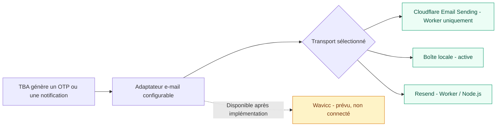

# <picture></picture> E-mail transactionnel et indépendance du fournisseur

<a href="../en/mail-providers.md" lang="en">English</a> | <a href="../es/mail-providers.md" lang="es">Español</a> | <a href="../pt/mail-providers.md" lang="pt">Português</a> | <a href="../de/mail-providers.md" lang="de">Deutsch</a> | <strong>Français</strong> | <a href="../it/mail-providers.md" lang="it">Italiano</a> | <a href="../zh/mail-providers.md" lang="zh">简体中文</a> | <a href="../ja/mail-providers.md" lang="ja">日本語</a> | <a href="../hi/mail-providers.md" lang="hi">हिन्दी</a> | <a href="../ar/mail-providers.md" lang="ar">العربية</a>

[Documentation technique](README.md) | [Présentation du projet](../README.fr.md)

> [!NOTE]
> **TBA n’impose aucun fournisseur commercial de messagerie.** L’authentification génère les OTP et les notifications de sécurité ; l’adaptateur les achemine via le service choisi pour chaque application indépendante. Ce choix ne modifie ni l’authentification, ni les sessions, ni les règles MFA.

## Fournisseurs et état réel de l’implémentation

| Transport | État | Configuration requise |
| :--- | :--- | :--- |
| Cloudflare Email Sending | **Implémenté** | `MAIL_PROVIDER=cloudflare`, binding `EMAIL` et expéditeur `MAIL_FROM` vérifié |
| Boîte de développement locale | **Implémentée pour usage local** | `MAIL_PROVIDER=local`, origine locale et `npm run mail:dev` |
| Resend | **Implémenté** | `MAIL_PROVIDER=resend`, `RESEND_API_KEY`, `MAIL_FROM` |
| Wavicc | **Intégration future privilégiée de Rounver ; non implémentée** | `WAVICC_API_KEY` est un espace réservé ; adaptateur testé et contrat API vérifié encore nécessaires |
| Tout autre service transactionnel | **Possible avec un adaptateur, pas automatiquement** | Implémenter et tester le transport du service choisi |

## Architecture de livraison des e-mails

## Configuration actuellement opérationnelle

Le setup accepte `--mail local`, `--mail resend` et `--mail cloudflare`. Le courrier local utilise une `APP_URL` locale et `npm run mail:dev`. Resend nécessite `RESEND_API_KEY` et `MAIL_FROM`. Cloudflare réutilise l’adaptateur existant avec un binding `send_email` nommé `EMAIL`, un `MAIL_FROM` autorisé et un domaine configuré pour l’envoi. Le setup vérifie localement, sans créer de ressources ni vérifier un domaine distant. La configuration peut attendre : le mode interactif demande confirmation, le mode non interactif continue avec une liste de tâches. Aucun binding, expéditeur ou secret n’est inventé ; l’envoi nécessite la configuration. Garder les secrets hors de Git. Wavicc reste l’intégration future privilégiée avec `WAVICC_API_KEY` comme emplacement réservé. Voir le [setup e-mail](setup-mail.md).

## Wavicc : intégration future privilégiée

Wavicc est **l’intégration privilégiée de Rounver lorsque son API d’e-mail transactionnel sera disponible**. `.dev.vars.example` contient `WAVICC_API_KEY=` uniquement comme nom de secret futur. **TBA ne lit pas cette clé actuellement. Il ne faut pas définir `MAIL_PROVIDER=wavicc` ni supposer l’existence d’un endpoint API.**

## Connecter un autre service en sécurité

**Avant d’activer un nouveau fournisseur :**

1. Vérifier l’API réelle, le mode d’authentification et les champs nécessaires.
2. Implémenter un adaptateur dédié sans supprimer les transports fonctionnels.
3. Conserver les identifiants dans un gestionnaire de secrets approuvé et vérifier l’expéditeur.
4. Tester la livraison et l’expiration des OTP, les nouvelles tentatives, les erreurs et les échecs de notification.
5. Adapter la configuration et les validations de déploiement seulement après réussite des tests.
6. Sélectionner le fournisseur pour une application précise et déployer uniquement avec autorisation explicite.

## Secrets et migration sécurisée

Ne placer **aucun identifiant réel** dans `.dev.vars.example`. Utiliser `.dev.vars` local (ignoré par Git) ou Wrangler Secrets pour les clés, et un `MAIL_FROM` vérifié. `CUSTOM_MAIL_API_KEY=` est aussi un simple espace réservé. L’ancienne variable de clé est conservée seulement pour compatibilité, pas comme valeur recommandée.

Le HTML commun comporte une alternative texte, sans images, polices distantes ni suivi. Il couvre OTP d’accès/inscription, nouvelle adresse, confirmation d’initialisation MFA, changement d’adresse, demandes et approbations. La marque suit `APP_NAME` ; l’application générique est TBA. Expiration et règles d’authentification restent inchangées.

`X-Auth-Language` choisit une langue activée pour l’e-mail, jamais les autorisations. Sans en-tête ou préférence valide, le défaut configuré s’applique (anglais initialement). Une préférence désactivée revient aussi au défaut. Les clés manquantes utilisent l’anglais. L’accès/inscription confirmé et le sélecteur mémorisent la préférence dans `verification` (`mail-language:<userId>`) ; les avis différés utilisent la langue du destinataire. Changer de langue ne renvoie pas les codes et ne change ni expiration, ni essais, ni vérification. Les anciens textes d’erreur restent reconnus.
