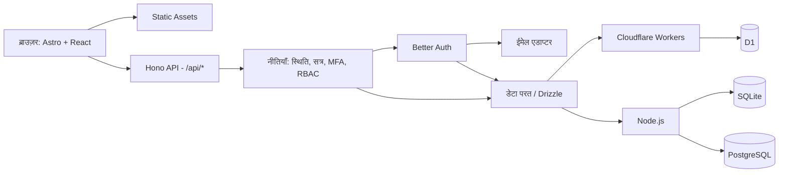

# <picture></picture> आर्किटेक्चर

<a href="../en/architecture.md" lang="en">English</a> | <a href="../es/architecture.md" lang="es">Español</a> | <a href="../pt/architecture.md" lang="pt">Português</a> | <a href="../de/architecture.md" lang="de">Deutsch</a> | <a href="../fr/architecture.md" lang="fr">Français</a> | <a href="../it/architecture.md" lang="it">Italiano</a> | <a href="../zh/architecture.md" lang="zh">简体中文</a> | <a href="../ja/architecture.md" lang="ja">日本語</a> | <strong>हिन्दी</strong> | <a href="../ar/architecture.md" lang="ar">العربية</a>

[तकनीकी दस्तावेज़](README.md) | [परियोजना का परिचय](../README.hi.md)

> [!NOTE]
> TBA का डिफ़ॉल्ट विन्यास Cloudflare Workers और D1 है। यही इंटरफ़ेस और Hono API Node.js पर SQLite या PostgreSQL के साथ चलते हैं। [डेटाबेस इंजन](database-engines.md)

TBA में एक único फ्रंटेंड Astro + React और एक único वर्कर Hono है। Astro एसेट्स जनरेट करता है और React केवल इंटरैक्टिव स्क्रीन्स को हाइड्रेट करता है। केवल `/api` और `/api/*` Hono को `run_worker_first: ["/api", "/api/*"]` के माध्यम से पहले चलाते हैं। Cloudflare सीधे पेज और मौजूदा फाइलों को वर्कर्स स्टेटिक एसेट्स के माध्यम से डिलीवर करता है; Hono `ASSETS` बाइंडिंग को कॉल नहीं करता है। लॉगिन या पैनल कंटेनर के लिए SSR की आवश्यकता नहीं है; वे स्टेटिक डॉक्यूमेंट डेटा प्राइवेट नहीं होते हैं।

`src/server/services/mail.ts`: `local`, `cloudflare`, `resend`. [Mail / Correo](mail-providers.md).

`src/server/auth.ts` बेहतर ऑथेंटिकेशन को अनुरोध पर बनाता है और चुने गए इंजन के Drizzle एडाप्टर का उपयोग करता है। यह कभी भी वैश्विक वेरिएबल्स में बाइंडिंग या डेटा को एक अनुरोध से दूसरे में संग्रहीत नहीं करता है। `security.ts` अधिकार नीतियों को लागू करता है। `policy.ts` में अनुमति कैटलॉग और सार्वजनिक भूमिका प्रतिबंध शामिल हैं। `database/schema.ts` स्कीमा का वर्णन करता है और `drizzle/*.sql` में चलने योग्य माइग्रेशन शामिल हैं।

बेहतर ऑथेंटिकेशन उपयोगकर्ताओं, सत्रों, खातों, सत्यापन, और TOTP का प्रबंधन करता है। इसके आधिकारिक तय किए गए संस्करण के क्षेत्रों को संरक्षित किया जाता है, जिनमें `verified`, `failedVerificationCount`, और `lockedUntil` दो-कारक प्रमाणीकरण से शामिल हैं। `password` क्षेत्र `account` तालिका के लिए आधिकारिक स्कीमा से संबंधित है; पासवर्ड प्रदाता अक्षम है और इसके एंडपॉइंट्स को उजागर नहीं किया जाता है।

अतिरिक्त तालिकाएं भूमिकाएं, कॉन्फ़िगरेशन, अनुरोध, ऑडिट, सत्र MFA पुष्टिकरण, और डिवाइस द्वारा वापस लेने योग्य विश्वास को संग्रहीत करती हैं। प्रारंभिक भूमिकाएं प्रशासक, संपादक, और दर्शक हैं; संपादक और दर्शक केवल `app.read` के साथ शुरू होते हैं। प्रत्येक एप्लिकेशन अपने व्यावसायिक अनुमतियों को जोड़ता है, बिना पहचान नियंत्रण को संशोधित किए।

पैनल दस्तावेज़ खाली कंटेनर के रूप में सार्वजनिक हैं; एपीआई को एक मौजूदा सत्र, सत्यापित मेल, सक्रिय खाता, दूसरा कारक जब लागू होता है, और अनुमति की आवश्यकता होती है। रिएक्ट में मेनू को छिपाना केवल एक नेविगेशन सुधार है। वर्कर प्रत्येक ऑपरेशन को पुनः मान्य करता है।

उपयोगकर्ताओं, भूमिकाओं और पंजीकरण के प्रशासनिक बदलावों के लिए सर्वर अनुमति और मौजूदा प्रशासक जाँच चाहिए। `/api/private/users/:id/revoke` में सत्र रद्द करने के लिए केवल `users.edit` चाहिए, अतिरिक्त प्रशासक जाँच नहीं। स्थायी हटाने में `users.deactivate` भी चाहिए; स्वयं को हटाना निषिद्ध है और अंतिम सक्रिय प्रशासक सुरक्षित रहता है। [सुरक्षा](security.md) देखें। `Admin.tsx` पैनल संयोजित करता है; `admin/useAdminController.tsx` स्थिति और अनुरोध, `usePanelHistory.ts` इतिहास, `AdminDialogs.tsx` संवाद तथा `BasicListViews.tsx` सामान्य सूचियाँ संभालते हैं। `server/basic-lists.ts` बिना उन्नत टेबल इंजन के 20 पंक्तियों वाले पिछले/अगले पृष्ठ देता है।

कॉन्फ़िगरेशन डेटाबेस में एकल रजिस्ट्री का उपयोग करता है; मोड में परिवर्तन के लिए पुनः तैनाती की आवश्यकता नहीं है। अंतिम सक्रिय प्रशासक और आरक्षित भूमिका को ट्रिगर्स द्वारा संरक्षित किया जाता है, जिसमें समकालिक परिवर्तन शामिल हैं।

मल्टी-टेनेंसी, संगठन, वर्कस्पेस, बिलिंग, सेशन फेडरेशन, R2 एक्टिव, या मल्टी-एजेंट इंफ्रास्ट्रक्चर नहीं है। हर स्थापना का अपना रनटाइम, डेटाबेस, उपयोगकर्ता, सत्र और सीक्रेट हैं।

## स्टेटिक रूटिंग और सुरक्षा

प्रवेश बिंदु `src/server/index.ts` एक ही Hono इंस्टेंस पर `src/server/routes/` मॉड्यूल को रजिस्टर करता है, मूल क्रम में। `src/server/http.ts` साझा हेल्पर्स को एकत्र करता है। सभी हैंडलर्स को ऑडिट किया गया है: सार्वजनिक कॉन्फ़िगरेशन, भेजने और OTP सत्यापन, सत्र, MFA चुनौती, निजी ऑपरेशन, और बेहतर ऑथेंटिकेशन `/api/` के तहत हैं। OAuth कॉलबैक `/api/auth/callback/google` है। `/login/complete/` एक स्थिर Astro पेज है जो `/api/session` को क्वेरी करता है; यह सर्वर पर OAuth को संसाधित नहीं करता है। `/api` के बाहर कोई गतिशील एंडपॉइंट्स नहीं हैं।

पेज `/`, `/login/`, `/login/complete/`, `/denied/`, `/admin/` और उनके सात दृश्य बिल्ड के दौरान जनरेट किए जाते हैं। प्रशासनिक कंटेनर निजी डेटा शामिल नहीं करते हैं। क्वेरी और म्यूटेशन API के माध्यम से समान सत्र, स्थिति, सत्यापित मेल, MFA, और RBAC जांच के साथ गुजरते हैं। सीधी नेविगेशन और रीलोड सामान्य नेविगेशन की तरह एक ही HTML की सेवा करते हैं।

`public/_headers` को `dist/_headers` में कॉपी किया जाता है और स्टेटिक एसेट्स की प्रतिक्रियाओं पर होनो की समान सुरक्षा हेडर लागू किए जाते हैं। होनो `secureHeaders` को एपीआई के लिए बनाए रखता है, साथ ही `Cache-Control: no-store` को भी। परीक्षण दोनों नीतियों की तुलना करते हैं ताकि अंतर का पता लगाया जा सके। सीएसपी, कुकीज और प्रमाणीकरण तर्क को बनाए रखा जाता है। केवल `/_astro/` के संस्करण वाले नाम वाले फ़ाइलें `Cache-Control: public, max-age=31536000, immutable` का उपयोग करती हैं; एचटीएमएल और संस्करण वाले संसाधन अपनी सामान्य पुनः मान्यकरण बनाए रखते हैं। `_headers` क्लाउडफ्लेयर मेटाडेटा है और इसे डाउनलोड करने योग्य फ़ाइल के रूप में प्रकाशित नहीं किया जाता है।

`not_found_handling: "404-page"` को बनाए रखा जाता है, एसपीए के फॉलबैक के बिना। यदि एपीआई के बाहर एक अनुरोध होनो तक पहुंचता है, तो यह 404 देता है और `ASSETS` से परामर्श नहीं करता है। एसएसआर, `/api/` के बाहर कॉलबैक या अन्य डायनेमिक हैंडलर्स को शामिल करने वाले डेरिवेटिव को दोनों कॉन्फ़िगरेशन में पैटर्न का विस्तार करना चाहिए और तैनाती से पहले परीक्षण जोड़ना चाहिए। प्री-रेंडर किए गए एचटीएमएल में निजी डेटा शामिल न करें या `public` या `dist` के भीतर संवेदनशील फ़ाइलें प्रकाशित न करें।

`tests/assets.test.ts` के परीक्षण एस्ट्रो और वर्कर को व्रैंगलर के साथ संकलित करते हैं, मिनीफ्लेयर/वर्कर्ड में स्टेटिक एसेट्स के वास्तविक राउटर को निष्पादित करते हैं और एक विशिष्ट स्थानीय हार्नेस बाइंडिंग के माध्यम से कॉल की गणना करते हैं। वह बाइंडिंग कॉन्फ़िगरेशन या तैनाती में मौजूद नहीं है। `/api/private/users` के तहत एक कृत्रिम स्थिर टक्कर यह सत्यापित करती है कि फ़ाइल प्रमाणीकरण से बच नहीं सकती है। इन परीक्षणों के लिए नए निर्भरता या दूरस्थ संसाधनों की आवश्यकता नहीं है।

संदर्भ: [चयनात्मक मार्ग](https://developers.cloudflare.com/workers/static-assets/routing/worker-script/) और [स्टेटिक एसेट्स हेडर](https://developers.cloudflare.com/workers/static-assets/headers/)।

मूल भूमिका अपनी स्थिर पहचान `viewer` को बनाए रखती है। भूमिका प्रतिक्रियाएं और ऑडिट संदर्भ ऐतिहासिक नाम «कंसल्टा» को «व्यूअर» के रूप में प्रस्तुत करती हैं, बिना मौजूदा डेटा को पुनः लिखे या पहले से लागू की गई प्रवास के। खुले पंजीकरण में, प्रशासक सभी कॉन्फ़िगर की गई भूमिकाओं के बीच प्रारंभिक भूमिका चुनता है; एपीआई चयन को मान्य करता है और स्पष्ट पुष्टि की मांग करता है। आगंतुक अपने ईमेल की जांच करते समय कॉन्फ़िगर की गई भूमिका प्राप्त करता है और इसे चुन नहीं सकता है। खुला पंजीकरण स्वचालित रूप से सक्षम नहीं है। देखें [पंजीकरण और भूमिका चयन](registration.md)।

साइडबार डेस्कटॉप पर संकुचित किया जा सकता है और `localStorage` में दृश्य प्राथमिकता को बनाए रखता है। संकुचित नेविगेशन बटन सुलभ नाम और शीर्षक के साथ सहायता बनाए रखते हैं। मोबाइल पर पूरा मेनू बना रहता है। फेविकॉन एसवीजी लोगो के परत चिह्न को पुनः बनाता है और एप्लिकेशन के लिए परिभाषित प्राथमिक रंग का उपयोग करता है।

## प्रबंधन तालिकाएं

उपयोगकर्ता, अनुरोध और ऑडिट की बुनियादी सूचियाँ सीमित नेविगेशन तथा सर्वर अनुमतियों के साथ रहती हैं। उन्नत तालिका इंजन और Excel मूल टेम्पलेट से बाहर हैं; हर परियोजना जरूरत के अनुसार जोड़ती है। [दायरा](template-scope.md) देखें।

## पैनल नेविगेशन

प्रशासनिक रिएक्ट घटक मेनू और दृश्य स्क्रीन को बनाए रखता है जबकि यह अगले गंतव्य को लोड करता है। हिस्ट्री एपीआई पीछे और आगे को बनाए रखता है बिना किसी अन्य एस्ट्रो दस्तावेज़ का अनुरोध किए या रिएक्ट को फिर से हाइड्रेट किए। संक्रमण डेटा और प्रतिक्रियाओं के प्राप्त होने पर पुष्टि की जाती है और रद्द की गई प्रतिक्रियाएं वर्तमान गंतव्य को प्रतिस्थापित नहीं कर सकती हैं। एक पतला और विलंबित संकेतक शीर्षलेख में «सामग्री लोड हो रही है» स्क्रीन को प्रतिस्थापित करता है। सामग्री के पिछले नियंत्रण स्थानांतरण के दौरान निष्क्रिय रहते हैं। सीधे लिंक, रीलोड और मॉडिफायर के साथ क्लिक बने रहते हैं।

`context=1` को शामिल करने वाली निजी पढ़ाई अपने डेटा के साथ `_context` देती है, जो पहले से ही अधिकृत अभिनेता की प्रस्तुति परियोजना है। उपयोगकर्ता और अनुरोध `includeRoles=1` के माध्यम से भूमिका कैटलॉग को शामिल कर सकते हैं, जिसमें उनके एंडपॉइंट के समान प्रमाणीकरण होता है। प्रत्येक दृश्य खोलने पर `/api/session` या भूमिकाओं के लिए अलग से अनुरोध की आवश्यकता नहीं होती है। प्राप्त कैटलॉग भी भूमिकाओं को खोलता है बिना किसी अन्य अनुरोध के जबकि यह वैध है। प्रोफ़ाइल और सुरक्षा उसी प्रोफ़ाइल पढ़ाई का पुनः उपयोग करते हैं।

संदर्भ और कैश केवल उस व्यक्ति द्वारा पहले से ही प्राप्त किए गए डेटा का प्रतिनिधित्व करते हैं। प्रत्येक नई निजी अनुरोध वर्तमान सर्वर नियंत्रणों को लागू करता है; वे अधिकार नहीं देते हैं और न ही एक रद्द करने को बायपास करने की अनुमति देते हैं। एचटीटीपी प्रतिक्रियाएं `Cache-Control: no-store` का उपयोग करती हैं ...

पहला प्रशासनिक रेंडर दोनों एस्ट्रो द्वारा उत्पन्न एचटीएमएल और हाइड्रेशन के दौरान खाली होता है। `Admin` मेनू, हेडर, शीर्षक, फॉर्म या लोडिंग स्टेट्स को तब तक नहीं माउंट करता है जब तक कि इसके संदर्भ और डेटा के साथ अधिकृत निजी प्रतिक्रिया प्राप्त नहीं हो जाती। एक पुनर्निर्देशन के दौरान यह भी एक खाली आउटपुट देता है। एक सत्र क्वेरी जोड़ी नहीं जाती है: यह मौजूदा संयुक्त पठन का उपयोग करता है। एक निश्चित अनुमति या सेवा त्रुटि एक न्यूनतम सार्वजनिक नोटिस दिखाती है, जिसमें पुन: प्रयास किया जाता है, प्रशासनिक संरचना से बाहर। एक सत्र की आंतरिक नेविगेशन, जो पहले से ही पुष्टि की गई है, पिछली सामग्री और इसकी कैश को पहले की तरह बनाए रखती है।

पैनल सत्र हानि को केंद्रीकृत तरीके से संभालता है: 401 के सामने यह इंटरफ़ेस के डेटा, कैश और अस्थायी गुप्त को साफ़ करता है और `location.replace("/login/")` का उपयोग करता है। पुष्टि किए गए लॉगआउट भी उसी राज्य को साफ़ करते हैं और इतिहास प्रविष्टि को बदल देते हैं। एक दस्तावेज़ को बीएफकैश में सहेजने से पहले इसके पैनल को सिंक्रोनस रूप से छिपाया जाता है और इसके संवाद बंद हो जाते हैं। यदि ब्राउज़र इसे पुनर्स्थापित करता है, तो इसकी निजी स्थिति को खारिज कर दिया जाता है और केवल वर्तमान दृश्य के लिए फिर से पूछा जाता है; एक सामान्य `pageshow` अतिरिक्त अनुरोध नहीं जोड़ता है। 403 अनुमति बनी रहती है, `MFA_REQUIRED` एमएफए चरण की ओर ले जाता है और `RECENT_AUTH_REQUIRED` पहचान की स्पष्ट पुष्टि को बनाए रखता है। एपीआई अपने राज्यों और जेसन प्रतिक्रियाओं को बनाए रखते हैं; पुनर्निर्देशन पैनल के फ्रंटएंड में होता है, एचटीएमएल की सेवा के लिए वर्कर को निष्पादित किए बिना।

पैनल की सभी पुन: पुष्टि एक ही सुलभ संवाद का उपयोग करती हैं: पहुंच परिवर्तन, सत्र रद्द करना, अनुरोधों की मंजूरी या अस्वीकृति, विश्वास रद्द करना, एमएफए अक्षम करना और पुनर्प्राप्ति को नवीनीकृत करना। `window.confirm`, `alert` या `prompt` का उपयोग नहीं किया जाता है। वे म्यूटेशन भेजने से पहले व्यक्ति और परिणाम दिखाते हैं; रद्द करने से फॉर्म संरक्षित रहता है। मेल प्रवाह पते, ओटीपी और दूसरे कारक को अलग करता है, जिसमें स्पष्ट परिणाम और बाद में नए मेल के साथ प्रवेश होता है।

## पैनल मॉड्यूल

पुनः उपयोग वाले पैकेज में नेविगेशन, डेटा लोडिंग/स्थिति और प्रशासनिक दृश्य अलग रखें। साझा डिजाइन और भाषा सुरक्षित रहें। QR जनरेटर MFA सेटअप की जरूरत पर लोड होता है; इसके लिए Excel निर्भरता आवश्यक नहीं है।

अंग्रेज़ी fallback के रूप में शुरुआती बंडल में रहती है। अन्य लॉगिन और पैनल कैटलॉग dynamic import और प्रति मॉड्यूल memory cache से लोड होते हैं। कीबोर्ड या पॉइंटर focus केवल संबंधित भाषा पहले लोड करता है; मेनू खोलने से सभी भाषाएँ डाउनलोड नहीं होतीं। पूरे कैटलॉग तैयार होने पर बदलाव होता है, जिससे फ़ॉर्म, सत्र और नेविगेशन सुरक्षित रहते हैं। cached बदलाव में नेटवर्क नहीं लगता; अंतिम चयन लागू होता है। शुरुआती विफलता में अंग्रेज़ी और बाद की विफलता में वर्तमान भाषा रहती है। ईमेल और build metadata पूरे server-only कैटलॉग इस्तेमाल करते हैं। [भाषा लोडिंग](language-loading.md) देखें।

नेविगेशन, स्पष्ट रीफ़्रेश या संबंधित बदलाव पर पैनल डेटा माँगता है। निष्क्रियता, फ़ोकस या टैब बदलने और कैश की समय-सीमा समाप्त होने से अपने आप अनुरोध नहीं होते। BFCache से लौटते समय निजी डेटा दिखाने से पहले पहुँच फिर जाँची जाती है।
