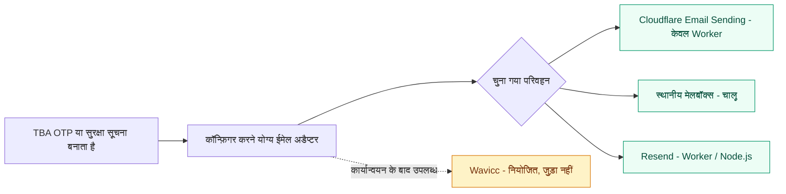

# <picture></picture> ट्रांज़ैक्शनल ईमेल और प्रदाता से स्वतंत्रता

<a href="../en/mail-providers.md" lang="en">English</a> | <a href="../es/mail-providers.md" lang="es">Español</a> | <a href="../pt/mail-providers.md" lang="pt">Português</a> | <a href="../de/mail-providers.md" lang="de">Deutsch</a> | <a href="../fr/mail-providers.md" lang="fr">Français</a> | <a href="../it/mail-providers.md" lang="it">Italiano</a> | <a href="../zh/mail-providers.md" lang="zh">简体中文</a> | <a href="../ja/mail-providers.md" lang="ja">日本語</a> | <strong>हिन्दी</strong> | <a href="../ar/mail-providers.md" lang="ar">العربية</a>

[तकनीकी दस्तावेज़](README.md) | [परियोजना का परिचय](../README.hi.md)

> [!NOTE]
> **TBA किसी विशेष व्यावसायिक ईमेल प्रदाता को अनिवार्य नहीं बनाता।** प्रमाणीकरण मॉड्यूल OTP और सुरक्षा सूचनाएँ बनाता है; ईमेल अडैप्टर उन्हें हर स्वतंत्र ऐप के लिए चुने गए प्रदाता से भेजता है। प्रदाता बदलने से प्रमाणीकरण, सत्र या MFA की नीति नहीं बदलती।

## प्रदाता और वास्तविक कार्यान्वयन स्थिति

| परिवहन | स्थिति | आवश्यक विन्यास |
| :--- | :--- | :--- |
| Cloudflare Email Sending | **लागू** | `MAIL_PROVIDER=cloudflare`, `EMAIL` बाइंडिंग और सत्यापित `MAIL_FROM` |
| स्थानीय विकास मेलबॉक्स | **स्थानीय उपयोग के लिए लागू** | `MAIL_PROVIDER=local`, स्थानीय ऐप मूल और `npm run mail:dev` |
| Resend | **लागू** | `MAIL_PROVIDER=resend`, `RESEND_API_KEY`, `MAIL_FROM` |
| Wavicc | **Rounver का भविष्य का पसंदीदा एकीकरण, अभी लागू नहीं** | `WAVICC_API_KEY` केवल स्थानधारक; जाँचा गया API अनुबंध और परीक्षण किया अडैप्टर चाहिए |
| अन्य ट्रांज़ैक्शनल ईमेल सेवाएँ | **अडैप्टर से संभव, अपने-आप नहीं** | चुनी गई सेवा के लिए परिवहन लागू और परीक्षण करें |

## ईमेल वितरण आर्किटेक्चर

## वर्तमान में कार्यरत विन्यास

सेटअप `--mail local`, `--mail resend` और `--mail cloudflare` स्वीकार करता है। स्थानीय ईमेल में local `APP_URL` और `npm run mail:dev`; Resend में `RESEND_API_KEY` और `MAIL_FROM` चाहिए। Cloudflare मौजूदा adapter इस्तेमाल करता है और `EMAIL` नाम का `send_email` binding, अनुमत `MAIL_FROM` तथा सक्षम sending domain चाहता है। सेटअप केवल स्थानीय जाँच करता है, संसाधन बनाता या remote domain जाँचता नहीं। कॉन्फ़िगरेशन बाद में हो सकती है: interactive मोड जारी रखने का विकल्प देता है, noninteractive मोड लंबित सूची दिखाकर आगे बढ़ता है। binding, sender या credentials गढ़े नहीं जाते; कॉन्फ़िगरेशन पूरी होने पर ही भेजना संभव है। secrets Git से बाहर रखें। Wavicc पसंदीदा भावी एकीकरण और `WAVICC_API_KEY` placeholder है। [ईमेल सेटअप](setup-mail.md) देखें।

## Wavicc: भविष्य का पसंदीदा एकीकरण

Wavicc **Rounver का पसंदीदा भविष्य का एकीकरण है, जब उसका ट्रांज़ैक्शनल ईमेल API तैयार हो जाएगा**। `.dev.vars.example` में `WAVICC_API_KEY=` भविष्य के रहस्य का नाम दिखाने के लिए है। **आज TBA यह कुंजी नहीं पढ़ता। `MAIL_PROVIDER=wavicc` सेट न करें और API endpoint के होने का अनुमान न लगाएँ।**

## दूसरी सेवा को सुरक्षित रूप से जोड़ना

**नया प्रदाता चालू करने से पहले:**

1. वास्तविक भेजने वाला API, प्रमाणीकरण और संदेश के आवश्यक फ़ील्ड जाँचें।
2. कार्यरत परिवहन हटाए बिना प्रदाता-विशिष्ट अडैप्टर लागू करें।
3. वास्तविक कुंजी अनुमोदित गुप्त भंडार में रखें और सत्यापित प्रेषक सेट करें।
4. OTP वितरण, समय-सीमा, दोबारा प्रयास, त्रुटियों और सूचना विफलताओं का परीक्षण करें।
5. अडैप्टर सही चलने के बाद ही सेटअप और डिप्लॉयमेंट जाँच बदलें।
6. विशेष ऐप के लिए प्रदाता चुनें और स्पष्ट अनुमति मिलने पर ही डिप्लॉय करें।

## रहस्य और सुरक्षित बदलाव

`.dev.vars.example` में **वास्तविक कुंजियाँ न रखें**। API कुंजियों को स्थानीय `.dev.vars` (Git द्वारा अनदेखा) या Wrangler Secrets में रखें और `MAIL_FROM` का सत्यापित पता इस्तेमाल करें। `CUSTOM_MAIL_API_KEY=` भी भविष्य के अडैप्टर का स्थानधारक है। पुरानी API कुंजी वाली वैरिएबल केवल अनुकूलता हेतु रहती है, अनुशंसित डिफ़ॉल्ट नहीं।

साझा HTML में plain-text विकल्प है, बाहरी चित्र, फ़ॉन्ट या ट्रैकिंग नहीं। इसमें पहुँच/पंजीकरण OTP, नया पता, MFA शुरू करने की पुष्टि, पता बदलने की सूचना, अनुरोध और स्वीकृति हैं। ब्रांड `APP_NAME` से आता है; सामान्य ऐप TBA है। कोड की अवधि और प्रमाणीकरण नियम अपरिवर्तित हैं।

`X-Auth-Language` ईमेल के लिए सक्रिय भाषा चुनता है, अनुमतियाँ नहीं। वैध header या प्राप्तकर्ता पसंद न हो तो विन्यस्त डिफ़ॉल्ट (शुरुआत में अंग्रेज़ी) है। निष्क्रिय सहेजी भाषा भी उसी पर लौटती है। अनुपस्थित कुंजियों का fallback अंग्रेज़ी है। सत्यापित प्रवेश/पंजीकरण और पैनल चयन मौजूदा `verification` metadata (`mail-language:<userId>`) में पसंद रखते हैं; बाद की सूचनाएँ प्राप्तकर्ता की भाषा लेती हैं। भाषा बदलना कोड दोबारा नहीं भेजता, अवधि, प्रयास या सत्यापन नहीं बदलता। पुराने त्रुटि पाठ पहचान योग्य रहते हैं।
