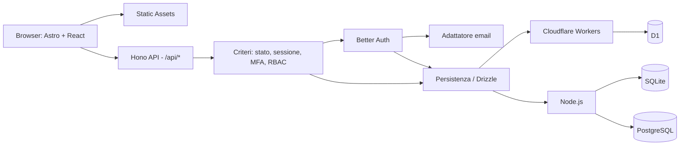

# <picture></picture> Architettura

<a href="../en/architecture.md" lang="en">English</a> | <a href="../es/architecture.md" lang="es">Español</a> | <a href="../pt/architecture.md" lang="pt">Português</a> | <a href="../de/architecture.md" lang="de">Deutsch</a> | <a href="../fr/architecture.md" lang="fr">Français</a> | <strong>Italiano</strong> | <a href="../zh/architecture.md" lang="zh">简体中文</a> | <a href="../ja/architecture.md" lang="ja">日本語</a> | <a href="../hi/architecture.md" lang="hi">हिन्दी</a> | <a href="../ar/architecture.md" lang="ar">العربية</a>

[Documentazione tecnica](README.md) | [Panoramica del progetto](../README.it.md)

> [!NOTE]
> TBA usa Cloudflare Workers con D1 per impostazione predefinita. La stessa interfaccia e API Hono funzionano in Node.js con SQLite o PostgreSQL. [Motori di database](database-engines.md)

TBA mantiene un unico frontend Astro + React e un unico Worker Hono. Astro genera gli assets e React hidrata solo le pagine interattive. Solo `/api` e `/api/*` eseguono prima Hono mediante `run_worker_first: ["/api", "/api/*"]`. Cloudflare consegna direttamente le pagine e i file esistenti mediante Workers Static Assets; Hono non chiama il binding `ASSETS`. Non e' necessario SSR per il login o il contenitore del pannello; quei documenti statici non contengono dati privati.

`src/server/services/mail.ts`: `local`, `cloudflare`, `resend`. [Mail / Correo](mail-providers.md).

`src/server/auth.ts` costruisce Better Auth per richiesta e usa l'adattatore Drizzle del motore selezionato. Non conserva mai bindings o dati di una richiesta in variabili globali. `security.ts` applica le politiche di autorizzazione. `policy.ts` contiene il catalogo dei permessi e le restrizioni dei ruoli pubblici. `database/schema.ts` descrive lo schema e `drizzle/*.sql` contiene le migrazioni eseguibili.

Better Auth amministra utenti, sessioni, account, verifiche e TOTP. I suoi campi ufficiali della versione fissa si conservano, inclusi `verified`, `failedVerificationCount` e `lockedUntil` di Two Factor. Il campo `password` della tabella `account` appartiene allo schema ufficiale; il fornitore di password e' disabilitato e i suoi endpoint non si espongono.

Le tabelle aggiuntive contengono ruoli, configurazione, richieste, audit, conferma MFA per sessione e fiducia revocabile per dispositivo. I ruoli iniziali sono Amministratore, Editore e Visualizzatore; Editore e Visualizzatore partono unicamente con `app.read`. Ogni applicazione aggiunge i suoi permessi di business, senza modificare i controlli di identita'.

I documenti del pannello sono pubblici come contenitori vuoti; le API richiedono sessione vigente, posta verificata, account attivo, secondo fattore quando corrisponde e permesso. Nascondere menu in React e' solo un miglioramento di navigazione. Il Worker ritorna a validare ogni operazione.

Le modifiche amministrative a utenti, ruoli e registrazione richiedono il permesso server e il controllo Amministratore esistente. Revocare sessioni tramite `/api/private/users/:id/revoke` richiede `users.edit`, senza ulteriore controllo Amministratore. L’eliminazione definitiva richiede anche `users.deactivate`, impedisce l’autoeliminazione e protegge l’ultimo amministratore attivo. Vedi [sicurezza](security.md). `Admin.tsx` compone il pannello; `admin/useAdminController.tsx` gestisce stato e richieste, `usePanelHistory.ts` la cronologia, `AdminDialogs.tsx` i dialoghi e `BasicListViews.tsx` gli elenchi limitati. `server/basic-lists.ts` fornisce pagine di 20 righe con precedente/successiva, senza motore avanzato.

La configurazione usa un unico record nel database; un cambio di modalita' non richiede redeploy. L'ultimo amministratore attivo e il ruolo riservato si proteggono con trigger, inclusi cambiamenti concomitanti.

Non c'e' multi-tenancy, organizzazioni, workspaces, fatturazione, federazione di sessioni, R2 attivo ne' infrastruttura multiagente. Ogni installazione usa runtime, database, utenti, sessioni e segreti propri.

## Inoltro statico e sicurezza

Il punto di ingresso `src/server/index.ts` registra i moduli di `src/server/routes/` su una stessa istanza di Hono, nell'ordine originale. `src/server/http.ts` raccoglie gli helper condivisi. Sono stati auditati tutti gli handler: configurazione pubblica, invio e verifica OTP, sessione, sfida MFA, operazioni private e Better Auth sono sotto `/api/`. Il callback OAuth e' `/api/auth/callback/google`. `/login/complete/` e' una pagina Astro statica che consulta `/api/session`; non elabora OAuth nel server. Non esistono endpoint dinamici al di fuori di `/api`.

Le pagine `/`, `/login/`, `/login/complete/`, `/denied/`, `/admin/` e le loro sette viste si generano durante il build. I contenitori amministrativi non includono dati privati. Le query e le mutazioni passano per l'API con le stesse verifiche di sessione, stato, posta verificata, MFA e RBAC. La navigazione diretta e il reload servono lo stesso HTML che una navigazione normale.

`public/_headers` si copia a `dist/_headers` e applica le stesse intestazioni di sicurezza di Hono alle risposte di Static Assets. Hono conserva `secureHeaders` per l'API, oltre a `Cache-Control: no-store`. I test confrontano entrambe le politiche per rilevare differenze. Vengono conservati CSP, cookie e logica di autenticazione. Solo i file con nome versionato di `/_astro/` utilizzano `Cache-Control: public, max-age=31536000, immutable`; HTML e risorse senza versione mantengono la loro convalida abituale. `_headers` e' metadato di Cloudflare e non viene pubblicato come file scaricabile.

Si conserva `not_found_handling: "404-page"`, senza fallback di SPA. Se una richiesta al di fuori dell'API raggiunge Hono, restituisce 404 e non consulta `ASSETS`. I derivati che incorporano SSR, callback al di fuori di `/api/` o altri handler dinamici devono estendere i pattern in entrambe le configurazioni e aggiungere test prima di distribuire. Non includere dati privati in HTML prerenderizzato ne' pubblicare file sensibili all'interno di `public` o `dist`.

I test di `tests/assets.test.ts` compilano Astro e il Worker con Wrangler, eseguono il router reale di Static Assets in Miniflare/workerd e contano invocazioni mediante un binding esclusivo del harness locale. Quel binding non esiste nella configurazione ne' nella distribuzione. Una collisione statica artificiale sotto `/api/private/users` verifica che il file non possa evitare l'autenticazione. Non sono richieste dipendenze nuove ne' risorse remote per questi test.

Riferimenti: [enrutamiento selectivo](https://developers.cloudflare.com/workers/static-assets/routing/worker-script/) e [cabeceras de Static Assets](https://developers.cloudflare.com/workers/static-assets/headers/).

Il ruolo di base conserva il suo identificatore stabile `viewer`. Le risposte dei ruoli e le referenze di audit presentano il nome storico «Consulta» come «Visualizzatore», senza riscrivere dati esistenti ne' migrazioni gia' applicate. In registro aperto, l'amministratore seleziona il ruolo iniziale tra tutti i ruoli configurati; l'API valida la scelta e richiede conferma esplicita. Il visitatore riceve il ruolo configurato al verificare la sua email e non puo' sceglierlo. Non si abilita automaticamente il registro aperto. Vedi [registro e selezione di ruolo](registration.md).

Il menu laterale puo' essere compresso nel desktop e conserva la preferenza visiva in `localStorage`. I pulsanti di navigazione compressi mantengono nomi accessibili e aiuti con il titolo. Nel mobile si conserva il menu completo. Il favicon SVG riproduce il simbolo di layer del logo e utilizza il colore primario definito per l'applicazione.

## Tabelle di gestione

Restano gli elenchi di utenti, richieste e audit con navigazione limitata e permessi lato server. Motori avanzati ed Excel sono esclusi dalla base; ogni derivato li implementa se necessario. Vedere l’[ambito](template-scope.md).

## Navigazione del pannello

Il componente React amministrativo conserva il menu e lo schermo visibile mentre carica la prossima destinazione. History API mantiene Indietro e Avanti senza richiedere altro documento Astro ne' idratare React di nuovo. La transizione viene confermata al ricevimento dei dati e le risposte cancellate non possono sostituire la destinazione attuale. Un indicatore fine e differito nell'intestazione sostituisce lo schermo di «Caricamento contenuto». I controlli del contenuto precedente rimangono inerti mentre si cambia destinazione. Si conservano collegamenti diretti, ricariche e clic con modificatori.

Le letture private che includono `context=1` restituiscono i loro dati insieme a `_context`, una proiezione di presentazione dell'attore gia' autorizzato. Utenti e Richieste possono includere il catalogo dei ruoli mediante `includeRoles=1`, con la stessa autorizzazione del loro endpoint. Non c'e' una richiesta separata di `/api/session` o ruoli all'apertura di ogni vista. Il catalogo ricevuto consente anche di aprire Ruoli senza altra richiesta mentre e' vigente. Profilo e Sicurezza riutilizzano la stessa lettura del profilo.

`ViewCache` conserva fino a otto risposte di presentazione all'interno del componente, riutilizzabili per trenta secondi. La lettura di un input non prolunga la sua validità. Non vengono salvate in localStorage, sessionStorage, Service Worker o cache condivisa. Non vengono cacheate mutazioni, QR, semi TOTP o codici di recupero. Vengono invalidati dopo mutazioni, cambi del contesto di identità/permessi, rifiuto di accesso, chiusura della sessione e transizioni BFCache. Il cambio di scheda o finestra preserva la vista mostrata. La scadenza viene verificata alla lettura di una voce della cache. Non ci sono sondaggi periodici né precaricamento di tutte le pagine.

Il contesto e la cache rappresentano solo dati già ricevuti da quella persona. Ogni nuova richiesta privata applica controlli attuali del server; non conferiscono autorizzazione né permettono di saltare una revoca. Le risposte HTTP continuano a utilizzare `Cache-Control: no-store`.

Il primo rendering amministrativo è vuoto sia nell'HTML generato da Astro che durante l'idratazione. `Admin` non monta menu, intestazione, titolo, formulari né stato di caricamento fino a quando non riceve la risposta privata autorizzata con il suo contesto e dati. Durante una reindirizzamento anche restituisce un output vuoto. Non si aggiunge una query di sessione: si utilizza la stessa lettura combinata esistente. Un errore definitivo di permessi o del servizio mostra un avviso pubblico minimo, con ritento, al di fuori della struttura amministrativa. La navigazione interna di una sessione già confermata conserva il contenuto precedente e la sua cache come prima.

Il pannello tratta la perdita di sessione in modo centralizzato: di fronte a un 401 pulisce dati, cache e segreti transitori dell'interfaccia e utilizza `location.replace("/login/")`. La chiusura di sessione confermata pulisce anche quello stato e sostituisce la voce del historial. Prima di salvare un documento in BFCache si nasconde sincronicamente il suo pannello e si chiudono i suoi dialoghi. Se il browser lo ripristina, si scarta il suo stato privato e si consulta nuovamente solo la vista attuale; un `pageshow` normale non aggiunge richieste. I 403 di permessi rimangono sullo schermo, `MFA_REQUIRED` conduce al passo MFA e `RECENT_AUTH_REQUIRED` conserva la conferma esplicita di identità. Le API mantengono i loro stati e risposte JSON; la reindirizzamento avviene nel frontend del pannello, senza eseguire il Worker per servire HTML.

Tutte le riconferme del pannello utilizzano lo stesso dialogo accessibile dell'applicazione: cambi di accesso, revoca di sessioni, approvazione o rifiuto di richieste, revoca di fiducia, disattivazione MFA e rinnovo di recupero. Non si utilizzano `window.confirm`, `alert` o `prompt`. Mostrano la persona e le conseguenze prima di inviare la mutazione; annullare conserva il formulario. Il flusso di posta separa indirizzo, OTP e secondo fattore, con risultato esplicito e ingresso successivo con la posta nuova.

## Moduli del pannello

Il pacchetto riutilizzabile deve separare navigazione, caricamento/stato e viste amministrative, mantenendo design e lingua condivisi. Il generatore QR si carica quando serve per MFA; ciò non richiede Excel.

L’inglese resta incluso come fallback. Gli altri cataloghi di accesso e pannello usano import dinamici e cache in memoria per modulo. Il focus di tastiera o puntatore precarica solo l’opzione indicata; aprire il menu non scarica tutte le lingue. Il cambio attende i cataloghi completi e conserva moduli, sessione e navigazione. La cache evita la rete; prevale l’ultima scelta. Un errore iniziale mostra l’inglese, un errore successivo mantiene la lingua attuale. Email e metadati del build usano cataloghi completi solo sul server. Vedi il [caricamento delle lingue](language-loading.md).

Il pannello legge i dati durante la navigazione, un aggiornamento esplicito o una modifica pertinente. Inattività, cambio di focus o scheda e scadenza della cache non attivano richieste da soli. Il ripristino dal BFCache verifica di nuovo l’accesso prima di mostrare i dati privati.
