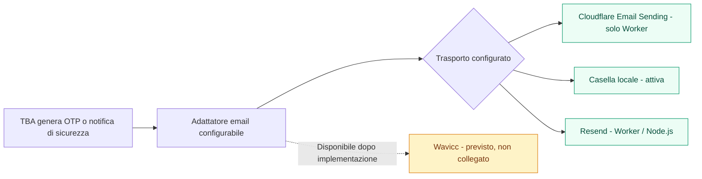

# <picture></picture> Email transazionali e indipendenza dal provider

<a href="../en/mail-providers.md" lang="en">English</a> | <a href="../es/mail-providers.md" lang="es">Español</a> | <a href="../pt/mail-providers.md" lang="pt">Português</a> | <a href="../de/mail-providers.md" lang="de">Deutsch</a> | <a href="../fr/mail-providers.md" lang="fr">Français</a> | <strong>Italiano</strong> | <a href="../zh/mail-providers.md" lang="zh">简体中文</a> | <a href="../ja/mail-providers.md" lang="ja">日本語</a> | <a href="../hi/mail-providers.md" lang="hi">हिन्दी</a> | <a href="../ar/mail-providers.md" lang="ar">العربية</a>

[Documentazione tecnica](README.md) | [Panoramica del progetto](../README.it.md)

> [!NOTE]
> **TBA non impone un particolare servizio commerciale di posta.** L’autenticazione genera OTP e notifiche di sicurezza; l’adattatore li invia tramite il servizio scelto per ogni applicazione indipendente. La scelta non cambia le regole di autenticazione, sessione o MFA.

## Provider e stato effettivo dell’implementazione

| Trasporto | Stato | Requisiti |
| :--- | :--- | :--- |
| Cloudflare Email Sending | **Implementato** | `MAIL_PROVIDER=cloudflare`, binding `EMAIL` e mittente `MAIL_FROM` verificato |
| Casella locale di sviluppo | **Implementata per uso locale** | `MAIL_PROVIDER=local`, origine locale e `npm run mail:dev` |
| Resend | **Implementato** | `MAIL_PROVIDER=resend`, `RESEND_API_KEY`, `MAIL_FROM` |
| Wavicc | **Integrazione futura preferita di Rounver; non implementata** | `WAVICC_API_KEY` è un segnaposto; servono adattatore testato e contratto API verificato |
| Qualsiasi altro servizio transazionale | **Possibile con adattatore; non automatico** | Implementare e testare il trasporto per il servizio scelto |

## Architettura della consegna email

## Configurazione attualmente funzionante

Il setup accetta `--mail local`, `--mail resend` e `--mail cloudflare`. La posta locale usa `APP_URL` locale e `npm run mail:dev`. Resend richiede `RESEND_API_KEY` e `MAIL_FROM`. Cloudflare riutilizza l’adattatore esistente e richiede un binding `send_email` chiamato `EMAIL`, `MAIL_FROM` consentito e dominio abilitato all’invio. Il setup verifica localmente senza creare risorse né verificare domini remoti. Si può configurare dopo: il modo interattivo chiede se proseguire, quello non interattivo continua con le attività pendenti. Non inventa binding, mittenti o credenziali; l’invio richiede la configurazione. I segreti restano fuori da Git. Wavicc resta l’integrazione futura preferita con `WAVICC_API_KEY` come placeholder. Vedi il [setup email](setup-mail.md).

## Wavicc: integrazione futura preferita

Wavicc è **l’integrazione preferita da Rounver quando la relativa API transazionale sarà pronta**. `.dev.vars.example` include `WAVICC_API_KEY=` solo come segnaposto per un segreto futuro. **Oggi TBA non legge questa chiave. Non impostare `MAIL_PROVIDER=wavicc` né presumere che esista un endpoint API.**

## Collegare in sicurezza un altro servizio

**Prima di abilitare un nuovo provider:**

1. Verificare l’API di invio reale, l’autenticazione e i campi richiesti.
2. Implementare un adattatore specifico senza eliminare i trasporti funzionanti.
3. Conservare le credenziali in un archivio di segreti approvato e configurare un mittente verificato.
4. Testare consegna e scadenza OTP, tentativi, gestione errori e guasti delle notifiche.
5. Aggiornare setup e controlli di distribuzione solo dopo il corretto funzionamento dell’adattatore.
6. Selezionare il provider per una singola applicazione e distribuire solo con autorizzazione esplicita.

## Segreti e migrazione sicura

Lasciare `.dev.vars.example` **senza credenziali reali**. Usare `.dev.vars` locale, ignorato da Git, o Wrangler Secrets per le chiavi; `MAIL_FROM` deve essere verificato. `CUSTOM_MAIL_API_KEY=` è un altro segnaposto. La variabile della vecchia chiave rimane solo per compatibilità e non è una raccomandazione predefinita.

L’HTML comune mantiene alternativa testuale senza immagini, font remoti o tracciamento. Copre OTP di accesso/registrazione, nuovo indirizzo, conferma per iniziare MFA, modifica email, richieste e approvazioni. Il marchio segue `APP_NAME`; l’app generica è TBA. Scadenza e regole di autenticazione dei codici restano invariate.

`X-Auth-Language` sceglie una lingua abilitata per le email, mai i permessi. Senza header o preferenza valida si usa il valore predefinito configurato (inizialmente inglese). Una preferenza disabilitata torna allo stesso valore. Inglese resta il fallback per chiavi mancanti. Accesso/registrazione verificato e selettore salvano la preferenza in `verification` (`mail-language:<userId>`); le notifiche successive usano la lingua del destinatario. Il cambio lingua non rinvia codici né modifica scadenze, tentativi o verifica. I vecchi errori restano riconosciuti.
