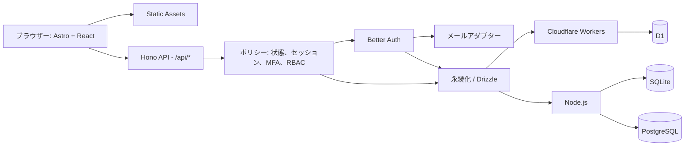

# <picture></picture> アーキテクチャ

<a href="../en/architecture.md" lang="en">English</a> | <a href="../es/architecture.md" lang="es">Español</a> | <a href="../pt/architecture.md" lang="pt">Português</a> | <a href="../de/architecture.md" lang="de">Deutsch</a> | <a href="../fr/architecture.md" lang="fr">Français</a> | <a href="../it/architecture.md" lang="it">Italiano</a> | <a href="../zh/architecture.md" lang="zh">简体中文</a> | <strong>日本語</strong> | <a href="../hi/architecture.md" lang="hi">हिन्दी</a> | <a href="../ar/architecture.md" lang="ar">العربية</a>

[技術ドキュメント](README.md) | [プロジェクト概要](../README.ja.md)

> [!NOTE]
> TBA の既定構成は Cloudflare Workers と D1 です。同じ画面と Hono API は Node.js 上で SQLite または PostgreSQL と組み合わせて動作します。 [データベースエンジン](database-engines.md)

TBA は、Astro + React の唯一のフロントエンドと、Hono の唯一の Worker を保持しています。Astro はアセットを生成し、React はインタラクティブな画面のみをハイドレートします。`/api` と `/api/*` は、`run_worker_first: ["/api", "/api/*"]` を使用して Hono を最初に実行します。Cloudflare は、Workers Static Assets を介して直接ページと既存のファイルを提供します。Hono は `ASSETS` へのバインディングを呼び出しません。ログインまたはパネル コンテナーの SSR は必要ありません。なぜなら、これらの静的ドキュメントにはプライベート データが含まれないからです。

`src/server/services/mail.ts`: `local`, `cloudflare`, `resend`. [Mail / Correo](mail-providers.md).

`src/server/auth.ts` は、リクエストごとに Better Auth を構築し、選択したエンジンの Drizzle アダプターを使用します。グローバル変数にリクエスト間のバインディングまたはデータを保持しません。`security.ts` は、認可ポリシーを適用します。`policy.ts` には、パーミッション カタログとパブリック ロールの制限が含まれています。`database/schema.ts` は、スキーマを記述し、`drizzle/*.sql` には実行可能なマイグレーションが含まれています。

Better Auth は、ユーザー、セッション、口座、検証、TOTP を管理します。固定バージョンの公式フィールドは保持されます。Two Factor の `verified`、`failedVerificationCount`、`lockedUntil` が含まれます。`password` フィールドは、`account` テーブルの公式スキーマに属します。パスワード プロバイダーは無効になっており、そのエンドポイントは公開されません。

追加のテーブルには、ロール、設定、リクエスト、監査、セッションごとの MFA 確認、およびデバイスごとの取り消し可能な信頼が含まれています。初期ロールは、管理者、エディター、ビューアーです。エディターとビューアーは、`app.read` でのみ開始されます。各アプリケーションは、ID 管理を変更せずにビジネス パーミッションを追加します。

パネル ドキュメントは、空のコンテナとして公開されます。API には、有効なセッション、検証されたメール、有効なアカウント、該当する場合は 2 要素認証、およびパーミッションが必要です。React でのメニューの非表示は、ナビゲーションの改善のみです。Worker は、各操作を再検証します。

ユーザー、ロール、登録の管理変更にはサーバー権限と既存の管理者チェックが必要です。`/api/private/users/:id/revoke` のセッション取消は追加の管理者チェックなしで `users.edit` を必要とします。完全削除にはさらに `users.deactivate` が必要で、自己削除を禁止し最後の有効な管理者を保護します。[セキュリティ](security.md)を参照してください。`Admin.tsx` が画面を構成し、`admin/useAdminController.tsx` が状態と通信、`usePanelHistory.ts` が履歴、`AdminDialogs.tsx` がダイアログ、`BasicListViews.tsx` が基本一覧を担当します。`server/basic-lists.ts` は高度な表エンジンなしで 20 行単位の前後ページを提供します。

設定は、データベース内単一レジストリを使用します。モードの変更には再デプロイは必要ありません。最後のアクティブな管理者と予約ロールは、同時変更を含むトリガーで保護されます。

マルチテナンシー、組織、ワークスペース、請求、セッションの連邦、R2 のアクティブ化、またはマルチエージェントのインフラストラクチャはありません。インストールごとにランタイム、データベース、ユーザー、セッションとシークレットが独立します。

## 静的ルーティングとセキュリティ

エントリ ポイント `src/server/index.ts` は、同じ Hono インスタンス上で `src/server/routes/` のモジュールを登録します。元の順序で。`src/server/http.ts` は、共有ヘルパーをまとめます。すべてのハンドラーは監査されています。パブリック設定、送信、OTP 検証、セッション、MFA チャレンジ、プライベート操作、および Better Auth はすべて `/api/` の下にあります。OAuth コールバックは `/api/auth/callback/google` です。`/login/complete/` は、Astro の静的ページで、`/api/session` を照会します。サーバーでは OAuth を処理しません。`/api` 以外の動的エンドポイントはありません。

`/`、`/login/`、`/login/complete/`、`/denied/`、`/admin/` ページとその 7 つのビューは、ビルド中に生成されます。管理コンテナにはプライベート データが含まれていません。クエリとミューテーションは、同じセッション、状態、検証済みメール、MFA、RBAC のチェックとともに API を通過します。直接ナビゲーションとリロードは、通常のナビゲーションと同じ HTML を提供します。

`public/_headers`は`dist/_headers`にコピーされ、Honoと同じセキュリティヘッダーがStatic Assetsのレスポンスに適用される。Honoは`secureHeaders`をAPIに保持し、さらに`Cache-Control: no-store`も保持する。テストは両方のポリシーを比較して差異を検出する。CSP、Cookie、認証ロジックは保持される。`/_astro/`のバージョン名付きファイルのみが`Cache-Control: public, max-age=31536000, immutable`を使用する。HTMLとバージョンなしのリソースは通常の再検証を維持する。`_headers`はCloudflareのメタデータであり、ダウンロード可能なファイルとして公開されない。

`not_found_handling: "404-page"`はSPAのフォールバックなしで保持される。API以外のリクエストがHonoに到達すると、404が返され、`ASSETS`に問い合わせない。SSR、`/api/`以外のコールバック、またはその他のダイナミックハンドラーを含む派生は、両方の構成でパターンを拡張し、デプロイ前にテストを追加する必要がある。プライベートデータをプリレンダリングされたHTMLに含めず、`public`または`dist`内で機密ファイルを公開しない。

`tests/assets.test.ts`のテストは、AstroとWorkerをWranglerでコンパイルし、Miniflare/workerdでStatic Assetsの実際のルーターを実行し、ローカルハーネスの専用バインディングを使用して呼び出しを数える。該当バインディングは、構成およびデプロイには存在しない。`/api/private/users`の下にある人工的な静的衝突は、ファイルが認証を回避できないことを確認する。新しい依存関係やリモートリソースはこれらのテストに必要ない。

参考：[選択的なルーティング](https://developers.cloudflare.com/workers/static-assets/routing/worker-script/)と[Static Assetsのヘッダー](https://developers.cloudflare.com/workers/static-assets/headers/)。

基本的な役割は安定した識別子`viewer`を保持する。役割のレスポンスと監査参照は、歴史的な名前「Consulta」を「Visualizador」として提示するが、既存のデータを上書きしたり、既に適用された移行を行ったりしない。オープンレジストリの場合、管理者はすべての構成された役割の中から初期役割を選択する。APIは選択を検証し、明示的な確認を要求する。訪問者はメールを確認したときに構成された役割を受け取り、選択することはできない。オープンレジストリは自動的に有効にならない。詳細は[登録と役割の選択](registration.md)を参照。

サイドメニューはデスクトップで折り畳むことができ、`localStorage`に視覚的な設定を保持する。折り畳まれたナビゲーションボタンはアクセシブルな名前とタイトル付きのヘルプを維持する。モバイルでは完全なメニューが保持される。SVGのファビコンはロゴのレイヤーシンボルを再生し、アプリケーションで定義されたプライマリーカラーを使用する。

## 管理テーブル

ユーザー・申請・監査の基本一覧は、制限したページ移動とサーバー権限確認付きで残ります。高度な表機構と Excel 出力は基本テンプレートに含めず、各派生プロジェクトで実装します。[対象範囲](template-scope.md)を参照してください。

## パネルナビゲーション

管理用のReactコンポーネントは、次の目的地を読み込む間もメニューと表示される画面を維持する。History APIは、Astroの別のドキュメントを要求したり、Reactを再度ハイドレートしたりせずに、前と次のナビゲーションを維持する。データとレスポンスを受け取ったときに遷移が確認される。キャンセルされたレスポンスは現在の目的地を置き換えることはできない。ヘッダーの微妙で遅延されたインジケーターは「コンテンツを読み込んでいます」の画面を置き換える。コンテンツの前のコントロールは目的地が変更される間、非アクティブになる。直接リンク、リロード、修飾子付きのクリックは維持される。

`context=1`を含むプライベート読み取りは、すでに認証されたアクターのプレゼンテーション投影である`_context`とともにデータを返す。ユーザーとリクエストは、同じ認証とともに`includeRoles=1`を使用してロールカタログを含めることができる。各ビューを開くたびに`/api/session`またはロールの個別のリクエストは必要ない。受け取ったカタログも、有効な場合、別のリクエストなしでロールを開くことを許可する。プロフィールとセキュリティは同じプロフィール読み取りを再利用する。

コンテキストとキャッシュは、すでに受信したデータのみを表します。各新しいプライベート要求は、サーバーの現在の制御を適用します。承認を付与したり、取り消しを回避したりすることはできません。HTTP 応答は `Cache-Control: no-store` を使用して続行します。

最初の管理レンダリングは、Astro によって生成された HTML と水和の両方で空です。`Admin` は、承認されたプライベート応答とそのコンテキストおよびデータを受信するまで、メニュー、ヘッダー、タイトル、フォーム、またはロード状態をマウントしません。リダイレクトの間も空の出力を返します。セッションのクエリは追加されません。既存の組み合わせ読み取りが使用されます。パーミッションまたはサービス エラーは、管理構造の外部で、再試行とともに最小限のパブリック通知を表示します。既に確認されたセッションの内部ナビゲーションは、以前のコンテンツとそのキャッシュを保持します。

パネルはセッションの喪失を中央的に処理します。401 の場合、インターフェイスのデータ、キャッシュ、および一時的なシークレットをクリーンアップし、`location.replace("/login/")` を使用します。確認されたログアウトもその状態をクリーンアップし、履歴エントリを置き換えます。BFCache にドキュメントを保存する前に、パネルの同期的非表示とダイアログの閉じることが行われます。ブラウザがそれを復元した場合、そのプライベート状態は破棄され、現在のビューのみが再度照会されます。通常の `pageshow` は追加の要求を追加しません。パーミッションの 403 は画面に残り、`MFA_REQUIRED` は MFA ステップに導き、`RECENT_AUTH_REQUIRED` はアイデンティティの明示的な確認を保持します。API は状態と JSON 応答を維持します。リダイレクトはパネルのフロントエンドで発生し、Worker を実行して HTML を提供することはありません。

パネルのすべての再確認は、アプリケーションの同じアクセス可能なダイアログを使用します。アクセスの変更、セッションの取り消し、要求の承認または拒否、信頼の取り消し、MFA の無効化、および回復の更新です。`window.confirm`、`alert`、または `prompt` は使用されません。ミューテーションを送信する前に、人物と結果が表示されます。キャンセルすると、フォームが保持されます。メール フローは、メール アドレス、OTP、2 番目の要素を分離し、明示的な結果と新しいメールでの後続の入力を提供します。

## パネルのモジュール

再利用パッケージではナビゲーション、読み込み・状態、管理ビューを分離し、共通デザインと言語設定を維持します。QR 生成器は MFA 設定時に必要になってから読み込みます。Excel への依存は不要です。

英語はフォールバックとして初期バンドルに含まれます。他のログイン・管理画面カタログは動的インポートとモジュール別メモリーキャッシュを使います。キーボードやポインターのフォーカスで該当オプションのみ先読みし、メニューを開くだけでは全言語を読み込みません。カタログが揃ってから切り替え、フォーム・セッション・画面遷移状態を保持します。キャッシュ済みの変更は通信不要で最後の選択が優先されます。初回失敗は英語、切り替え失敗は現在の言語を表示します。メールとビルド用メタデータは完全なサーバー専用辞書を使います。[言語読み込み](language-loading.md)を参照してください。

画面遷移、明示的な更新、関連する変更時にデータを取得します。非操作時、フォーカス変更、タブ切り替え、キャッシュ期限切れだけではリクエストは発生しません。BFCache から復元するときは、非公開データを表示する前にアクセスを再検証します。
