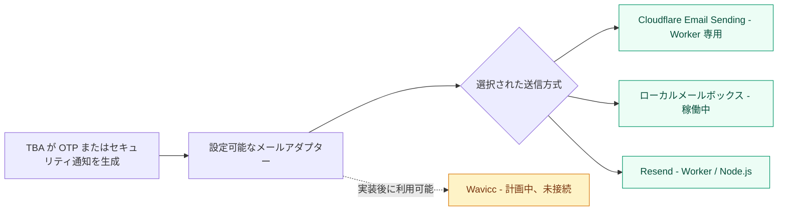

# <picture></picture> トランザクションメールとプロバイダー非依存

<a href="../en/mail-providers.md" lang="en">English</a> | <a href="../es/mail-providers.md" lang="es">Español</a> | <a href="../pt/mail-providers.md" lang="pt">Português</a> | <a href="../de/mail-providers.md" lang="de">Deutsch</a> | <a href="../fr/mail-providers.md" lang="fr">Français</a> | <a href="../it/mail-providers.md" lang="it">Italiano</a> | <a href="../zh/mail-providers.md" lang="zh">简体中文</a> | <strong>日本語</strong> | <a href="../hi/mail-providers.md" lang="hi">हिन्दी</a> | <a href="../ar/mail-providers.md" lang="ar">العربية</a>

[技術ドキュメント](README.md) | [プロジェクト概要](../README.ja.md)

> [!NOTE]
> **TBA は特定の商用メールサービスを必須としません。** 認証モジュールが OTP とセキュリティ通知を生成し、メールアダプターが各アプリで選んだプロバイダーから配信します。サービスを変更しても認証、セッション、MFA の規則は変わりません。

## プロバイダーと実際の実装状況

| 送信方式 | 状態 | 必要な設定 |
| :--- | :--- | :--- |
| Cloudflare Email Sending | **実装済み** | `MAIL_PROVIDER=cloudflare`、`EMAIL` バインディング、確認済み `MAIL_FROM` |
| ローカル開発メールボックス | **ローカル用途で実装済み** | `MAIL_PROVIDER=local`、ローカルオリジン、`npm run mail:dev` |
| Resend | **実装済み** | `MAIL_PROVIDER=resend`, `RESEND_API_KEY`, `MAIL_FROM` |
| Wavicc | **Rounver の将来の優先連携先、未実装** | `WAVICC_API_KEY` はプレースホルダー。確認済み API 仕様とテスト済みアダプターが必要 |
| その他のトランザクションメール | **アダプター経由で利用可能だが自動ではない** | 対象サービス用の送信アダプターを実装・テストする |

## メール配信アーキテクチャ

## 現在利用できる設定

セットアップは `--mail local`、`--mail resend`、`--mail cloudflare` に対応します。ローカルメールはローカルの `APP_URL` と `npm run mail:dev`、Resend は `RESEND_API_KEY` と `MAIL_FROM` を使います。Cloudflare は既存アダプターを使い、`EMAIL` という `send_email` バインディング、許可された `MAIL_FROM`、送信設定済みドメインが必要です。ローカル条件だけを検査し、リソース作成や遠隔ドメイン検証は行いません。後回しにでき、対話モードは続行を確認し、非対話モードは未設定項目を表示して続行します。バインディング・送信元・資格情報を生成せず、設定完了まで送信できません。秘密情報は Git 外に保存します。Wavicc は将来の優先連携で、`WAVICC_API_KEY` は予約用です。[メールセットアップ](setup-mail.md)を参照してください。

## Wavicc：将来の優先連携先

Wavicc は、**トランザクションメール API が完成した時点で Rounver が優先する連携先**です。`.dev.vars.example` の `WAVICC_API_KEY=` は将来の秘密鍵名を示すだけです。**現在 TBA はこの値を読みません。`MAIL_PROVIDER=wavicc` を設定したり、API エンドポイントが存在すると想定したりしないでください。**

## 別サービスを安全に接続する

**新しいプロバイダーの有効化前に：**

1. 実際の送信 API、認証方式、必要なメッセージ項目を確認する。
2. 現在稼働する送信方式を残したまま専用アダプターを実装する。
3. 承認された秘密情報ストアに資格情報を保存し、確認済み送信元を設定する。
4. OTP の送達・有効期限、再試行、エラー処理、通知失敗をテストする。
5. アダプターの動作確認後に限りセットアップとデプロイ検証を更新する。
6. 特定アプリで新プロバイダーを選択し、明示的な承認後のみデプロイする。

## 秘密鍵と安全な移行

`.dev.vars.example` に**実際の資格情報を含めない**でください。API キーはローカルの `.dev.vars`（Git 管理対象外）または Wrangler Secrets に保存し、`MAIL_FROM` には確認済みのメールアドレスを使用します。`CUSTOM_MAIL_API_KEY=` も将来用のプレースホルダーです。旧 API キー変数は互換性のみを目的に残しており、推奨設定ではありません。

共通 HTML はプレーンテキストを併せ持ち、外部画像・フォント・追跡を使いません。アクセス・登録 OTP、新アドレス、MFA 設定確認、アドレス変更通知、申請、承認を扱います。ブランドは `APP_NAME` に従い、汎用アプリ名は TBA です。コードの有効期限と認証規則は不変です。

`X-Auth-Language` は有効なメール言語を選び、権限には使いません。有効なヘッダーや受信者設定がなければアプリ既定値（初期は英語）を使用し、無効化された保存言語も既定値に戻します。未翻訳キーは英語へ戻ります。確認済みログイン・登録とパネル選択が既存 `verification` メタデータ（`mail-language:<userId>`）へ設定を保存し、遅延通知は受信者の言語を使います。変更でコードを再送せず、有効期限・試行回数・検証も変えません。旧エラー文も互換性のため認識します。
