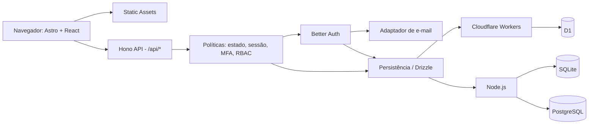

# <picture></picture> Arquitetura

<a href="../en/architecture.md" lang="en">English</a> | <a href="../es/architecture.md" lang="es">Español</a> | <strong>Português</strong> | <a href="../de/architecture.md" lang="de">Deutsch</a> | <a href="../fr/architecture.md" lang="fr">Français</a> | <a href="../it/architecture.md" lang="it">Italiano</a> | <a href="../zh/architecture.md" lang="zh">简体中文</a> | <a href="../ja/architecture.md" lang="ja">日本語</a> | <a href="../hi/architecture.md" lang="hi">हिन्दी</a> | <a href="../ar/architecture.md" lang="ar">العربية</a>

[Documentação técnica](README.md) | [Visão geral do projeto](../README.pt.md)

> [!NOTE]
> O TBA usa Cloudflare Workers com D1 por padrão. A mesma interface e API Hono também funcionam no Node.js com SQLite ou PostgreSQL. [Mecanismos de banco de dados](database-engines.md)

TBA mantém um único frontend Astro + React e um único Worker Hono. Astro gera os assets e React hidrata somente as telas interativas. Somente `/api` e `/api/*` executam primeiro Hono mediante `run_worker_first: ["/api", "/api/*"]`. Cloudflare entrega diretamente as páginas e os arquivos existentes mediante Workers Static Assets; Hono não chama o binding `ASSETS`. Não é necessário SSR para o login ou o contêiner do painel; esses documentos estáticos não contêm dados privados.

`src/server/services/mail.ts`: `local`, `cloudflare`, `resend`. [Mail / Correo](mail-providers.md).

`src/server/auth.ts` constrói Better Auth por solicitação e usa o adaptador Drizzle do mecanismo selecionado. Nunca conserva bindings nem dados de uma petição em variáveis globais. `security.ts` aplica as políticas de autorização. `policy.ts` contém o catálogo de permissões e as restrições de roles públicos. `database/schema.ts` descreve o esquema e `drizzle/*.sql` contém as migrações executáveis.

Better Auth administra usuários, sessões, contas, verificações e TOTP. Seus campos oficiais da versão fixada são conservados, incluindo `verified`, `failedVerificationCount` e `lockedUntil` de Two Factor. O campo `password` da tabela `account` pertence ao esquema oficial; o provedor de senhas está desabilitado e seus endpoints não são expostos.

As tabelas adicionais contêm roles, configuração, solicitações, auditoria, confirmação MFA por sessão e confiança revogável por dispositivo. Os roles iniciais são Administrador, Editor e Visualizador; Editor e Visualizador iniciam somente com `app.read`. Cada aplicação adiciona seus permissões de negócio, sem modificar os controles de identidade.

Os documentos do painel são públicos como contêineres vazios; as APIs requerem sessão vigente, correio verificado, conta ativa, segundo fator quando correspondente e permissão. Ocultar menus em React é somente uma melhoria de navegação. O Worker volta a validar cada operação.

Alterações administrativas de usuários, funções e cadastro exigem a permissão no servidor e a proteção existente de Administrador. Revogar sessões em `/api/private/users/:id/revoke` exige `users.edit`, sem proteção adicional de Administrador. Excluir definitivamente também exige `users.deactivate`, impede autoexclusão e protege o último administrador ativo. Consulte [segurança](security.md). `Admin.tsx` compõe o painel; `admin/useAdminController.tsx` reúne estado e requisições, `usePanelHistory.ts` trata o histórico, `AdminDialogs.tsx` contém diálogos e `BasicListViews.tsx` mostra listas limitadas. `server/basic-lists.ts` oferece páginas de 20 linhas com anterior/próxima, sem motor avançado.

A configuração usa um registro único no banco de dados; uma mudança de modalidade não requer redeploy. O último administrador ativo e o role reservado são protegidos com triggers, incluindo mudanças concorrentes.

Não há multi-tenancy, organizações, workspaces, faturamento, federação de sessões, R2 ativo nem infraestrutura multiagente. Cada instalação tem ambiente de execução, banco de dados, usuários, sessões e segredos próprios.

## Encaminhamento estático e segurança

O ponto de entrada `src/server/index.ts` registra os módulos de `src/server/routes/` sobre uma mesma instância de Hono, na ordem original. `src/server/http.ts` reúne os helpers compartilhados. Foram auditados todos os handlers: configuração pública, envio e verificação OTP, sessão, desafio MFA, operações privadas e Better Auth estão sob `/api/`. O callback OAuth é `/api/auth/callback/google`. `/login/complete/` é uma página Astro estática que consulta `/api/session`; não processa OAuth no servidor. Não existem endpoints dinâmicos fora de `/api`.

As páginas `/`, `/login/`, `/login/complete/`, `/denied/`, `/admin/` e suas sete vistas são geradas durante o build. Os contêineres administrativos não incluem dados privados. As consultas e mutações passam pela API com as mesmas verificações de sessão, estado, correio verificado, MFA e RBAC. A navegação direta e a recarga servem o mesmo HTML que uma navegação normal.

`public/_headers` copia a `dist/_headers` e aplica as mesmas cabeçalhos de segurança que Hono às respostas de Static Assets. Hono conserva `secureHeaders` para a API, além de `Cache-Control: no-store`. Os testes comparam ambas políticas para detectar diferenças. São conservados CSP, cookies e lógica de autenticação. Somente os arquivos com nome versionado de `/_astro/` usam `Cache-Control: public, max-age=31536000, immutable`; HTML e recursos sem versionado mantêm sua revalidação habitual. `_headers` é metadado de Cloudflare e não é publicado como arquivo descarregável.

Conserva-se `not_found_handling: "404-page"`, sem fallback de SPA. Se uma solicitação fora da API chega a Hono, devuelve 404 e não consulta `ASSETS`. Os derivados que incorporem SSR, callbacks fora de `/api/` ou outros handlers dinâmicos devem ampliar os padrões em ambas configurações e adicionar testes antes de implantar. Não incluir dados privados em HTML pré-renderizado nem publicar arquivos sensíveis dentro de `public` ou `dist`.

Os testes de `tests/assets.test.ts` compilam Astro e o Worker com Wrangler, executam o router real de Static Assets em Miniflare/workerd e contam invocações mediante um binding exclusivo do harness local. Esse binding não existe na configuração nem na implantação. Uma colisão estática artificial sob `/api/private/users` verifica que o arquivo não possa evitar a autenticação. Não são requeridas dependências novas nem recursos remotos para esses testes.

Referências: [enrutamento seletivo](https://developers.cloudflare.com/workers/static-assets/routing/worker-script/) e [cabeçalhos de Static Assets](https://developers.cloudflare.com/workers/static-assets/headers/).

O papel básico conserva seu identificador estável `viewer`. As respostas de papéis e as referências de auditoria apresentam o nome histórico «Consulta» como «Visualizador», sem reescrever dados existentes nem migrações já aplicadas. Em registro aberto, o administrador seleciona o papel inicial entre todos os papéis configurados; a API valida a escolha e exige confirmação explícita. O visitante recebe o papel configurado ao verificar seu correio e não pode escolhê-lo. Não é habilitado automaticamente o registro aberto. Ver [registro e seleção de papel](registration.md).

O menu lateral pode ser contraído em desktop e conserva a preferência visual em `localStorage`. Os botões de navegação contraídos mantêm nomes acessíveis e ajudas com o título. Em móvel, é conservado o menu completo. O favicon SVG reproduz o símbolo de camadas do logotipo e usa a cor primária definida para a aplicação.

## Tabelas de gestão

As listagens básicas de usuários, solicitações e auditoria permanecem, com navegação limitada e permissões no servidor. Motores avançados e Excel ficam fora da base; cada derivado os implementa se necessário. Veja o [escopo](template-scope.md).

## Navegação do painel

O componente React administrativo conserva o menu e a tela visível enquanto carrega o próximo destino. History API mantém Atrás e Adiante sem solicitar outro documento Astro nem hidratar React novamente. A transição é confirmada ao receber os dados e as respostas canceladas não podem substituir o destino atual. Um indicador fino e diferido no cabeçalho substitui a tela de «Carregando conteúdo». Os controles do conteúdo anterior ficam inertes enquanto se muda de destino. São conservados links diretos, recargas e cliques com modificadores.

As leituras privadas que incluem `context=1` devolvem seus dados junto com `_context`, uma projeção de apresentação do ator já autorizado. Usuários e Solicitações podem incluir o catálogo de papéis mediante `includeRoles=1`, com a mesma autorização que seu endpoint. Não há uma petição separada de `/api/session` ou papéis ao abrir cada vista. O catálogo recebido também permite abrir Papéis sem outra petição enquanto estiver vigente. Perfil e Segurança reutilizam a mesma leitura de perfil.

`ViewCache` conserva até oito respostas de apresentação dentro do componente, reutilizáveis por trinta segundos. A leitura de uma entrada não prolonga sua vigência. Não se guardam em localStorage, sessionStorage, Service Worker ou cache compartilhada. Não se cacheiam mutações, QR, sementes TOTP nem códigos de recuperação. Se invalidam após mutações, mudanças do contexto de identidade/permisos, recusa de acesso, encerramento da sessão e transições com BFCache. Trocas de guia ou de janela preservam a vista exibida. A validade é verificada ao consultar uma entrada no cache. Não há sondagens periódicas nem pré-carregamento de todas as páginas.

O contexto e a cache só representam dados já recebidos por essa pessoa. Cada nova petição privada aplica controles atuais do servidor; não conferem autorização nem permitem saltar uma revogação. As respostas HTTP seguem usando `Cache-Control: no-store`.

O primeiro render administrativo está vazio tanto no HTML gerado por Astro quanto durante a hidratação. `Admin` não monta menu, cabeçalho, título, formulários nem estado de carga até receber a resposta privada autorizada com seu contexto e dados. Durante uma redirecionamento também devolve uma saída vazia. Não se adiciona uma consulta de sessão: se usa a mesma leitura combinada existente. Um erro definitivo de permissões ou do serviço mostra um aviso público mínimo, com reintento, fora da estrutura administrativa. A navegação interna de uma sessão já confirmada conserva o conteúdo anterior e sua cache como antes.

O painel trata a perda de sessão de forma centralizada: ante um 401 limpa dados, cache e segredos transitorios da interface e usa `location.replace("/login/")`. O fechamento de sessão confirmado também limpa esse estado e substitui a entrada do histórico. Antes de guardar um documento em BFCache, se oculta sincronicamente seu painel e se fecham seus diálogos. Se o navegador o restaura, se descarta seu estado privado e se consulta de novo apenas a vista atual; um `pageshow` normal não agrega petições. Os 403 de permissões permanecem na tela, `MFA_REQUIRED` conduz ao passo MFA e `RECENT_AUTH_REQUIRED` conserva a confirmação explícita de identidade. As APIs mantêm seus estados e respostas JSON; a redirecionamento ocorre no frontend do painel, sem executar o Worker para servir HTML.

Todas as reconfirmações do painel usam o mesmo diálogo acessível da aplicação: mudanças de acesso, revogação de sessões, aprovação ou recusa de solicitações, revogação de confiança, desativação MFA e renovação de recuperação. Não se usam `window.confirm`, `alert` ou `prompt`. Mostram a pessoa e as consequências antes de enviar a mutação; cancelar conserva o formulário. O fluxo de correio separa endereço, OTP e segundo fator, com resultado explícito e ingresso posterior com o correio novo.

## Módulos do painel

O pacote reutilizável deve separar navegação, carga/estado e vistas administrativas, preservando design e idioma compartilhados. O gerador QR é carregado quando necessário para MFA; isso não implica dependência de Excel.

O inglês permanece incluído como fallback. Os outros catálogos de login e painel usam imports dinâmicos e cache em memória por módulo. O foco do teclado ou ponteiro antecipa apenas a opção indicada; abrir o menu não baixa todos os idiomas. A troca ocorre quando os catálogos estão prontos, preservando formulários, sessão e navegação. Idiomas em cache não exigem rede; vale a última escolha. Falhas iniciais mostram inglês; falhas na troca mantêm o idioma atual. E-mails e metadados do build usam catálogos completos apenas no servidor. Consulte a [carga de idiomas](language-loading.md).

O painel consulta os dados ao navegar, atualizar manualmente ou fazer uma alteração relevante. Inatividade, foco, troca de aba e vencimento do cache por si só não geram requisições. A restauração via BFCache revalida o acesso antes de mostrar dados privados.
