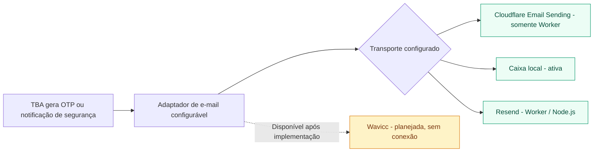

# <picture></picture> E-mail transacional e independência de provedor

<a href="../en/mail-providers.md" lang="en">English</a> | <a href="../es/mail-providers.md" lang="es">Español</a> | <strong>Português</strong> | <a href="../de/mail-providers.md" lang="de">Deutsch</a> | <a href="../fr/mail-providers.md" lang="fr">Français</a> | <a href="../it/mail-providers.md" lang="it">Italiano</a> | <a href="../zh/mail-providers.md" lang="zh">简体中文</a> | <a href="../ja/mail-providers.md" lang="ja">日本語</a> | <a href="../hi/mail-providers.md" lang="hi">हिन्दी</a> | <a href="../ar/mail-providers.md" lang="ar">العربية</a>

[Documentação técnica](README.md) | [Visão geral do projeto](../README.pt.md)

> [!NOTE]
> **O TBA não exige nenhum provedor comercial de e-mail específico.** A autenticação gera OTPs e notificações de segurança; o adaptador de e-mail entrega essas mensagens pelo serviço escolhido para cada aplicação independente. A escolha não altera as regras de autenticação, sessões ou MFA.

## Provedores e estado real da implementação

| Transporte | Estado | Requisitos |
| :--- | :--- | :--- |
| Cloudflare Email Sending | **Implementado** | `MAIL_PROVIDER=cloudflare`, binding `EMAIL` e remetente `MAIL_FROM` verificado |
| Caixa local de desenvolvimento | **Implementada para uso local** | `MAIL_PROVIDER=local`, origem local e `npm run mail:dev` |
| Resend | **Implementado** | `MAIL_PROVIDER=resend`, `RESEND_API_KEY`, `MAIL_FROM` |
| Wavicc | **Integração futura preferencial da Rounver; não implementada** | `WAVICC_API_KEY` é um espaço reservado; faltam adaptador testado e contrato de API verificado |
| Qualquer outro serviço transacional | **Possível por adaptador; não é automático** | Implementar e testar o transporte do serviço escolhido |

## Arquitetura de entrega de e-mail

## Configuração funcional atual

O setup aceita `--mail local`, `--mail resend` e `--mail cloudflare`. E-mail local usa `APP_URL` local e `npm run mail:dev`. Resend exige `RESEND_API_KEY` e `MAIL_FROM`. Cloudflare reutiliza o adaptador existente e exige binding `send_email` chamado `EMAIL`, `MAIL_FROM` permitido e domínio habilitado para envio. O setup verifica requisitos locais sem criar recursos nem verificar domínios remotos. É possível configurar depois: o modo interativo pergunta se deseja continuar; o não interativo continua com pendências. Não inventa bindings, remetentes ou credenciais; o envio depende da configuração. Segredos ficam fora do Git. Wavicc permanece a integração futura preferida, com `WAVICC_API_KEY` como placeholder. Consulte o [setup de e-mail](setup-mail.md).

## Wavicc: integração futura preferencial

Wavicc é a **integração preferida da Rounver quando sua API de e-mail transacional estiver pronta**. `.dev.vars.example` inclui `WAVICC_API_KEY=` apenas para registrar o nome de um segredo futuro. **Hoje o TBA não lê essa chave. Não configure `MAIL_PROVIDER=wavicc` nem presuma a existência de um endpoint.**

## Conectar outro serviço com segurança

**Antes de habilitar um novo provedor:**

1. Verifique a API real de envio, a autenticação e os campos exigidos pelas mensagens.
2. Implemente um adaptador específico preservando os transportes funcionais.
3. Guarde a credencial em um armazenamento de segredos aprovado e configure um remetente verificado.
4. Teste entrega e validade dos OTPs, tentativas, erros e falhas nas notificações.
5. Atualize o setup e a validação de implantação somente depois de testar o adaptador.
6. Selecione o serviço para uma aplicação específica e implante apenas com autorização explícita.

## Segredos e transição segura

Mantenha `.dev.vars.example` **sem credenciais reais**. Use `.dev.vars` local, ignorado pelo Git, ou Wrangler Secrets para chaves reais; configure `MAIL_FROM` com endereço verificado. `CUSTOM_MAIL_API_KEY=` também é só um espaço reservado. A variável de chave do transporte antigo permanece apenas para compatibilidade, não como padrão recomendado.

O HTML compartilhado mantém alternativa em texto e não usa imagens, fontes remotas ou rastreamento. Abrange OTP de acesso/cadastro, nova direção, confirmação para iniciar MFA, aviso de mudança de e-mail, solicitações e aprovação. A marca textual usa `APP_NAME`; a aplicação genérica é TBA. Códigos mantêm suas regras de validade e autenticação.

`X-Auth-Language` escolhe um idioma habilitado para o e-mail, nunca permissões. Sem cabeçalho ou preferência válida, usa o padrão configurado (inglês inicialmente). Preferência desabilitada também retorna ao padrão. Inglês continua como fallback de chaves ausentes. Acesso/cadastro verificado e seleção no painel guardam a preferência em `verification` (`mail-language:<userId>`); avisos posteriores usam o idioma do destinatário. Mudar idioma não reenvia códigos nem altera validade, tentativas ou verificação. Erros antigos continuam reconhecidos por compatibilidade.
