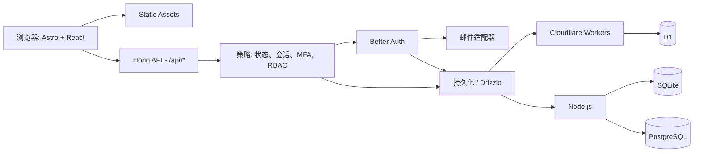

# <picture></picture> 架构

<a href="../en/architecture.md" lang="en">English</a> | <a href="../es/architecture.md" lang="es">Español</a> | <a href="../pt/architecture.md" lang="pt">Português</a> | <a href="../de/architecture.md" lang="de">Deutsch</a> | <a href="../fr/architecture.md" lang="fr">Français</a> | <a href="../it/architecture.md" lang="it">Italiano</a> | <strong>简体中文</strong> | <a href="../ja/architecture.md" lang="ja">日本語</a> | <a href="../hi/architecture.md" lang="hi">हिन्दी</a> | <a href="../ar/architecture.md" lang="ar">العربية</a>

[技术文档](README.md) | [项目概览](../README.zh.md)

> [!NOTE]
> TBA 默认在 Cloudflare Workers 上使用 D1。同一界面和 Hono API 也可在 Node.js 上搭配 SQLite 或 PostgreSQL 运行。 [数据库引擎](database-engines.md)

TBA 维护一个唯一的 Astro + React 前端和一个唯一的 Hono Worker。Astro 生成 assets，React 只对交互式屏幕进行 hydrate。只有 `/api` 和 `/api/*` 通过 `run_worker_first: ["/api", "/api/*"]` 首先执行 Hono。Cloudflare 直接通过 Workers Static Assets 交付页面和现有文件；Hono 不调用 `ASSETS` 绑定。对于登录或面板容器，不需要 SSR；这些静态文档不包含私有数据。

`src/server/services/mail.ts`: `local`, `cloudflare`, `resend`. [Mail / Correo](mail-providers.md).

`src/server/auth.ts` 根据请求构建 Better Auth 并使用 所选引擎的 Drizzle 适配器。它从不在全局变量中保留绑定或请求数据。`security.ts` 应用授权策略。`policy.ts` 包含权限目录和公共角色限制。`database/schema.ts` 描述了模式，`drizzle/*.sql` 包含可执行的迁移。

Better Auth 管理用户、会话、账户、验证和 TOTP。其固定版本的官方字段被保留，包括 Two Factor 的 `verified`、`failedVerificationCount` 和 `lockedUntil`。表 `account` 中的 `password` 字段属于官方模式；密码提供程序被禁用，其端点不被公开。

额外的表格包含角色、配置、请求、审计、会话 MFA 确认和设备可信度撤销。初始角色是管理员、编辑器和查看器；编辑器和查看器仅以 `app.read` 启动。每个应用程序添加其业务权限，而不修改身份控制。

面板文档作为公共容器公开；API 需要有效的会话、已验证的电子邮件、活动账户、适当的第二因素和权限。React 中隐藏菜单只是导航的改进。Worker 验证每个操作。

用户、角色和注册的管理变更需要服务端权限及现有管理员检查。`/api/private/users/:id/revoke` 撤销会话只需 `users.edit`，无需额外管理员检查。永久删除还需 `users.deactivate`，禁止删除自己并保护最后一位活跃管理员。参见[安全说明](security.md)。`Admin.tsx` 组合面板；`admin/useAdminController.tsx` 管理状态和请求，`usePanelHistory.ts` 处理历史，`AdminDialogs.tsx` 提供对话框，`BasicListViews.tsx` 显示有界列表。`server/basic-lists.ts` 提供每页 20 行及上一页/下一页，不包含高级表格引擎。

配置使用 数据库中的单个注册表；模式更改不需要重新部署。最后一个活动管理员和保留角色受到触发器保护，包括并发更改。

没有多租户、组织、工作空间、计费、会话联合、R2 活动或多代理基础设施。每套安装拥有独立的运行环境、数据库、用户、会话和密钥。

## 静态路由和安全

入口点 `src/server/index.ts` 在 Hono 的同一实例上注册 `src/server/routes/` 模块，按原始顺序。`src/server/http.ts` 收集共享的帮助程序。所有处理程序都经过审计：公共配置、发送和验证 OTP、会话、MFA 挑战、私有操作和 Better Auth 都在 `/api/` 下。OAuth 回调是 `/api/auth/callback/google`。`/login/complete/` 是一个 Astro 静态页面，查询 `/api/session`；它不在服务器上处理 OAuth。除了 `/api` 之外，没有动态端点。

`/`、`/login/`、`/login/complete/`、`/denied/`、`/admin/` 页面及其七个视图在构建过程中生成。管理容器不包含私有数据。查询和变异通过 API 进行，具有相同的会话、状态、已验证电子邮件、MFA 和 RBAC 检查。直接导航和重新加载服务与正常导航相同的 HTML。

`public/_headers` 被复制到 `dist/_headers` 并应用与 Hono 相同的安全头到 Static Assets 的响应中。Hono 保留 `secureHeaders` 用于 API，另外还有 `Cache-Control: no-store`。测试比较两种策略以检测差异。CSP、cookies 和身份验证逻辑被保留。只有带有版本名称的 `/_astro/` 文件使用 `Cache-Control: public, max-age=31536000, immutable`；HTML 和未版本化的资源保持其通常的重新验证。`_headers` 是 Cloudflare 的元数据，不作为可下载文件发布。

保留 `not_found_handling: "404-page"`，不使用 SPA 回退。如果一个非 API 请求到达 Hono，它返回 404 并不查询 `ASSETS`。包含 SSR、`/api/` 之外的回调或其他动态处理程序的派生必须在两种配置中扩展模式并在部署之前添加测试。不要在预渲染的 HTML 中包含私有数据，也不要在 `public` 或 `dist` 中发布敏感文件。

`tests/assets.test.ts` 测试使用 Wrangler 编译 Astro 和 Worker，并在 Miniflare/workerd 中运行 Static Assets 的实际路由器，通过一个本地测试框架的专用绑定来计算调用次数。该绑定在配置或部署中不存在。在 `/api/private/users` 下创建一个人工静态冲突，以验证文件不能绕过身份验证。这些测试不需要新的依赖项或远程资源。

参考：[选择性路由](https://developers.cloudflare.com/workers/static-assets/routing/worker-script/) 和 [Static Assets 头](https://developers.cloudflare.com/workers/static-assets/headers/)。

基本角色保留其稳定的标识符 `viewer`。角色响应和审计引用以“视图者”呈现历史名称“查询”，而不重写现有数据或应用迁移。开放注册时，管理员从所有配置的角色中选择初始角色；API 验证选择并要求明确确认。访客在验证其电子邮件地址时收到配置的角色，并且无法选择它。开放注册不会被自动启用。请参阅 [注册和角色选择](registration.md)。

侧边菜单可以在桌面上折叠，并在 `localStorage` 中保留视觉偏好。折叠的导航按钮保持可访问的名称和带有标题的帮助。移动设备上保留完整的菜单。SVG favicon 重现徽标的层次符号，并使用为应用程序定义的主色。

## 管理表格

保留基础用户、申请和审计列表，使用有限分页和服务端权限。高级表格引擎及 Excel 导出不属于基础模板，各项目可按需实现。参阅[模板范围](template-scope.md)。

## 面板导航

管理 React 组件保留菜单和可见屏幕，同时加载下一个目标。History API 保持后退和前进按钮不请求其他 Astro 文档或重新水合 React。转换在接收到数据和响应被取消时确认，不能替换当前目标。头部中的一个精细且延迟的指示器取代了“加载内容”的屏幕。内容更改时，之前内容的控件变为非活动状态。保留直接链接、重新加载和带有修饰符的点击。

包含 `context=1` 的私人读取返回其数据以及 `_context`，即已授权的演员的表示形式。用户和请求可以通过 `includeRoles=1` 包含角色目录，具有与其端点相同的授权。打开每个视图时不需要单独的 `/api/session` 或角色请求。接收到的目录也允许在其有效期内打开角色而无需其他请求。个人资料和安全性重用相同的个人资料读取。

上下文和缓存仅表示该人已收到的数据。每个新私人请求都应用当前服务器控制；它们不授予授权，也不允许绕过撤销。HTTP响应继续使用`Cache-Control: no-store`。

首次管理渲染在Astro生成的HTML和水合过程中均为空。`Admin`在收到授权的私人响应及其上下文和数据之前，不挂载菜单、页头、标题、表单或加载状态。在重定向期间也返回空输出。不会添加会话查询；使用相同的现有组合读取。权限或服务的最终错误显示最小的公共通知，带有重试，位于管理结构之外。已确认会话的内部导航保留以前的内容及其缓存，如前所述。

面板以集中方式处理会话丢失：在401时清除接口数据、缓存和临时机密，并使用`location.replace("/login/")`。确认的注销也清除该状态并替换历史记录条目。在将文档保存到BFCache之前，同步隐藏其面板并关闭其对话框。如果浏览器恢复它，将丢弃其私有状态，并仅查询当前视图；正常的`pageshow`不会添加请求。权限的403保持在屏幕上，`MFA_REQUIRED`转到MFA步骤，`RECENT_AUTH_REQUIRED`保留身份的显式确认。API保持其状态和JSON响应；重定向发生在面板的前端，无需执行Worker来提供HTML。

面板的所有重新确认都使用应用程序的相同可访问对话框：访问更改、会话撤销、请求批准或拒绝、信任撤销、MFA停用和恢复更新。不会使用`window.confirm`、`alert`或`prompt`。在发送变异之前显示人员和后果；取消保留表单。邮件流程分离地址、OTP和第二因素，具有显式结果和后续输入新邮件。

## 面板模块

可复用包应分离导航、数据加载与状态、管理视图，并保持共享设计和语言偏好。仅在设置 MFA 时加载二维码生成器；这不依赖 Excel。

英语作为回退始终包含在初始包中。其余登录和面板词典按模块动态导入并缓存在内存。键盘或指针聚焦某个选项时预加载该选项，打开菜单不会下载所有语言。词典完整就绪后才切换，保留表单、会话和导航；缓存切换无需网络，最后一次选择生效。首次加载失败显示英语，后续切换失败保留当前语言。邮件和构建元数据使用独立的完整服务端词典。参见[语言加载](language-loading.md)。

面板在导航、手动刷新或相关数据变更时发起查询。空闲、焦点变化、切换标签页或缓存到期本身都不会触发请求。从 BFCache 恢复页面时，会先重新验证访问权限再显示私有数据。
