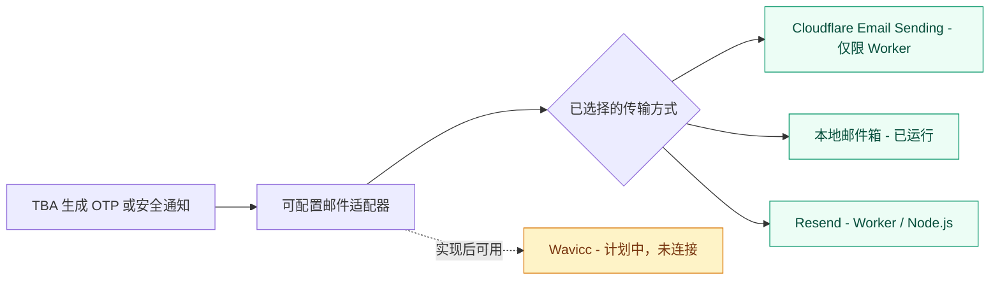

# <picture></picture> 事务性邮件与服务商独立性

<a href="../en/mail-providers.md" lang="en">English</a> | <a href="../es/mail-providers.md" lang="es">Español</a> | <a href="../pt/mail-providers.md" lang="pt">Português</a> | <a href="../de/mail-providers.md" lang="de">Deutsch</a> | <a href="../fr/mail-providers.md" lang="fr">Français</a> | <a href="../it/mail-providers.md" lang="it">Italiano</a> | <strong>简体中文</strong> | <a href="../ja/mail-providers.md" lang="ja">日本語</a> | <a href="../hi/mail-providers.md" lang="hi">हिन्दी</a> | <a href="../ar/mail-providers.md" lang="ar">العربية</a>

[技术文档](README.md) | [项目概览](../README.zh.md)

> [!NOTE]
> **TBA 不强制使用某一家商业邮件服务商。** 身份验证模块负责生成 OTP 和安全通知，邮件适配器通过每个独立应用选择的服务商发送。选择发送服务不会改变身份验证、会话或 MFA 规则。

## 服务商及实际实现状态

| 传输方式 | 状态 | 配置要求 |
| :--- | :--- | :--- |
| Cloudflare Email Sending | **已实现** | `MAIL_PROVIDER=cloudflare`、`EMAIL` 绑定及已验证的 `MAIL_FROM` 发件人 |
| 本地开发邮件箱 | **已实现，仅供本地使用** | `MAIL_PROVIDER=local`、本地应用地址及 `npm run mail:dev` |
| Resend | **已实现** | `MAIL_PROVIDER=resend`, `RESEND_API_KEY`, `MAIL_FROM` |
| Wavicc | **Rounver 优先考虑的未来集成，尚未实现** | `WAVICC_API_KEY` 仅是占位符；还需要经过验证的 API 协议和测试的适配器 |
| 其他事务性邮件服务 | **可以通过适配器接入，但不会自动生效** | 开发并测试所选服务的传输层 |

## 邮件发送架构

## 目前可以正常运行的配置

初始化工具支持 `--mail local`、`--mail resend` 和 `--mail cloudflare`。本地邮件使用本地 `APP_URL` 和 `npm run mail:dev`；Resend 需要 `RESEND_API_KEY` 与 `MAIL_FROM`。Cloudflare 复用现有适配器，需要名为 `EMAIL` 的 `send_email` 绑定、允许的 `MAIL_FROM` 以及已启用发送的域名。工具只检查本地条件，不创建资源或验证远程域名。可稍后配置：交互模式询问是否继续，非交互模式列出待办后继续。不编造绑定、发件人或密钥，配置完成前无法发送邮件。密钥不得进入 Git。Wavicc 保留为首选未来集成，`WAVICC_API_KEY` 仅作占位。参见[邮件初始化](setup-mail.md)。

## Wavicc：优先考虑的未来集成

Wavicc 是 **Rounver 计划在事务性邮件 API 完成后优先集成的服务**。`.dev.vars.example` 中的 `WAVICC_API_KEY=` 只是未来密钥名称的占位符。**TBA 目前不读取此值。不要设置 `MAIL_PROVIDER=wavicc`，也不要假定相关 API 端点已经存在。**

## 安全接入其他服务

**启用新服务商之前：**

1. 核实真实的发送 API、身份验证方式和消息所需字段。
2. 实现专用适配器，同时保留已经可以正常运行的传输方式。
3. 将凭据保存在获批准的密钥存储中，并配置经过验证的发件人。
4. 测试 OTP 投递、有效期、重试、错误处理及通知失败情况。
5. 只有适配器测试成功后才更新初始化脚本和部署检查。
6. 针对特定应用选择新服务，并且仅在明确授权后部署。

## 密钥管理与安全迁移

`.dev.vars.example` **不得包含真实凭据**。实际 API 密钥应存于本地 `.dev.vars`（被 Git 忽略）或 Wrangler Secrets，并为 `MAIL_FROM` 配置已验证的地址。`CUSTOM_MAIL_API_KEY=` 也只是未来适配器的占位符。旧 API 密钥变量仅为兼容而保留，不是推荐默认值。

共享 HTML 保留纯文本备选，无外部图片、字体或跟踪。覆盖访问/注册 OTP、新邮箱验证、MFA 设置确认、邮箱变更通知、新申请及批准。品牌文字来自 `APP_NAME`，通用应用名为 TBA。代码有效期和认证规则保持不变。

`X-Auth-Language` 选择已启用的邮件语言，不影响权限。没有有效请求头或收件人偏好时，使用应用配置的默认语言（初始为英语）；保存但已停用的语言也回退到默认值。缺失翻译键仍回退英语。已验证登录/注册及面板选择将偏好存入现有 `verification` 元数据（`mail-language:<userId>`）；延迟通知使用收件人语言。切换界面不会重发代码或改变有效期、次数和验证规则。旧错误文本继续兼容识别。
